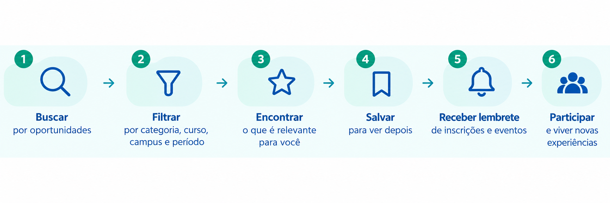

# 🌱 ConectaU
### Descubra, participe, conecte-se.

<p align="center">
  
</p>

> **O problema não é a falta de oportunidades na UFLA.
> É o custo de descobri-las a tempo e encontrar as que realmente são
> relevantes para cada pessoa.**

---

## 📌 Sobre o ConectaU

O **ConectaU** é uma plataforma web que reúne e personaliza
oportunidades da UFLA, como eventos, atividades, bolsas, projetos
e processos seletivos.

A proposta é facilitar a descoberta dessas oportunidades,
funcionando como uma **camada complementar aos canais oficiais
da universidade**.

O ConectaU **não realiza inscrições**. Ao encontrar algo relevante,
o usuário é levado ao **canal oficial responsável pela oportunidade** (da UFLA, quando aplicável), onde a participação
é efetivada. A plataforma cuida da parte que hoje falha: descobrir
a oportunidade certa a tempo.

---

## ❗ O problema

A UFLA oferece e divulga diversas oportunidades para sua comunidade
universitária.

O desafio está em fazer **a oportunidade certa chegar à pessoa certa,
no momento certo**.

Atualmente, essas informações podem estar distribuídas entre
diferentes canais:

<p align="center">
  
</p>

**E-mail institucional · Redes sociais · Grupos de mensagens ·
Sites e portais · SIG · Professores · Organizações estudantis**

Essa dispersão exige que cada pessoa acompanhe diferentes fontes e
identifique, entre muitas informações, aquilo que é relevante para
seu perfil.

Como consequência, uma oportunidade pode ser descoberta tarde demais
ou nem chegar ao conhecimento de quem poderia participar.

---

## 📚 Motivação e evidências

Estudos sobre comunicação no ensino superior indicam que estudantes
recebem informações por diferentes canais e que aspectos como
**relevância, preferências e excesso de mensagens** influenciam a
forma como essas informações são percebidas.

Além disso, pesquisas relacionam a participação em atividades
extracurriculares e o sentimento de pertencimento à experiência e a
diferentes resultados acadêmicos dos estudantes.

Essas evidências, juntamente com uma pesquisa exploratória realizada
com membros da comunidade da UFLA, ajudaram a fundamentar o problema
abordado pelo ConectaU.

---

## 📊 Pesquisa exploratória

Para realizar uma validação inicial do problema dentro da comunidade
da UFLA, foi elaborado um formulário sobre a descoberta de eventos,
projetos, bolsas, processos seletivos e outras oportunidades.

A pesquisa recebeu **26 respostas**.

Os resultados apontam para dificuldades relacionadas à descoberta
oportuna de oportunidades e indicam interesse em recursos que
facilitem sua busca e organização.

<p align="center">
  
</p>

### Recursos considerados úteis

<p align="center">
  
</p>

Entre os participantes que relataram ter descoberto oportunidades
tarde demais, o motivo mais frequente foi ter tomado conhecimento
**após o encerramento das inscrições**.

> **Importante:** a pesquisa possui caráter exploratório e não tem como
> objetivo representar estatisticamente toda a comunidade da UFLA.

---

## 👥 Público-alvo

O ConectaU é destinado à comunidade universitária, incluindo:

<p align="center">
  
</p>

A proposta contempla inicialmente os campi de **Lavras/MG** e
**São Sebastião do Paraíso/MG**.

---

## 💡 Proposta de solução

O ConectaU propõe uma plataforma que reúne oportunidades em um único
ambiente e permite que cada usuário encontre aquilo que é mais
relevante para seu perfil.

<p align="center">
  
</p>

O fluxo permite que o usuário encontre, filtre e acompanhe
oportunidades relevantes até o momento da participação — que acontece
**no canal oficial**, por meio do link da publicação original.

### Como as oportunidades entram na plataforma

| Caminho | Como funciona |
|---|---|
| **Coleta automática** | Um coletor percorre periodicamente páginas públicas da UFLA, normaliza o que encontra, remove duplicados e coloca os resultados em uma fila de curadoria |
| **Cadastro manual** | Quem deseja divulgar algo procura a equipe do ConectaU |

Em ambos os casos, **a publicação é feita por um administrador da
plataforma**: não existe cadastro aberto de oportunidades por usuários.
Essa curadoria humana é o que impede divulgações falsas ou incorretas
de chegarem à comunidade.

Cada oportunidade publicada sempre aponta para a **fonte oficial**,
preservando a origem da informação.

O ConectaU **não substitui os canais oficiais da UFLA**.

A proposta é atuar como uma **camada complementar de descoberta e
organização**, facilitando o acesso às informações que já são
divulgadas pela universidade e por sua comunidade.

---

## 🎯 Impacto social esperado

O impacto esperado está relacionado principalmente à ampliação do
acesso às oportunidades e ao estímulo à participação da comunidade.

<!-- <p align="center">
  
</p>-->

Espera-se contribuir para:

- ampliar o acesso às oportunidades;
- facilitar a descoberta de atividades relevantes;
- estimular a participação da comunidade;
- aproximar estudantes, professores e servidores;
- fortalecer a integração entre cursos, áreas e campi.

### 📈 Como medir o impacto

O impacto poderá ser acompanhado por indicadores como:

- quantidade de oportunidades cadastradas;
- quantidade de oportunidades visualizadas;
- quantidade de usuários participantes;
- quantidade de oportunidades salvas;
- distribuição de oportunidades visualizadas entre cursos e campi;
- encaminhamentos da plataforma para os canais oficiais;
- redução de relatos de descoberta tardia;
- percepção dos usuários sobre a facilidade de encontrar oportunidades.

---

## 🧪 Exemplo de uso

Imagine um estudante interessado em **pesquisa e tecnologia**.

Em vez de acompanhar diversos canais separadamente, ele acessa o
ConectaU e encontra oportunidades relacionadas aos seus interesses.

Ele pode filtrar as oportunidades, salvar aquelas que considera
relevantes e criar lembretes para não perder os prazos.

Ao decidir participar, ele abre o **link da fonte oficial** e conclui
a inscrição no canal da UFLA.

Assim, uma oportunidade que poderia passar despercebida pode ser
encontrada pelo estudante no momento adequado.

---

## 🆔 Identidade da startup

**Nome:** ConectaU

**Slogan:** *Descubra, participe, conecte-se.*

### Proposta de valor

> **Uma plataforma que reúne e personaliza oportunidades da UFLA para
> que cada membro da comunidade encontre o que é relevante para ele
> antes que o prazo acabe.**

---

## 🏗️ Documentação de arquitetura

A arquitetura proposta para a Parte 2 da disciplina está em
[`docs/arquitetura/`](docs/arquitetura/):

| Item | Documento |
|---|---|
| 4.1 — Decomposição em microsserviços | [`4.1-microsservicos.md`](docs/arquitetura/4.1-microsservicos.md) |
| 4.2 — API REST e HATEOAS | [`4.2-api-rest.md`](docs/arquitetura/4.2-api-rest.md) · [`openapi.yaml`](docs/arquitetura/openapi.yaml) |
| 4.3 — API Gateway | [`4.3-gateway.md`](docs/arquitetura/4.3-gateway.md) |
| 4.4 — Backend for Frontend | [`4.4-bff.md`](docs/arquitetura/4.4-bff.md) |
| 4.5 — Dados, consistência e outbox | [`4.5-dados-outbox.md`](docs/arquitetura/4.5-dados-outbox.md) |
| 4.6 — SAGA de publicação | [`4.6-saga.md`](docs/arquitetura/4.6-saga.md) |
| 4.7 — CQRS | [`4.7-cqrs.md`](docs/arquitetura/4.7-cqrs.md) |

> Os documentos descrevem a proposta arquitetural da Parte 2. Na Parte 3,
> foi implementado o serviço de identidade, acompanhado de sua infraestrutura
> de conteinerização e orquestração com Docker, Docker Compose e Kubernetes.

---

## 🚀 Execução e infraestrutura

A Parte 3 do projeto contempla a conteinerização do serviço de identidade e do banco de dados PostgreSQL, além da orquestração desses componentes utilizando Docker, Docker Compose e Kubernetes.

> 🎥 **Vídeo da entrega 3:** [assista à apresentação no Google Drive](https://drive.google.com/drive/folders/1_DyPLt6FhXqFV3msJlyv8K-zaNSfAilI?usp=sharing)

### Tecnologias utilizadas

- **Docker:** construção das imagens dos serviços.
- **Docker Compose:** execução integrada dos containers, com redes separadas por camada e volume persistente para o PostgreSQL.
- **Kubernetes:** gerenciamento dos Pods, Deployments, Services, ConfigMap, Secret, PersistentVolumeClaim e Ingress.
- **Traefik:** controlador de Ingress utilizado para direcionar as requisições ao serviço de identidade.

### Execução com Docker Compose

Pré-requisitos: Docker Desktop e Docker Compose.

1. Crie o arquivo de variáveis de ambiente:

   ```powershell
   Copy-Item .env.example .env
   ```

2. Configure as credenciais no arquivo `.env`.

3. Construa as imagens e inicie os serviços:

   ```powershell
   docker compose up -d --build
   ```

4. Verifique os containers:

   ```powershell
   docker compose ps
   ```

5. Teste o serviço de identidade:

   ```powershell
   Invoke-RestMethod http://localhost:3101/health
   ```

Para encerrar os containers:

```powershell
docker compose down
```

O volume nomeado do PostgreSQL é preservado ao encerrar os containers com esse comando.

### Orquestração com Kubernetes

Pré-requisitos: Docker Desktop com Kubernetes habilitado, `kubectl` configurado e controlador Traefik instalado no cluster.

Construa as imagens utilizadas pelos manifests:

```powershell
docker build -t conectau-identidade:1.0 -f Dockerfile .
docker build -t conectau-postgres:latest -f infrastructure/docker/postgres/Dockerfile .
```

Configure o Secret local a partir do exemplo:

```powershell
Copy-Item infrastructure/kubernetes/secret.example.yaml infrastructure/kubernetes/secret.yaml
```

Edite o arquivo `secret.yaml` com as credenciais desejadas. Esse arquivo contém credenciais locais e é ignorado pelo Git; apenas o arquivo `secret.example.yaml`, com valores ilustrativos, é versionado no repositório.

Aplique os manifests:

```powershell
kubectl apply -f infrastructure/kubernetes/namespace.yaml
kubectl apply -f infrastructure/kubernetes/secret.yaml
kubectl apply -f infrastructure/kubernetes/configmap.yaml
kubectl apply -f infrastructure/kubernetes/postgres.yaml
kubectl apply -f infrastructure/kubernetes/identidade.yaml
kubectl apply -f infrastructure/kubernetes/ingress.yaml
```

Verifique os recursos:

```powershell
kubectl get all -n conectau
kubectl get pvc -n conectau
kubectl get ingress -n conectau
```

### Acesso ao serviço pelo Ingress

Com o Traefik em execução, abra um terminal e execute:

```powershell
kubectl port-forward -n traefik service/traefik 8080:80
```

Em outro terminal, teste o acesso:

```powershell
Invoke-RestMethod -Uri http://localhost:8080/health -Headers @{ Host = "conectau.local" }
```

### Demonstração de escalabilidade

Para aumentar o número de réplicas do serviço de identidade:

```powershell
kubectl scale deployment identidade -n conectau --replicas=3
```

Verifique os Pods:

```powershell
kubectl get pods -n conectau
```

Para retornar à configuração inicial:

```powershell
kubectl scale deployment identidade -n conectau --replicas=1
```

### Persistência de dados

A persistência do PostgreSQL foi verificada nos dois ambientes:

- **Docker Compose:** os dados permaneceram disponíveis após a reinicialização do container, utilizando volume nomeado.
- **Kubernetes:** os dados permaneceram disponíveis após a recriação do Pod PostgreSQL, utilizando PersistentVolumeClaim.

---

## 👨‍💻 Equipe

| Integrante | Função |
|---|---|
| **Guilherme Alexandre Cunha Silva** | Scrum Master |
| **Gustavo de Assis Vieira** | Desenvolvedor |
| **João Vitor Givisiez Lessa** | Desenvolvedor |
| **Maria Luiza Santos Ferreira** | Product Owner |

---

## 📚 Referências

1. **GILANI, David.** *Student attitudes and preferences towards
   communications from their university – a meta-analysis of student
   communications research within UK higher education institutions.*
   Journal of Higher Education Policy and Management, v. 46, n. 3,
   p. 274–290, 2024.  
   DOI: 10.1080/1360080X.2024.2344234.

2. **SIMPSON, Judith; BRANAGAN, Caitlin; LAU CHENG VON, Vonnie;
   WILLIAMS, Lily.** *Spamming our students? The use of email as a
   mass communication tool in higher education.*
   Journal of Further and Higher Education, p. 152–159, 2025.  
   DOI: 10.1080/13603108.2024.2440705.

3. **KULP, Amanda M.; PASCALE, Amanda Blakewood; GRANDSTAFF,
   Matthew.** *Types of Extracurricular Campus Activities and
   First-Year Students’ Academic Success.*
   Journal of College Student Retention: Research, Theory & Practice,
   v. 23, n. 3, p. 747–767, 2021.  
   DOI: 10.1177/1521025119876249.

4. **VAN KESSEL, Gisela et al.** *Relationship between university
   belonging and student outcomes: A systematic review and
   meta-analysis.* The Australian Educational Researcher, v. 52,
   p. 2511–2534, 2025.  
   DOI: 10.1007/s13384-025-00822-8.

5. **UNIVERSIDADE FEDERAL DE LAVRAS (UFLA).**
   *Divulgação de eventos.* Catálogo de Serviços da UFLA.