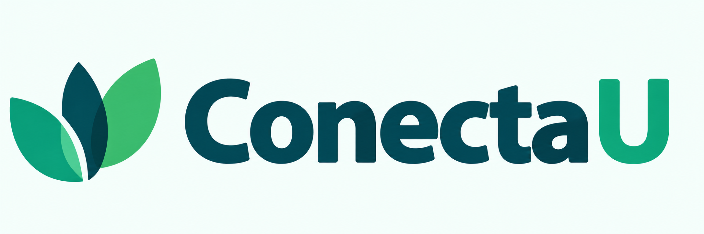
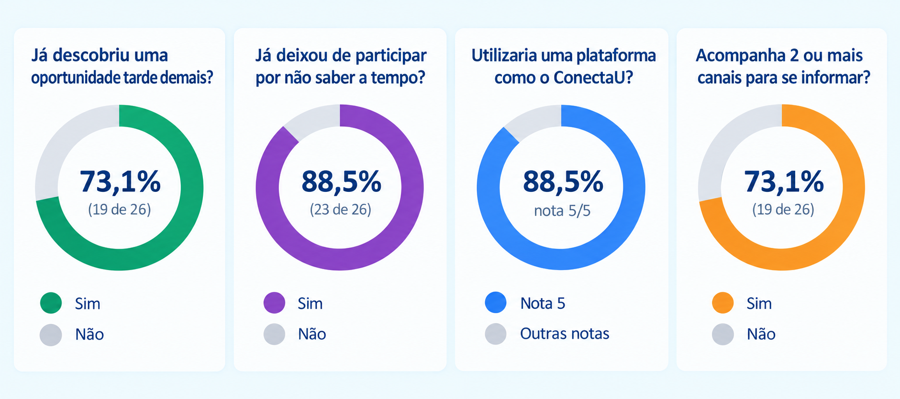
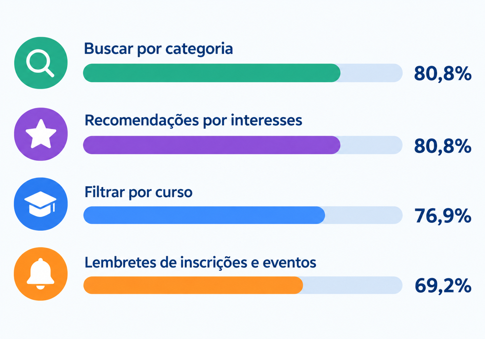
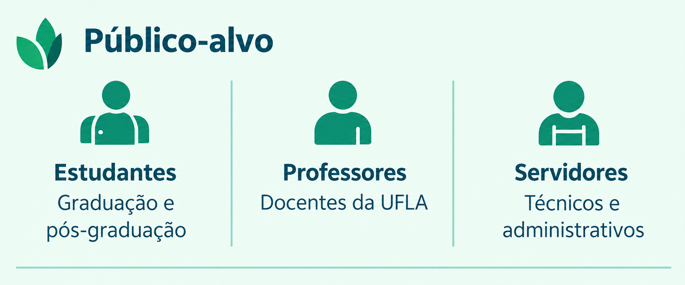

# 🌱 ConectaU
### Descubra, participe, conecte-se.

<p align="center">
  
</p>

> **O problema não é a falta de oportunidades na UFLA.
> É o custo de descobri-las a tempo e encontrar as que realmente são
> relevantes para cada pessoa.**

---

## 📌 Sobre o ConectaU

O **ConectaU** é uma plataforma web que reúne e personaliza
oportunidades da UFLA, como eventos, atividades, bolsas, projetos
e processos seletivos.

A proposta é facilitar a descoberta dessas oportunidades,
funcionando como uma **camada complementar aos canais oficiais
da universidade**.

O ConectaU **não realiza inscrições**. Ao encontrar algo relevante,
o usuário é levado ao **canal oficial responsável pela oportunidade** (da UFLA, quando aplicável), onde a participação
é efetivada. A plataforma cuida da parte que hoje falha: descobrir
a oportunidade certa a tempo.

---

## ❗ O problema

A UFLA oferece e divulga diversas oportunidades para sua comunidade
universitária.

O desafio está em fazer **a oportunidade certa chegar à pessoa certa,
no momento certo**.

Atualmente, essas informações podem estar distribuídas entre
diferentes canais:

<p align="center">
  
</p>

**E-mail institucional · Redes sociais · Grupos de mensagens ·
Sites e portais · SIG · Professores · Organizações estudantis**

Essa dispersão exige que cada pessoa acompanhe diferentes fontes e
identifique, entre muitas informações, aquilo que é relevante para
seu perfil.

Como consequência, uma oportunidade pode ser descoberta tarde demais
ou nem chegar ao conhecimento de quem poderia participar.

---

## 📚 Motivação e evidências

Estudos sobre comunicação no ensino superior indicam que estudantes
recebem informações por diferentes canais e que aspectos como
**relevância, preferências e excesso de mensagens** influenciam a
forma como essas informações são percebidas.

Além disso, pesquisas relacionam a participação em atividades
extracurriculares e o sentimento de pertencimento à experiência e a
diferentes resultados acadêmicos dos estudantes.

Essas evidências, juntamente com uma pesquisa exploratória realizada
com membros da comunidade da UFLA, ajudaram a fundamentar o problema
abordado pelo ConectaU.

---

## 📊 Pesquisa exploratória

Para realizar uma validação inicial do problema dentro da comunidade
da UFLA, foi elaborado um formulário sobre a descoberta de eventos,
projetos, bolsas, processos seletivos e outras oportunidades.

A pesquisa recebeu **26 respostas**.

Os resultados apontam para dificuldades relacionadas à descoberta
oportuna de oportunidades e indicam interesse em recursos que
facilitem sua busca e organização.

<p align="center">
  
</p>

### Recursos considerados úteis

<p align="center">
  
</p>

Entre os participantes que relataram ter descoberto oportunidades
tarde demais, o motivo mais frequente foi ter tomado conhecimento
**após o encerramento das inscrições**.

> **Importante:** a pesquisa possui caráter exploratório e não tem como
> objetivo representar estatisticamente toda a comunidade da UFLA.

---

## 👥 Público-alvo

O ConectaU é destinado à comunidade universitária, incluindo:

<p align="center">
  
</p>

A proposta contempla inicialmente os campi de **Lavras/MG** e
**São Sebastião do Paraíso/MG**.

---

## 💡 Proposta de solução

O ConectaU propõe uma plataforma que reúne oportunidades em um único
ambiente e permite que cada usuário encontre aquilo que é mais
relevante para seu perfil.

<p align="center">
  
</p>

O fluxo permite que o usuário encontre, filtre e acompanhe
oportunidades relevantes até o momento da participação — que acontece
**no canal oficial**, por meio do link da publicação original.

### Como as oportunidades entram na plataforma

| Caminho | Como funciona |
|---|---|
| **Coleta automática** | Um coletor percorre periodicamente páginas públicas da UFLA, normaliza o que encontra, remove duplicados e coloca os resultados em uma fila de curadoria |
| **Cadastro manual** | Quem deseja divulgar algo procura a equipe do ConectaU |

Em ambos os casos, **a publicação é feita por um administrador da
plataforma**: não existe cadastro aberto de oportunidades por usuários.
Essa curadoria humana é o que impede divulgações falsas ou incorretas
de chegarem à comunidade.

Cada oportunidade publicada sempre aponta para a **fonte oficial**,
preservando a origem da informação.

O ConectaU **não substitui os canais oficiais da UFLA**.

A proposta é atuar como uma **camada complementar de descoberta e
organização**, facilitando o acesso às informações que já são
divulgadas pela universidade e por sua comunidade.

---

## 🎯 Impacto social esperado

O impacto esperado está relacionado principalmente à ampliação do
acesso às oportunidades e ao estímulo à participação da comunidade.

<!-- <p align="center">
  
</p>-->

Espera-se contribuir para:

- ampliar o acesso às oportunidades;
- facilitar a descoberta de atividades relevantes;
- estimular a participação da comunidade;
- aproximar estudantes, professores e servidores;
- fortalecer a integração entre cursos, áreas e campi.

### 📈 Como medir o impacto

O impacto poderá ser acompanhado por indicadores como:

- quantidade de oportunidades cadastradas;
- quantidade de oportunidades visualizadas;
- quantidade de usuários participantes;
- quantidade de oportunidades salvas;
- distribuição de oportunidades visualizadas entre cursos e campi;
- encaminhamentos da plataforma para os canais oficiais;
- redução de relatos de descoberta tardia;
- percepção dos usuários sobre a facilidade de encontrar oportunidades.

---

## 🧪 Exemplo de uso

Imagine um estudante interessado em **pesquisa e tecnologia**.

Em vez de acompanhar diversos canais separadamente, ele acessa o
ConectaU e encontra oportunidades relacionadas aos seus interesses.

Ele pode filtrar as oportunidades, salvar aquelas que considera
relevantes e criar lembretes para não perder os prazos.

Ao decidir participar, ele abre o **link da fonte oficial** e conclui
a inscrição no canal da UFLA.

Assim, uma oportunidade que poderia passar despercebida pode ser
encontrada pelo estudante no momento adequado.

---

## 🆔 Identidade da startup

**Nome:** ConectaU

**Slogan:** *Descubra, participe, conecte-se.*

### Proposta de valor

> **Uma plataforma que reúne e personaliza oportunidades da UFLA para
> que cada membro da comunidade encontre o que é relevante para ele
> antes que o prazo acabe.**

---

## 🏗️ Documentação de arquitetura

> 📘 **Comece por [`SISTEMA.md`](SISTEMA.md)**: explica como o sistema funciona de ponta a ponta
> (microsserviços, gateway, BFFs, SAGA, CQRS, outbox, assistente com LLM) e traz um mapa de
> onde encontrar cada coisa no repositório.

Os documentos de cada decisão estão em [`docs/arquitetura/`](docs/arquitetura/). A
[visão geral da arquitetura](docs/arquitetura/ARQUITETURA-CONECTAU.md) traz o diagrama
integrado e os números do sistema:

- **5 serviços de domínio:** Identidade, Coleta, Oportunidades, Engajamento e Assistente;
- **6 bancos**, um ou mais por serviço e nunca compartilhados (5 PostgreSQL e 1 MongoDB);
- **API Gateway** (Traefik), **2 BFFs** e **2 clientes** (Portal Web e Painel Admin);
- **SAGA** orquestrada de publicação, **CQRS** e **outbox** em Oportunidades; **RAG** no Assistente.

| Item | Documento |
|---|---|
| **Como o sistema funciona (comece aqui)** | [`SISTEMA.md`](SISTEMA.md) |
| Visão geral da arquitetura | [`ARQUITETURA-CONECTAU.md`](docs/arquitetura/ARQUITETURA-CONECTAU.md) |
| 4.1 — Decomposição em microsserviços | [`4.1-microsservicos.md`](docs/arquitetura/4.1-microsservicos.md) |
| 4.2 — API REST e HATEOAS | [`4.2-api-rest.md`](docs/arquitetura/4.2-api-rest.md) · [`openapi.yaml`](docs/arquitetura/openapi.yaml) |
| 4.3 — API Gateway | [`4.3-gateway.md`](docs/arquitetura/4.3-gateway.md) |
| 4.4 — Backend for Frontend | [`4.4-bff.md`](docs/arquitetura/4.4-bff.md) |
| 4.5 — Dados, consistência e outbox | [`4.5-dados-outbox.md`](docs/arquitetura/4.5-dados-outbox.md) |
| 4.6 — SAGA de publicação | [`4.6-saga.md`](docs/arquitetura/4.6-saga.md) |
| 4.7 — CQRS | [`4.7-cqrs.md`](docs/arquitetura/4.7-cqrs.md) |
| Por que um banco e um container por serviço | [`decisoes-isolamento.md`](docs/arquitetura/decisoes-isolamento.md) |
| Parte 3 — containers, Compose e Kubernetes | [`docs/infraestrutura.md`](docs/infraestrutura.md) |
| Parte 4 — RAG, agente LangChain e LLM como serviço distribuído | [`docs/parte-4/rag-e-agente.md`](docs/parte-4/rag-e-agente.md) |
| Parte 4 — avaliação do RAG (com e sem recuperação) | [`docs/parte-4/avaliacao-rag.md`](docs/parte-4/avaliacao-rag.md) |

> A arquitetura apresentada na Parte 2 tinha 7 serviços; ela foi simplificada para 5,
> mantendo todos os padrões exigidos. O que mudou e por quê está na seção
> [Revisão em relação à Parte 2](docs/arquitetura/4.1-microsservicos.md#revisão-em-relação-à-parte-2).
> Na Parte 3, os 5 serviços, os BFFs, o gateway e os clientes foram implementados e
> containerizados (Docker Compose e Kubernetes) — ver [Execução e infraestrutura](#-execução-e-infraestrutura).
> Na Parte 4, o Assistente ganhou o RAG completo com agente LangChain e LLM da Groq, tratado como
> dependência falível (circuit breaker, retentativa com backoff, cache e fallback).

---

## 🚀 Execução e infraestrutura

> 🎥 **Vídeo da entrega 3:** [assista à apresentação no Google Drive](https://drive.google.com/drive/folders/1_DyPLt6FhXqFV3msJlyv8K-zaNSfAilI?usp=sharing)

O sistema completo roda em **18 containers**:
- **Serviços de domínio:** 5 (Oportunidades em dois processos: API e projetor do CQRS);
- **Borda:** 2 BFFs, 2 clientes e o API Gateway;
- **Dados e mensageria:** 6 bancos e o RabbitMQ.

Os detalhes de imagens, multi-stage, redes, volumes e manifests estão em [`docs/infraestrutura.md`](docs/infraestrutura.md).

| Tecnologia | Uso |
|---|---|
| **Node.js 22 + TypeScript** | Serviços e BFFs, num monorepo com npm workspaces e um pacote compartilhado ([`packages/comum`](packages/comum/)) |
| **PostgreSQL 17** (5 instâncias, uma com **pgvector**) e **MongoDB 8** | Database per service |
| **RabbitMQ 4** | Eventos publicados pela outbox de Oportunidades |
| **LangChain** + **Groq** (`openai/gpt-oss-120b`) | Agente e chains do Assistente; LLM remoto |
| **transformers.js** (`multilingual-e5-small`) | Embeddings locais do RAG, sem API externa |
| **Traefik 3** | API Gateway no Compose e Ingress Controller no Kubernetes |
| **nginx** | Servidor dos clientes (Portal Web e Painel Admin) |
| **Docker Compose** e **Kubernetes** | Execução local e orquestração |

### Docker Compose (um comando)

Pré-requisitos: Docker Desktop (ou Docker Engine com Compose v2) e as portas 8080, 8081 e 15672 livres.

```powershell
Copy-Item .env.example .env      # depois troque os valores do .env
docker compose up -d --build
docker compose ps                 # todos devem ficar "healthy" em ~1 minuto
```

**LLM do assistente.** Para o assistente gerar respostas, preencha `GROQ_API_KEY` no `.env` com uma
chave criada em https://console.groq.com/keys e rode `docker compose up -d assistente`. É a única
configuração a completar. Sem a chave, todo o sistema funciona, e o assistente responde em modo de
recuperação (os trechos mais relevantes, sem texto gerado). A primeira construção da imagem do Assistente
baixa o modelo de embeddings (~130 MB).

**Atualizando a partir da Parte 3.** O banco do Assistente mudou de esquema (vetores de 384 posições e
tabelas novas), e o esquema só é aplicado num volume vazio. Recrie o volume dele uma vez:

```powershell
docker compose rm -sf assistente assistente-db
docker volume rm conectau_assistente-dados
docker compose up -d --build
```

Ou apague todos os dados de teste com `docker compose down -v`. As oportunidades já publicadas antes
disso não estarão no índice do assistente; publique de novo ou comece do zero.

| Endereço | O que é |
|---|---|
| http://localhost:8080 | **Portal Web** (comunidade) |
| http://localhost:8080/painel/ | **Painel Admin** — entre com `ADMIN_EMAIL` e `ADMIN_SENHA` do `.env` |
| http://127.0.0.1:8081 | Painel do Traefik (rotas e middlewares do gateway) |
| http://127.0.0.1:15672 | Painel do RabbitMQ (`RABBITMQ_USUARIO` / `RABBITMQ_SENHA`) |

Na primeira subida, a Coleta já roda uma coleta da fonte de exemplo, com **dados fictícios**, e o Painel Admin mostra 6 candidatos para curadoria.

Para encerrar, use `docker compose down`, que preserva os volumes dos bancos. Para apagar os dados e reexecutar os esquemas, use `docker compose down -v`.

**Demonstração de ponta a ponta.** Requer Node.js 22 no host. O script percorre todo o fluxo pelo gateway: login, curadoria, SAGA (caminho feliz e falha com compensação), CQRS, feed, favoritos, assistente (RAG, agente e catálogo), segurança, falha do LLM com fallback e circuit breaker, e encerramento.

```powershell
node scripts/demonstracao.mjs
```

**Assistente e LLM:**

```powershell
node scripts/falha-llm.mjs on       # derruba o provedor de LLM (fallback e, após 3 falhas, circuito aberto)
node scripts/falha-llm.mjs status   # disjuntor, latência, tokens e custo das respostas
node scripts/falha-llm.mjs off
node scripts/avaliar-rag.mjs        # avaliação com e sem recuperação -> docs/parte-4/avaliacao-rag.md
```

Para testar sem gastar tokens, há um simulador da API da Groq: `node scripts/groq-simulado.mjs` e, no `.env`,
`GROQ_API_KEY=teste` e `GROQ_BASE_URL=http://host.docker.internal:4010` (só para testes; as respostas são simuladas).

**Provocar a falha da SAGA manualmente.** Pare o Assistente, publique uma oportunidade pelo Painel Admin e veja a compensação acontecer:

```powershell
docker compose stop assistente
docker compose start assistente
```

Outra opção é definir `SIMULAR_FALHA_INDEXACAO=true` no `.env` e rodar `docker compose up -d assistente`.

**Ver os bancos separados:**

```powershell
docker compose exec identidade-db psql -U identidade -c "\dt"
docker compose exec oportunidades-leitura-db psql -U oportunidades_leitura -c "SELECT titulo, versao, visivel FROM oportunidades_view"
docker compose exec coleta-db mongosh -u root -p --authenticationDatabase admin coleta --eval "db.candidatos.countDocuments()"
```

### Kubernetes

Pré-requisitos: Kubernetes do Docker Desktop habilitado, `kubectl` e o **Traefik** instalado no cluster como Ingress Controller (com as CRDs).

```powershell
# 1. Construir as imagens (as mesmas do Compose)
docker compose build

# 2. Só no Kubernetes do Docker Desktop em modo kind: carregar as imagens no nó
node scripts/carregar-imagens-kind.mjs

# 3. Criar o arquivo de segredos (ignorado pelo Git) e trocar os valores (inclusive GROQ_API_KEY)
Copy-Item infrastructure/kubernetes/segredos.env.example infrastructure/kubernetes/segredos.env

# 4. Aplicar tudo (namespace, ConfigMaps, Secret, StatefulSets, Deployments, Services e Ingress)
#    Vindo da Parte 3? Antes, apague o banco do Assistente (o esquema mudou):
#    kubectl delete statefulset assistente-db -n conectau; kubectl delete pvc dados-assistente-db-0 -n conectau
kubectl apply -k infrastructure/kubernetes
kubectl get pods -n conectau -w
```

Acesso pelo Ingress, num terminal separado:

```powershell
kubectl port-forward -n traefik service/traefik 8090:80
```

Depois disso, o Portal fica em http://localhost:8090, o Painel em http://localhost:8090/painel/, e a demonstração roda com `node scripts/demonstracao.mjs --url=http://localhost:8090 --falha=k8s`.

**Escalabilidade:**

```powershell
kubectl scale deployment bff-web -n conectau --replicas=4
kubectl scale deployment oportunidades -n conectau --replicas=3
kubectl get pods -n conectau -l app=oportunidades
```

Com várias réplicas de Oportunidades, cada SAGA e cada lote da outbox continua sendo processado por uma única réplica (`FOR UPDATE SKIP LOCKED`).

**Falha da SAGA no cluster:** escale o Assistente para zero, publique uma oportunidade e depois volte a escala para um.

```powershell
kubectl scale deployment assistente -n conectau --replicas=0
kubectl scale deployment assistente -n conectau --replicas=1
```

### Desenvolvimento

```powershell
npm install
npm run typecheck     # checa os tipos de todos os workspaces
npm run build         # empacota cada serviço com esbuild (dist/*.cjs)
```

---

## 👨‍💻 Equipe

| Integrante | Função |
|---|---|
| **Guilherme Alexandre Cunha Silva** | Scrum Master |
| **Gustavo de Assis Vieira** | Desenvolvedor |
| **João Vitor Givisiez Lessa** | Desenvolvedor |
| **Maria Luiza Santos Ferreira** | Product Owner |

---

## 📚 Referências

1. **GILANI, David.** *Student attitudes and preferences towards
   communications from their university – a meta-analysis of student
   communications research within UK higher education institutions.*
   Journal of Higher Education Policy and Management, v. 46, n. 3,
   p. 274–290, 2024.  
   DOI: 10.1080/1360080X.2024.2344234.

2. **SIMPSON, Judith; BRANAGAN, Caitlin; LAU CHENG VON, Vonnie;
   WILLIAMS, Lily.** *Spamming our students? The use of email as a
   mass communication tool in higher education.*
   Journal of Further and Higher Education, p. 152–159, 2025.  
   DOI: 10.1080/13603108.2024.2440705.

3. **KULP, Amanda M.; PASCALE, Amanda Blakewood; GRANDSTAFF,
   Matthew.** *Types of Extracurricular Campus Activities and
   First-Year Students’ Academic Success.*
   Journal of College Student Retention: Research, Theory & Practice,
   v. 23, n. 3, p. 747–767, 2021.  
   DOI: 10.1177/1521025119876249.

4. **VAN KESSEL, Gisela et al.** *Relationship between university
   belonging and student outcomes: A systematic review and
   meta-analysis.* The Australian Educational Researcher, v. 52,
   p. 2511–2534, 2025.  
   DOI: 10.1007/s13384-025-00822-8.

5. **UNIVERSIDADE FEDERAL DE LAVRAS (UFLA).**
   *Divulgação de eventos.* Catálogo de Serviços da UFLA.
