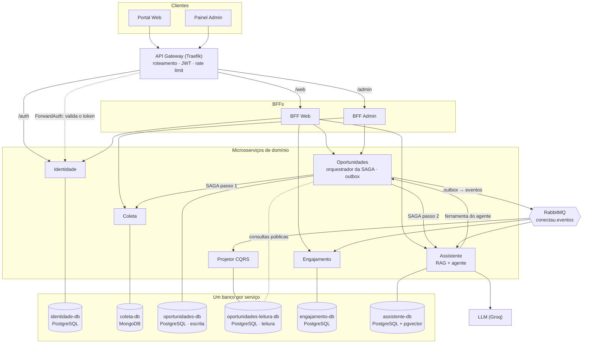
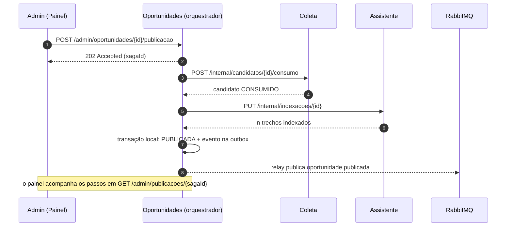
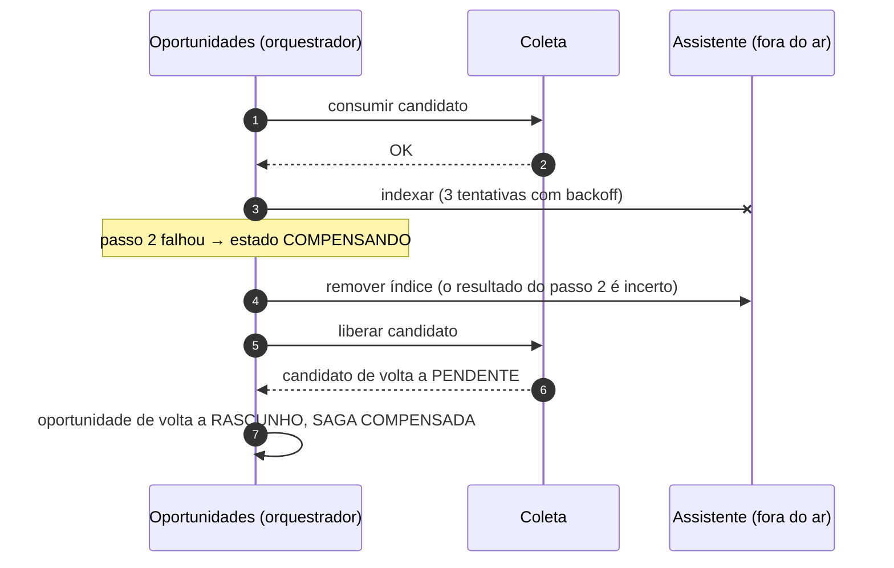
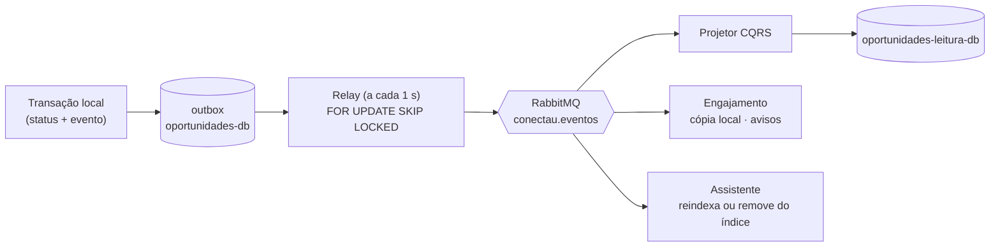

# ConectaU — como o sistema funciona

Este documento explica a arquitetura do ConectaU de ponta a ponta: quais são os microsserviços, como uma requisição chega até eles, onde entram o API Gateway e os BFFs, como a SAGA publica uma oportunidade, como o CQRS e a outbox mantêm os dados em dia e onde o modelo de linguagem é usado. No fim há um mapa de **onde encontrar cada coisa no repositório**.

Para subir o sistema, veja o [README](README.md#-execução-e-infraestrutura). Os detalhes de cada decisão estão em [`docs/arquitetura/`](docs/arquitetura/), [`docs/infraestrutura.md`](docs/infraestrutura.md) e [`docs/parte-4/`](docs/parte-4/).

## Sumário

1. [Visão geral](#1-visão-geral)
2. [Os 5 microsserviços](#2-os-5-microsserviços)
3. [Por onde entra uma requisição: gateway e BFFs](#3-por-onde-entra-uma-requisição-gateway-e-bffs)
4. [Comunicação entre os serviços](#4-comunicação-entre-os-serviços)
5. [SAGA: a publicação de uma oportunidade](#5-saga-a-publicação-de-uma-oportunidade)
6. [CQRS, outbox e eventos](#6-cqrs-outbox-e-eventos)
7. [Um banco por serviço](#7-um-banco-por-serviço)
8. [Assistente: RAG, agente e LLM](#8-assistente-rag-agente-e-llm)
9. [Segurança](#9-segurança)
10. [Containers, redes e Kubernetes](#10-containers-redes-e-kubernetes)
11. [Dois fluxos completos, passo a passo](#11-dois-fluxos-completos-passo-a-passo)
12. [Onde encontrar cada coisa](#12-onde-encontrar-cada-coisa)

## 1. Visão geral

O ConectaU reúne as oportunidades da UFLA (eventos, atividades, bolsas, projetos e processos seletivos) num só lugar, filtra pelo perfil de cada pessoa e lembra dos prazos. A inscrição continua no canal oficial: o ConectaU resolve a descoberta.

O sistema roda em **18 containers**:

| Camada | Componentes |
|---|---|
| Clientes | **Portal Web** (comunidade) e **Painel Admin** (curadoria) |
| Borda | **API Gateway** (Traefik), **BFF Web** e **BFF Admin** |
| Domínio | **5 microsserviços**: Identidade, Coleta, Oportunidades (API e projetor do CQRS em dois containers), Engajamento e Assistente |
| Dados e mensageria | **6 bancos** (5 PostgreSQL, um deles com pgvector, e 1 MongoDB) e o **RabbitMQ** |
| Externo | Provedor de LLM (Groq), acessado só pelo Assistente |



## 2. Os 5 microsserviços

| Serviço | Responsabilidade | Banco próprio | Porta | Código |
|---|---|---|---|---|
| **Identidade** | Cadastro, login (JWT), perfil (curso, campus, interesses), papéis `ESTUDANTE` e `ADMIN`, e validação de token para o gateway | PostgreSQL `identidade-db` | 3101 | [`services/identidade/`](services/identidade/) |
| **Coleta** | Fontes, coletor periódico, normalização, remoção de duplicados, cadastro manual de candidatos e fila de curadoria | MongoDB `coleta-db` | 3102 | [`services/coleta/`](services/coleta/) |
| **Oportunidades** | Catálogo oficial (criar, editar, publicar, encerrar), **orquestrador da SAGA**, **outbox** e o **modelo de leitura do CQRS** (projetor em outro container) | PostgreSQL de escrita `oportunidades-db` + PostgreSQL de leitura `oportunidades-leitura-db` | 3103 (projetor: 3113) | [`services/oportunidades/`](services/oportunidades/) |
| **Engajamento** | Favoritos, lembretes de prazo e avisos in-app; guarda uma cópia mínima das oportunidades, alimentada por eventos | PostgreSQL `engajamento-db` | 3104 | [`services/engajamento/`](services/engajamento/) |
| **Assistente** | Base de conhecimento e índice vetorial dos editais, agente LangChain com LLM da Groq, guarda de escopo, disjuntor, cache e fallback | PostgreSQL + pgvector `assistente-db` | 3105 | [`services/assistente/`](services/assistente/) |

Cada serviço é um projeto Node.js 22 + TypeScript independente, com o próprio Dockerfile e o próprio banco. O código repetido entre eles (logs, cliente HTTP com retentativa, mensageria, autenticação por cabeçalho, validação) está no pacote compartilhado [`packages/comum/`](packages/comum/), que é empacotado dentro de cada serviço na construção da imagem: não existe biblioteca compartilhada em tempo de execução.

**Por que esse corte.** Cada fronteira protege uma regra ou uma carga diferente:

- dados coletados são não confiáveis, enquanto o catálogo só tem o que um admin curou;
- o catálogo é muito lido e pouco escrito, enquanto favoritos e lembretes são dados por usuário, escritos o tempo todo;
- o Assistente depende de um provedor externo caro e falível e não pode ver dados pessoais;
- a Identidade concentra credenciais.

A justificativa completa está em [`4.1-microsservicos.md`](docs/arquitetura/4.1-microsservicos.md) e em [`decisoes-isolamento.md`](docs/arquitetura/decisoes-isolamento.md).

## 3. Por onde entra uma requisição: gateway e BFFs

Os clientes nunca falam direto com os serviços. Tudo passa pelo **API Gateway (Traefik)**, a única porta publicada no host (`localhost:8080`).

| Caminho | Vai para | O que o gateway faz antes |
|---|---|---|
| `/auth/usuarios`, `/auth/sessoes` | Identidade | Reescreve para `/api/v1/...`; não exige token (é o cadastro e o login) |
| `/web/**` | BFF Web | Valida o JWT na Identidade (ForwardAuth), injeta `X-Usuario-Id` e `X-Usuario-Papel`, limite de 50 req/s (rajada de 100) |
| `/web/conversas/**` | BFF Web → Assistente | O mesmo, com um limite mais apertado: **10 perguntas por minuto**, porque cada uma consome LLM |
| `/admin/**` | BFF Admin | Exige token de **ADMIN** (403 para estudante) |
| `/painel/` | Painel Admin | Arquivos estáticos |
| `/` | Portal Web | Arquivos estáticos |
| `/internal/**` | **lugar nenhum** | Não existe rota: os comandos internos (da SAGA, por exemplo) só são acessíveis por dentro da rede |

Como o gateway **descarta** qualquer `X-Usuario-*` enviado pelo cliente e só repassa os que a Identidade devolveu, um usuário não consegue se passar por outro forjando cabeçalhos (a demonstração verifica isso). As regras estão em [`dinamico.yml`](infrastructure/docker/gateway/dinamico.yml) (Compose) e em [`gateway.yaml`](infrastructure/kubernetes/gateway.yaml) (Kubernetes, como Ingress e Middlewares do Traefik).

**Os dois BFFs** existem porque os clientes precisam de coisas diferentes ([`4.4-bff.md`](docs/arquitetura/4.4-bff.md)):

| | BFF Web (comunidade) | BFF Admin (curadoria) |
|---|---|---|
| Agrega | Perfil (Identidade) + catálogo (Oportunidades) + "salvo" e avisos (Engajamento) + Assistente | Fila de candidatos (Coleta) + escrita de Oportunidades + andamento da SAGA |
| Formato | Cards enxutos; feed filtrado por campus e interesses; links HATEOAS reescritos para `/web` | Registro completo: oportunidade + procedência do candidato + passos da SAGA |
| Se algo cai | Degrada: sem o Engajamento, o feed sai sem o campo `salvo` | Mostra o erro para o admin decidir |

## 4. Comunicação entre os serviços

| Tipo | Quando | Exemplos |
|---|---|---|
| **HTTP síncrono** | Quando quem chama precisa da resposta para continuar | BFFs → serviços; passos da SAGA (Oportunidades → Coleta e Assistente); ferramenta do agente (Assistente → Oportunidades) |
| **Eventos assíncronos (RabbitMQ)** | Quando outros serviços precisam reagir a uma mudança, sem que quem mudou espere por eles | `oportunidade.publicada`, `.editada` e `.encerrada`, consumidos pelo projetor, pelo Engajamento e pelo Assistente |

As chamadas HTTP entre serviços têm timeout, retentativa com backoff exponencial e propagação do `X-Request-Id` (o mesmo id aparece nos logs de todos os serviços de uma requisição). Os consumidores de eventos reconectam sozinhos, retentam até 3 vezes e mandam a mensagem para uma fila de mortas (`<fila>.mortas`), em vez de travar a fila.

## 5. SAGA: a publicação de uma oportunidade

Publicar uma oportunidade é a transação de negócio que atravessa **3 serviços**, cada um com o próprio banco: não existe transação ACID entre eles. A SAGA é **orquestrada**: o serviço Oportunidades coordena os passos e guarda o estado em `saga_publicacao` e `saga_passos`, no mesmo banco do catálogo ([`4.6-saga.md`](docs/arquitetura/4.6-saga.md), código em [`saga.ts`](services/oportunidades/src/saga.ts)).

| Passo | Serviço | Ação | Compensação |
|---|---|---|---|
| 1. `CONSUMIR_CANDIDATO` | Coleta | Marca o candidato como `CONSUMIDO`, para não ser publicado duas vezes | Devolve o candidato para `PENDENTE` |
| 2. `INDEXAR_ASSISTENTE` | Assistente | Gera os embeddings do texto e grava no pgvector, para o assistente responder sobre o edital | Remove os trechos do índice |
| 3. `CONCLUIR_PUBLICACAO` (pivô) | Oportunidades | Numa transação local: status `PUBLICADA`, versão +1 e evento gravado na outbox | — (a partir daqui não volta) |

**Caminho feliz:**



**Falha com compensação** (o que a demonstração provoca ao vivo, derrubando o Assistente):



Garantias de robustez:

- **Idempotência:** cada passo pode ser repetido sem efeito duplicado. A indexação é um `PUT` que substitui o índice, e o consumo do candidato aceita a mesma SAGA de novo.
- **Timeout tratado como incerto:** se um passo estourou o tempo, ele também é compensado, porque pode ter sido aplicado sem que a resposta chegasse.
- **Várias réplicas sem duplicar:** com várias réplicas de Oportunidades, cada SAGA é reservada por uma só (`FOR UPDATE SKIP LOCKED`).

## 6. CQRS, outbox e eventos

O catálogo é muito lido (estudantes buscando) e pouco escrito (admins publicando). Por isso Oportunidades separa os dois modelos em **dois bancos** ([`4.7-cqrs.md`](docs/arquitetura/4.7-cqrs.md)):

- **Modelo de escrita** (`oportunidades-db`): normalizado, com o estado da SAGA e a outbox.
- **Modelo de leitura** (`oportunidades-leitura-db`): uma visão pronta para a busca (`oportunidades_view`), com índice de texto em português. A busca pública e o feed leem só daqui.

O modelo de leitura é atualizado assim:



- **Outbox:** o evento é gravado na mesma transação que muda a oportunidade, então nunca acontece de a oportunidade mudar sem o evento sair, nem o contrário (sem *dual write*). O relay publica o que estiver pendente ([`relay.ts`](services/oportunidades/src/relay.ts)).
- **Projetor:** aplica o evento só se a versão for mais nova (`WHERE versao < EXCLUDED.versao`), então eventos repetidos ou fora de ordem não estragam a leitura ([`projetor.ts`](services/oportunidades/src/projetor.ts)).
- **Consistência eventual:** a publicação aparece na busca em geral em menos de 1 s (a demonstração mede).
- **Consumidores idempotentes:** o Engajamento registra cada `messageId` já processado. Quando o prazo muda, ele recalcula os lembretes e avisa quem favoritou; quando a oportunidade é encerrada, cancela os lembretes. O Assistente reindexa o edital editado e tira do índice o encerrado.

## 7. Um banco por serviço

| Banco | Tecnologia | Dono | Por quê |
|---|---|---|---|
| `identidade-db` | PostgreSQL | Identidade | Dados pessoais e credenciais, com integridade relacional |
| `coleta-db` | MongoDB | Coleta | Candidatos têm formato variável, vindo de fontes diferentes |
| `oportunidades-db` | PostgreSQL | Oportunidades (escrita) | Catálogo, SAGA e outbox na mesma transação |
| `oportunidades-leitura-db` | PostgreSQL | Oportunidades (leitura) | Busca textual, separada da escrita (CQRS) |
| `engajamento-db` | PostgreSQL | Engajamento | Favoritos, lembretes, avisos e a cópia das oportunidades |
| `assistente-db` | PostgreSQL + pgvector | Assistente | Texto e embeddings no mesmo lugar, com busca por similaridade |

Nenhum serviço lê o banco de outro: não há `JOIN` entre bancos. Quando um serviço precisa de um dado alheio, pede pela API ou mantém uma cópia derivada de eventos. No Docker Compose, cada banco fica numa rede própria em que só o serviço dono entra, então o isolamento é imposto pela rede e não só por convenção.

## 8. Assistente: RAG, agente e LLM

O Assistente responde perguntas sobre oportunidades e sobre o funcionamento do ConectaU, sempre citando as fontes ([`docs/parte-4/rag-e-agente.md`](docs/parte-4/rag-e-agente.md)).

| Peça | Como é feita |
|---|---|
| **Base de conhecimento própria** | 8 documentos sobre o ConectaU e conceitos acadêmicos ([`conhecimento/`](services/assistente/conhecimento/)) + o texto de cada oportunidade publicada (indexado pela SAGA e mantido em dia pelos eventos) |
| **Embeddings** | Modelo multilíngue `e5-small`, executado localmente no próprio serviço (sem API paga e sem internet) |
| **Base vetorial** | pgvector com índice HNSW |
| **LangChain** | Chains (com e sem recuperação) e um **agente** com 3 ferramentas: busca na base vetorial, busca no catálogo real de Oportunidades e detalhe de uma oportunidade |
| **LLM** | Groq (`openai/gpt-oss-120b`). A chave `GROQ_API_KEY` é a única configuração a preencher; sem ela, o assistente responde em modo de recuperação |
| **Escopo** | Uma guarda antes do LLM recusa perguntas fora do tema (sem gastar tokens), e o prompt é a segunda camada |
| **Resiliência** | Circuit breaker, timeout e retentativa com backoff, cache (exato e semântico) e fallback com os trechos encontrados |
| **Medição** | Latência, tokens e custo estimado de cada resposta (`GET /internal/llm`) e avaliação com e sem recuperação ([`avaliacao-rag.md`](docs/parte-4/avaliacao-rag.md)) |

## 9. Segurança

- **Autenticação centralizada:** o gateway valida o JWT na Identidade (ForwardAuth) antes de repassar. Os serviços confiam só nos cabeçalhos que o gateway injeta.
- **Autorização:** recursos pessoais (favoritos, lembretes, avisos, conversas) usam sempre o usuário do token, nunca um id vindo da requisição; quem não é dono recebe 403. Rotas de admin exigem o papel `ADMIN`.
- **Rotas internas:** `/internal/**` não tem rota no gateway e exige um token de serviço (`X-Token-Servico`), comparado em tempo constante.
- **Senhas:** guardadas só como hash com scrypt e salt.
- **Segredos:** ficam fora do Git, no `.env` e no `segredos.env`; os dois arquivos de exemplo estão versionados com valores fictícios.
- **Assistente sem dados pessoais:** o Assistente não acessa perfil, favoritos nem lembretes; para o provedor externo sai só a pergunta e trechos públicos. Ele é também o único serviço com saída para a internet.
- **Containers:** rodam com usuário sem privilégios e têm `HEALTHCHECK`.

## 10. Containers, redes e Kubernetes

Cada serviço tem o próprio Dockerfile multi-stage: o estágio de build verifica os tipos e empacota o código, e a imagem final leva só o resultado. Tudo sobe com `docker compose up -d --build` ([`docker-compose.yml`](docker-compose.yml)). As redes isolam as camadas ([`docs/infraestrutura.md`](docs/infraestrutura.md)):

| Rede | Quem participa |
|---|---|
| `rede-borda` | Gateway, clientes, BFFs e Identidade |
| `rede-aplicacao` (interna) | BFFs e os 5 serviços; o gateway não está nela |
| `rede-mensageria` (interna) | RabbitMQ, Oportunidades, projetor, Engajamento e Assistente |
| `rede-dados-<serviço>` (interna) | Um banco e o seu serviço |
| `rede-saida` | Só o Assistente: a única rede com saída para a internet, para chamar o LLM |
| `rede-gerencia` | Só o painel do RabbitMQ, publicado em `127.0.0.1` |

No Kubernetes, os mesmos componentes viram Deployments, StatefulSets (bancos e RabbitMQ, com volume persistente), Services, um ConfigMap por serviço, um Secret gerado pelo kustomize e um Ingress com os Middlewares do Traefik. Tudo sobe com `kubectl apply -k infrastructure/kubernetes`. Oportunidades pode ter várias réplicas sem duplicar SAGA nem eventos, graças ao `SKIP LOCKED`.

## 11. Dois fluxos completos, passo a passo

**Um admin publica uma oportunidade**

1. O coletor encontra um evento numa página pública da UFLA, remove duplicados e cria um **candidato** `PENDENTE` na Coleta.
2. No Painel Admin (`/painel/`), o admin vê a fila (`/admin/candidatos`, BFF Admin → Coleta) e cria uma oportunidade em `RASCUNHO` a partir do candidato (BFF Admin → Oportunidades).
3. O admin clica em publicar. Oportunidades responde `202` e inicia a **SAGA**: consome o candidato na Coleta, indexa o edital no Assistente e, na transação final, marca `PUBLICADA` e grava o evento na **outbox**.
4. O relay publica `oportunidade.publicada` no RabbitMQ. O **projetor** atualiza o modelo de leitura e o **Engajamento** guarda sua cópia.
5. Em menos de um segundo, a oportunidade aparece na busca e no feed do Portal Web.

**Um estudante descobre e acompanha uma oportunidade**

1. O estudante entra (`/auth/sessoes` → Identidade, que devolve o JWT).
2. O feed (`/web/feed`) passa pelo gateway, que valida o token, e pelo BFF Web, que lê o perfil na Identidade, busca no modelo de leitura de Oportunidades com o campus e os interesses e marca o que já está salvo (Engajamento).
3. Ele abre uma oportunidade: os botões (salvar, lembrar, perguntar) vêm dos links **HATEOAS** da resposta.
4. Ele salva e cria um lembrete (Engajamento). Se o admin mudar o prazo, o evento `oportunidade.editada` faz o Engajamento recalcular o lembrete e avisar.
5. Ele pergunta ao assistente "o que preciso levar?". O Assistente aplica a guarda de escopo e o agente busca o trecho do edital no pgvector. O LLM responde citando a fonte; se o LLM estiver fora, a resposta sai em modo degradado com os trechos encontrados.
6. Para se inscrever, ele abre o link da **fonte oficial**.

## 12. Onde encontrar cada coisa

| Para mostrar | Arquivo |
|---|---|
| Decomposição e fronteiras dos serviços | [`docs/arquitetura/4.1-microsservicos.md`](docs/arquitetura/4.1-microsservicos.md) |
| Contrato REST, versionamento e HATEOAS | [`docs/arquitetura/openapi.yaml`](docs/arquitetura/openapi.yaml), [`4.2-api-rest.md`](docs/arquitetura/4.2-api-rest.md), links em [`modelo.ts`](services/oportunidades/src/modelo.ts) |
| Regras do gateway (rotas, JWT, rate limit) | [`infrastructure/docker/gateway/dinamico.yml`](infrastructure/docker/gateway/dinamico.yml) |
| Validação do token usada pelo gateway | [`services/identidade/src/index.ts`](services/identidade/src/index.ts) (rota `/internal/autenticacao`) |
| BFFs e a diferença entre as respostas | [`bffs/bff-web/src/index.ts`](bffs/bff-web/src/index.ts), [`bffs/bff-admin/src/index.ts`](bffs/bff-admin/src/index.ts) |
| SAGA: orquestrador, passos e compensações | [`services/oportunidades/src/saga.ts`](services/oportunidades/src/saga.ts), tabelas em [`db/escrita.sql`](services/oportunidades/db/escrita.sql) |
| Participantes da SAGA | Coleta: rotas `/internal/candidatos/...` em [`services/coleta/src/index.ts`](services/coleta/src/index.ts); Assistente: `/internal/indexacoes` em [`services/assistente/src/index.ts`](services/assistente/src/index.ts) |
| Outbox e relay | [`services/oportunidades/src/relay.ts`](services/oportunidades/src/relay.ts), `registrarEvento` em [`modelo.ts`](services/oportunidades/src/modelo.ts) |
| CQRS: projetor e modelo de leitura | [`services/oportunidades/src/projetor.ts`](services/oportunidades/src/projetor.ts), [`db/leitura.sql`](services/oportunidades/db/leitura.sql) |
| Consumidor idempotente de eventos | [`services/engajamento/src/index.ts`](services/engajamento/src/index.ts), [`packages/comum/src/mensageria.ts`](packages/comum/src/mensageria.ts) |
| Esquema de cada banco | `services/<serviço>/db/` |
| Dockerfiles (multi-stage) | `services/<serviço>/Dockerfile`, `bffs/<bff>/Dockerfile`, `clients/<cliente>/Dockerfile`, `infrastructure/docker/` |
| Compose: redes e volumes | [`docker-compose.yml`](docker-compose.yml) |
| Kubernetes: Deployments, StatefulSets, ConfigMaps, Secret e Ingress | [`infrastructure/kubernetes/`](infrastructure/kubernetes/) (`servicos.yaml`, `bancos.yaml`, `configmaps.yaml`, `gateway.yaml`, `kustomization.yaml`) |
| RAG: ingestão, embeddings, recuperação | [`conhecimento.ts`](services/assistente/src/conhecimento.ts), [`embeddings.ts`](services/assistente/src/embeddings.ts), [`recuperacao.ts`](services/assistente/src/recuperacao.ts) |
| LangChain: chains, agente e ferramentas | [`cadeias.ts`](services/assistente/src/cadeias.ts), [`ferramentas.ts`](services/assistente/src/ferramentas.ts) |
| Circuit breaker, retentativa, cache e fallback | [`resiliencia.ts`](services/assistente/src/resiliencia.ts), [`llm.ts`](services/assistente/src/llm.ts), [`cache.ts`](services/assistente/src/cache.ts), [`perguntar.ts`](services/assistente/src/perguntar.ts) |
| Guarda de escopo | [`services/assistente/src/escopo.ts`](services/assistente/src/escopo.ts) |
| Avaliação do RAG, latência e custo | [`docs/parte-4/avaliacao-rag.md`](docs/parte-4/avaliacao-rag.md), [`docs/parte-4/rag-e-agente.md`](docs/parte-4/rag-e-agente.md) |
| Demonstração de ponta a ponta | [`scripts/demonstracao.mjs`](scripts/demonstracao.mjs) |
| Provocar falha no LLM ao vivo | [`scripts/falha-llm.mjs`](scripts/falha-llm.mjs) |

**Comandos da apresentação:**

```powershell
docker compose up -d --build                 # sobe os 18 containers
node scripts/demonstracao.mjs                # roteiro completo: SAGA (sucesso e falha), CQRS, BFFs, segurança, RAG e disjuntor
node scripts/falha-llm.mjs on | off | status # derruba e restabelece o LLM (fallback e disjuntor)
node scripts/avaliar-rag.mjs                 # avaliação com e sem recuperação (precisa de GROQ_API_KEY)
```

Para mostrar os bancos separados:

```powershell
docker compose ps                                               # um container por banco
docker compose exec assistente-db psql -U assistente -c "\dt"   # tabelas só do Assistente
```
