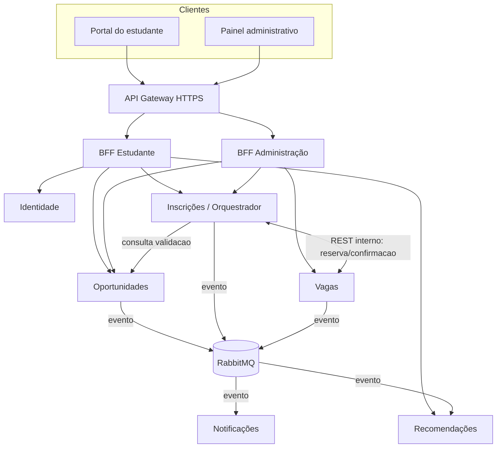

# 4.1 — Decomposição em microsserviços

## Bounded contexts

| Serviço | Responsabilidade exclusiva | Dados que possui | O que NÃO deve fazer |
| --- | --- | --- | --- |
| Usuario | Perfil, preferências, vínculo com usuário interno | `users`, `preferences` | Guardar inscrições ou número de vagas |
| Oportunidades | Cadastro, publicação e consulta de oportunidades | `opportunities`, `categories`, `outbox_events` | Decidir aprovação de candidatura |
| Inscrições | Solicitações, estados e histórico de inscrição; coordenar saga | `applications`, `application_steps`, `outbox_events` | Editar vagas diretamente |
| Vagas | Capacidade, reservas, confirmação e liberação de vagas | `capacities`, `reservations`, `outbox_events` | Controlar perfil do estudante |
| Notificações | Templates, envio e acompanhamento de notificações | `notifications`, `delivery_attempts` | Alterar o estado de inscrições |
| Recomendações | Projeções, ranking, recomendações e busca | `opportunity_projection`, `recommendation_scores` | Ser origem oficial de oportunidades |

> **Decisão proposta:** Inscrições é o **orquestrador de negócio** da SAGA e também o serviço de domínio dono das inscrições. Não existe necessidade de um sétimo banco chamado “banco do orquestrador”. O componente orquestrador usa apenas o banco de Inscrições.

## Justificativa das fronteiras

- Oportunidades muda quando uma unidade cria ou publica editais; Inscrições muda com candidaturas; Vagas gerencia concorrência e disponibilidade. Mantê-los separados protege invariantes diferentes.
- Identidade concentra dados pessoais e permissões. Notificações absorve falhas de serviços externos sem bloquear inscrições. Recomendações pode evoluir seu algoritmo sem alterar cadastro ou candidatura.
- A alternativa monolítica teria menor custo operacional, mas acoplamento mais forte. A alternativa de um microsserviço por entidade geraria chamadas excessivas e transações distribuídas desnecessárias.
- **Trade-off reconhecido:** infraestrutura mais cara, consistência eventual e complexidade operacional. A divisão é uma decisão arquitetural acadêmica; para uma implantação pequena, um monólito modular poderia ser economicamente superior.

## Componentes e comunicação

## Contratos e ownership

- Não há joins SQL entre bancos de serviços; consultas cruzadas são feitas por APIs ou projeções alimentadas por eventos.
- Inscrições guarda referências `userId`, `opportunityId`, `reservationId`, não chaves estrangeiras interbancos.
- Dados recebidos por eventos são cópias derivadas e podem estar defasados.
- Endpoint interno não significa endpoint público: rotas `/internal/**` exigem identidade de serviço e não são publicadas no gateway.
