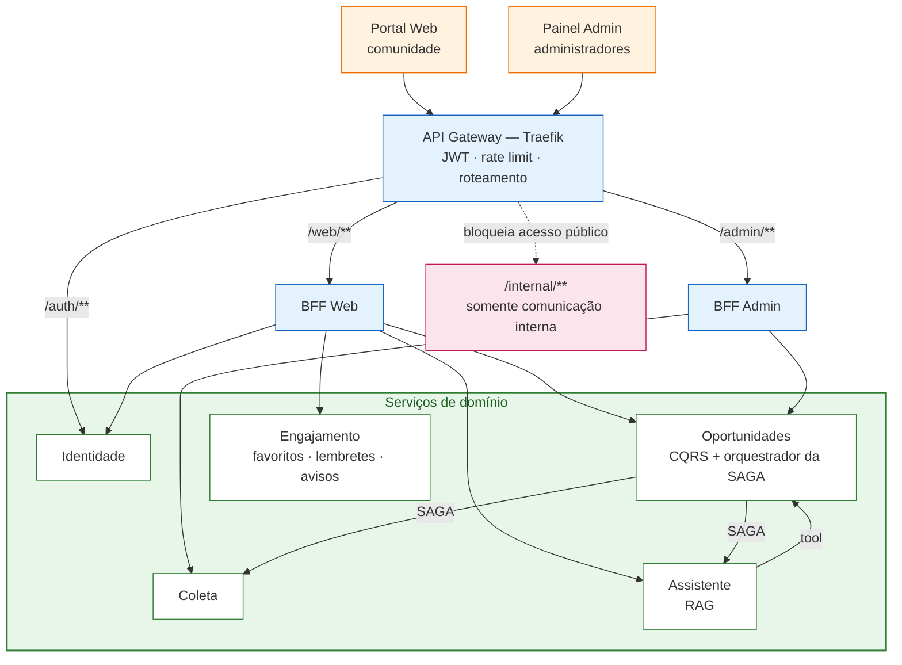

# 4.1 — Decomposição em microsserviços

> **Status:** arquitetura revisada após a Parte 2 (ver [Revisão em relação à Parte 2](#revisão-em-relação-à-parte-2)). Os 5 serviços estão implementados e containerizados desde a Parte 3; a geração de respostas por LLM no Assistente é escopo da Parte 4.

## Decisões de produto que guiam a decomposição

| Decisão | Consequência arquitetural |
|---|---|
| O ConectaU é uma **camada de descoberta**: a inscrição acontece no canal oficial (link `fonteOficial`) | Não há serviço de inscrições nem de vagas. A transação distribuída do sistema é a **publicação** de uma oportunidade |
| **Toda oportunidade entra pela Coleta**: pela coleta automática de páginas da UFLA ou pelo cadastro manual de um admin, que cria um candidato de origem `MANUAL` | Uma única porta de entrada e um único fluxo de curadoria. A SAGA de publicação sempre atravessa Coleta, Assistente e Oportunidades |
| **Não existe usuário publicador.** Quem quer divulgar fala com um **admin**, que publica | Apenas dois papéis: `ESTUDANTE` e `ADMIN`. Toda publicação passa por curadoria humana |
| O cliente da comunidade é **web responsivo** (funciona no celular, sem app de loja) | Dois clientes distintos — Portal Web e Painel Admin — e, portanto, dois BFFs |
| Funcionalidade de LLM: **assistente de editais** (RAG) | Serviço **Assistente** com base vetorial própria, alimentada pela SAGA de publicação |
| Os avisos são **in-app** e nascem de favoritos e lembretes (prazo próximo, oportunidade alterada ou encerrada) | Avisos ficam dentro do **Engajamento**; não há serviço separado de notificações |

## Serviços de domínio (5)

| # | Serviço | Responsabilidade exclusiva | Dados que possui | Banco | O que NÃO deve fazer |
|---|---|---|---|---|---|
| 1 | **Identidade** | Cadastro e login, perfil (curso, campus, interesses), papéis `ESTUDANTE`/`ADMIN`, emissão e verificação de JWT | `usuarios`, `interesses` | PostgreSQL | Guardar favoritos ou oportunidades |
| 2 | **Coleta** | Fontes, execução do coletor, normalização, **deduplicação**, cadastro manual de candidatos e fila de curadoria | `fontes`, `execucoes`, `candidatos` (bruto + campos extraídos) | MongoDB | Publicar por conta própria; apenas sugere candidatos |
| 3 | **Oportunidades** | Catálogo oficial: criar, editar, publicar e encerrar; **orquestrar a SAGA de publicação**; manter o modelo de leitura (CQRS); publicar eventos pela outbox | Escrita: `oportunidades`, `saga_publicacao`, `saga_passos`, `outbox`. Leitura: `oportunidades_view` | PostgreSQL (escrita) + PostgreSQL (leitura, instância separada) | Enviar avisos ou guardar favoritos |
| 4 | **Engajamento** | Favoritos, **lembretes de prazo** e **avisos in-app** do usuário | `favoritos`, `lembretes`, `notificacoes`, `oportunidade_resumo` (cópia via evento), `mensagens_processadas` | PostgreSQL | Alterar a oportunidade |
| 5 | **Assistente** | Ingestão de editais na base vetorial, recuperação, geração de respostas com citações, cache de respostas e histórico de conversas | `chunks` + embeddings, `conversas`, `cache_respostas` | PostgreSQL + pgvector | Gravar em outros serviços; só lê dados do sistema por *tools* |

> **Orquestrador da SAGA:** vive **dentro do serviço Oportunidades**. O estado da SAGA fica nas tabelas `saga_publicacao` e `saga_passos`, no mesmo banco do catálogo. Assim, mudar o status da oportunidade e avançar a SAGA acontecem na mesma transação local; com um orquestrador separado, seria preciso sincronizar dois bancos — outra transação distribuída só para coordenar a primeira.

## Componentes que não são serviços de domínio

| Componente | Papel | Tem banco? |
|---|---|---|
| **API Gateway** (Traefik) | Entrada única: roteamento, autenticação, rate limit ([4.3](4.3-gateway.md)) | Não |
| **BFF Web** | Agrega e adapta respostas para o Portal Web ([4.4](4.4-bff.md)) | Não |
| **BFF Admin** | Agrega e adapta respostas para o Painel Admin ([4.4](4.4-bff.md)) | Não |
| **Portal Web** e **Painel Admin** | Clientes | Não |
| **RabbitMQ** | Transporte dos eventos publicados pela outbox ([4.5](4.5-dados-outbox.md)) | Fila própria |

## Justificativa das fronteiras

- **Coleta × Oportunidades:** dados coletados são *não confiáveis* (duplicados, incompletos, de formato variável); o catálogo contém apenas dados *curados por um admin*. Separar impede que uma falha do coletor polua o catálogo e permite rodar a coleta sem disputar recursos com as consultas dos estudantes.
- **Oportunidades × Engajamento:** o catálogo é lido muito e escrito pouco, só por admins; favoritos, lembretes e avisos são dados *por usuário*, escritos com frequência. São invariantes e cargas diferentes.
- **Assistente isolado:** depende de um provedor remoto caro e falível (LLM e embeddings); precisa de *circuit breaker*, cache e escala próprios, e não deve ter acesso a dados pessoais.
- **Identidade isolada:** concentra dados pessoais e credenciais, com requisitos de proteção próprios.
- **Por que os avisos ficaram no Engajamento:** todo aviso do ConectaU nasce de um favorito ou de um lembrete. Separar Notificações exigiria um evento e uma cópia de dados a mais para cada aviso, sem proteger nenhuma regra adicional. Como não há envio de e-mail, não existe integração externa lenta cujas falhas precisem ser isoladas.
- **Por que não há serviço de Recomendações:** o ranking personalizado dependia de cópias de perfis e de oportunidades num banco próprio. Para o volume de oportunidades da UFLA, filtrar o feed pelo campus e pelos interesses do perfil resolve: o BFF Web lê o perfil e consulta o modelo de leitura com esses filtros. Recomendações pode voltar como serviço quando houver um algoritmo que justifique (por exemplo, similaridade por embeddings).
- **Alternativas descartadas:** um monólito teria menor custo operacional, mas não atenderia aos objetivos da disciplina; um serviço por entidade (Favoritos e Lembretes separados) geraria chamadas extras sem proteger nenhuma regra de negócio adicional.
- **Trade-off reconhecido:** infraestrutura mais cara, consistência eventual e maior complexidade operacional. Para uma implantação pequena, um monólito modular seria economicamente superior. O porquê de pagar esse preço está em [Por que um banco e um container por serviço](decisoes-isolamento.md).

## Componentes e comunicação

## Contratos e ownership

- Não há `JOIN` entre bancos de serviços; consultas cruzadas são feitas por APIs ou por cópias alimentadas por eventos.
- Os serviços guardam referências (`usuarioId`, `oportunidadeId`, `candidatoId`), nunca chaves estrangeiras entre bancos.
- Dados recebidos por eventos são cópias derivadas e podem estar defasados (ver [4.5](4.5-dados-outbox.md)).
- **Exceção de roteamento de autenticação:** `/auth/**` é encaminhado pelo gateway diretamente à Identidade para cadastro e login; não passa pelos BFFs.
- Endpoint interno não é endpoint público: rotas `/internal/**` (comandos da SAGA e verificação de token) exigem identidade de serviço e não são publicadas no gateway.

## Revisão em relação à Parte 2

A arquitetura apresentada na Parte 2 tinha 7 serviços de domínio e 5 tecnologias de armazenamento. Ao planejar a implementação, o grupo simplificou o desenho para que cada peça tenha um motivo claro de existir e possa ser demonstrada funcionando. Os padrões exigidos (gateway, BFF, database per service, outbox, SAGA, CQRS e RAG) foram todos mantidos.

| Parte 2 | Revisão | Motivo |
|---|---|---|
| 7 serviços de domínio | **5 serviços** | Cada serviço restante protege uma regra ou uma carga própria; os removidos não protegiam |
| Notificações como serviço (MongoDB + Redis) | Avisos in-app dentro do **Engajamento** | Todo aviso nasce de favorito ou lembrete; sem e-mail, não há falha externa a isolar |
| Recomendações como serviço (PostgreSQL + Redis) | Removido; feed filtrado pelo perfil no **BFF Web** | O volume de oportunidades não justifica um motor de ranking |
| Cadastro manual pulava a Coleta | Todo cadastro entra como **candidato** na Coleta | Um único fluxo de curadoria, e a SAGA sempre atravessa 3 serviços |
| SAGA com 5 participantes | SAGA com **3 participantes** (Oportunidades, Coleta, Assistente) | Mesma garantia de negócio, com menos passos para compensar e explicar |
| Modelo de leitura em OpenSearch | **PostgreSQL em instância separada**, com busca textual | Menos memória e uma tecnologia a menos; o modelo continua separado e reconstruível ([4.7](4.7-cqrs.md)) |
| Redis para cache e filas | Removido; cache do assistente na tabela `cache_respostas` | O custo de uma consulta no banco é desprezível perto de uma chamada ao LLM |
| Gateway: Kong ou Traefik | **Traefik** | Já usado como Ingress Controller na Parte 3 |
| Diagrama integrado com orquestrador separado e banco próprio | Orquestrador **dentro de Oportunidades** | Era o que este documento e o 4.6 já definiam; um serviço e um banco a menos |

## Documentos relacionados

| Item | Documento |
|---|---|
| Visão geral | [`ARQUITETURA-CONECTAU.md`](ARQUITETURA-CONECTAU.md) |
| Por que um banco e um container por serviço | [`decisoes-isolamento.md`](decisoes-isolamento.md) |
| 4.2 — API REST | [`4.2-api-rest.md`](4.2-api-rest.md) · [`openapi.yaml`](openapi.yaml) |
| 4.3 — API Gateway | [`4.3-gateway.md`](4.3-gateway.md) |
| 4.4 — BFF | [`4.4-bff.md`](4.4-bff.md) |
| 4.5 — Dados e outbox | [`4.5-dados-outbox.md`](4.5-dados-outbox.md) |
| 4.6 — SAGA | [`4.6-saga.md`](4.6-saga.md) |
| 4.7 — CQRS | [`4.7-cqrs.md`](4.7-cqrs.md) |
