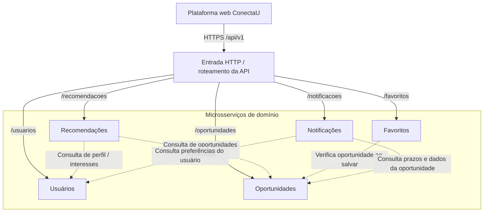

# 4.1 — Decomposição em microsserviços | ConectaU

> **Status:** proposta arquitetural para avaliação acadêmica. Este documento não afirma que os serviços já foram implementados.

## Contexto e objetivo

O **ConectaU** facilita a descoberta, personalização e acompanhamento de oportunidades divulgadas na comunidade da UFLA (eventos, atividades, bolsas, projetos e processos seletivos). Atua como complemento aos canais oficiais, não como substituto. A arquitetura deve permitir que usuários encontrem oportunidades por curso, campus e interesses, salvem oportunidades e recebam avisos sobre prazos.

## Serviços de domínio

| Serviço  | Responsabilidade principal | Dados que controla | O que não faz |
|---|---|---|---|
| **Usuários** (`usuarios-service`) | Gerenciar perfil, curso, campus e interesses | Usuários e preferências | Não publica oportunidades |
| **Oportunidades** (`oportunidades-service`) | Cadastrar, consultar, editar, publicar e encerrar oportunidades | Oportunidades, categorias, prazos e fontes | Não decide quais são mais relevantes para cada usuário |
| **Recomendações** (`recomendacoes-service`) | Produzir lista ordenada de oportunidades aderentes ao perfil | Critérios de pontuação e projeções para recomendação | Não edita oportunidades ou perfis |
| **Favoritos** (`favoritos-service`) | Salvar e remover oportunidades da lista de acompanhamento de cada usuário | Relações usuário–oportunidade | Não controla publicação nem prazos das oportunidades |
| **Notificações** (`notificacoes-service`) | Gerar e controlar avisos de novas oportunidades e prazos | Avisos e estado de leitura | Não é responsável por decidir os dados cadastrais |

**Fronteiras adotadas:** cada serviço corresponde a uma capacidade de negócio com regras e ciclo de evolução próprios (*bounded contexts*). Os serviços usam IDs de outros domínios, em vez de editar seus dados diretamente.

**Por que este corte e não outro?** Um serviço único concentraria publicação, personalização e acompanhamento, aumentando acoplamento. Separar apenas por tecnologias ou operações CRUD fragmentaria regras relacionadas. Recomendações é independente de Oportunidades porque ranking/personalização pode evoluir sem afetar a publicação. Favoritos é independente de Recomendações porque salvar é uma ação explícita do usuário, enquanto recomendar é um cálculo. Notificações é independente porque possui regras próprias de agendamento e leitura. Usuários é dono da fonte de verdade do perfil.

Essa escolha atende à exigência acadêmica de 4+ serviços, mas implica maior custo operacional: para uma implementação inicial pequena, um monólito modular também seria tecnicamente defensável. Neste trabalho, a opção por microsserviços é **proposta de arquitetura**, não alegação de necessidade comprovada de escala.

## Diagrama de componentes e comunicação

**Legenda:** seta contínua = entrada de requisição HTTP; seta tracejada = dependência lógica entre serviços. O componente de entrada é mostrado apenas para contextualizar as chamadas; suas regras detalhadas pertencem ao item 4.3, fora do escopo desta documentação. O desenho não define ainda tecnologia de mensageria, bancos ou BFFs.

## Cenários de comunicação

1. **Explorar oportunidades:** o cliente consulta `GET /api/v1/oportunidades` e recebe oportunidades publicadas, com filtros de campus, categoria, busca textual e prazo.
2. **Receber recomendações:** o cliente consulta `GET /api/v1/recomendacoes?usuarioId={id}`. O serviço de Recomendações usa dados do perfil (Usuários) e oportunidades publicadas (Oportunidades) e retorna a lista ordenada com motivos de relevância.
3. **Salvar oportunidade:** o cliente envia `POST /api/v1/favoritos`. Favoritos valida a existência da oportunidade junto a Oportunidades e registra o vínculo com o usuário autenticado.
4. **Acompanhar prazos:** Notificações identifica avisos de prazo com base em oportunidades e preferências do usuário. A modalidade de atualização dos dados entre serviços ainda será detalhada nas demais partes do projeto; este documento não pressupõe integração implementada.

## Decisões e limites

- Cada serviço é **dono de suas regras e dados**; outros serviços acessam informações por contrato, nunca por consultas diretas às suas tabelas.
- As comunicações interserviços desenhadas acima são **contratos lógicos previstos**. Estratégias assíncronas, armazenamento e consistência pertencem a outras seções do trabalho.
- O ConectaU referencia a **fonte original** da publicação (`fonteUrl`), para preservar a autoridade dos canais institucionais; salvar ou visualizar uma oportunidade não equivale a inscrição oficial.
- Inicialmente são contemplados os campi de **Lavras** e **São Sebastião do Paraíso**.

**Documento complementar:** [4.2 — API REST](4.2-api-rest.md) · [Contrato OpenAPI](openapi.yaml).
