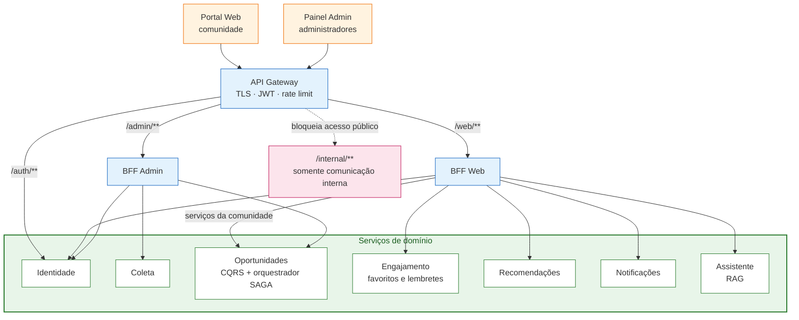

# 4.1 — Decomposição em microsserviços

> **Status:** Proposta arquitetural.

## Decisões de produto que guiam a decomposição

A decomposição parte de cinco decisões de produto. Elas explicam por que não existem serviços de *Inscrições* e *Vagas*:

| Decisão | Consequência arquitetural |
|---|---|
| O ConectaU é uma **camada de descoberta**: a inscrição acontece no canal oficial (link `fonteOficial`) | Não há serviço de inscrições nem de vagas. A transação distribuída do sistema passa a ser o fluxo de **publicação** de uma oportunidade |
| Oportunidades entram por **coleta automática** de eventos da UFLA (palestras, workshops, minicursos) **e** por cadastro manual | Serviço próprio de **Coleta**, com fontes, execuções, deduplicação e fila de curadoria |
| **Não existe usuário publicador.** Quem quer divulgar fala com um **admin** da plataforma, que publica | Apenas dois papéis: `ESTUDANTE` e `ADMIN`. Toda publicação passa por curadoria humana, o que evita oportunidades falsas sem um motor de verificação |
| O cliente da comunidade é **web responsivo** (funciona no celular, sem app de loja) | Dois clientes distintos — Portal Web e Painel Admin — e, portanto, dois BFFs |
| Funcionalidade de LLM: **assistente de editais** (RAG) | Serviço **Assistente** com base vetorial própria, alimentada pela SAGA de publicação |

## Contextos Delimitados

| # | Serviço | Responsabilidade exclusiva | Dados que possui | Banco | O que NÃO deve fazer |
|---|---|---|---|---|---|
| 1 | **Identidade** | Cadastro/login, perfil (curso, campus, vínculo, interesses), papéis `ESTUDANTE`/`ADMIN`, emissão de JWT | `usuarios`, `interesses`, `papeis`, `outbox` | PostgreSQL | Guardar favoritos ou oportunidades |
| 2 | **Coleta** | Fontes cadastradas, execução do coletor, normalização, **deduplicação** e fila de candidatos para curadoria | `fontes`, `execucoes`, `candidatos` (bruto + campos extraídos), `outbox` | MongoDB (documentos heterogêneos) | Publicar por conta própria; apenas sugere candidatos |
| 3 | **Oportunidades** | Catálogo oficial: criar, editar, publicar e encerrar; **orquestrar a SAGA de publicação**; manter o modelo de leitura (CQRS) | Escrita: `oportunidades`, `saga_publicacao`, `outbox`. Leitura: `oportunidades_view` | PostgreSQL (escrita) + OpenSearch (leitura) | Calcular ranking ou enviar avisos |
| 4 | **Engajamento** | Favoritos ("salvar para ver depois") e **lembretes de prazo** configurados pelo usuário | `favoritos`, `lembretes`, `oportunidade_resumo` (cópia via evento) | PostgreSQL | Alterar a oportunidade |
| 5 | **Notificações** | Agendar, enviar (in-app e e-mail) e registrar entregas; janelas de envio | `notificacoes`, `agendamentos`, `tentativas_entrega` | MongoDB + Redis (fila de agendamento) | Decidir sozinho quem é o público-alvo (recebe a lista pronta) |
| 6 | **Recomendações** | Projeção de oportunidades × perfis; ranking personalizado com motivos; público-alvo de uma oportunidade | `projecao_oportunidades`, `projecao_perfis`, `scores` | Redis (scores) + PostgreSQL (projeções) | Ser fonte oficial de oportunidades ou de perfis |
| 7 | **Assistente** | Ingestão de editais na base vetorial, recuperação, geração de respostas, histórico de conversas | `chunks` + embeddings, `conversas`, `cache_respostas` | PostgreSQL + pgvector + Redis (cache) | Gravar em outros serviços; só lê por *tools* |

> **Decisão sobre o orquestrador:** **Oportunidades** é o orquestrador da SAGA de publicação e também o dono do catálogo. Não existe um banco separado "do orquestrador": o estado da SAGA vive na tabela `saga_publicacao`, dentro do banco de Oportunidades.

## Justificativa das fronteiras

- **Coleta × Oportunidades:** dados coletados são *não confiáveis* (duplicados, incompletos, de formato variável); o catálogo contém apenas dados *curados por um admin*. Separar impede que uma falha do coletor polua o catálogo e permite escalar os jobs pesados de coleta de forma independente.
- **Oportunidades × Engajamento:** o catálogo muda pouco e é lido muito; favoritos e lembretes são dados *por usuário*, escritos com frequência. São invariantes e cargas diferentes.
- **Notificações isolado:** absorve falhas de e-mail e novas tentativas sem travar a publicação nem os favoritos.
- **Recomendações isolado:** o algoritmo evolui (de regras para embeddings) sem tocar no catálogo.
- **Assistente isolado:** depende de um provedor remoto caro e falível (LLM); precisa de *circuit breaker*, cache e escala próprios.
- **Identidade isolado:** concentra dados pessoais e permissões, com ciclo de vida e requisitos de proteção próprios.
- **Alternativas descartadas:** um monólito teria menor custo operacional, mas não atenderia aos objetivos da disciplina; um serviço por entidade (ex.: "Favoritos" e "Lembretes" separados) geraria chamadas extras e transações distribuídas sem proteger nenhuma regra de negócio adicional.
- **Trade-off reconhecido:** infraestrutura mais cara, consistência eventual e maior complexidade operacional. Para uma implantação pequena, um monólito modular poderia ser economicamente superior.

## Componentes e comunicação

## Contratos e ownership

- Não há joins SQL entre bancos de serviços; consultas cruzadas são feitas por APIs ou por projeções alimentadas por eventos.
- Os serviços guardam referências (`usuarioId`, `oportunidadeId`, `candidatoId`), nunca chaves estrangeiras interbancos.
- Dados recebidos por eventos são cópias derivadas e podem estar defasados (ver [4.5](4.5-dados-outbox.md)).
- **Exceção de roteamento de autenticação:** `/auth/**` é encaminhado pelo gateway diretamente ao serviço Identidade para cadastro e login; não passa pelos BFFs. O contrato OpenAPI descreve os endpoints lógicos dos serviços (`/api/v1/**`), enquanto os clientes usam as rotas de entrada do gateway e os contratos dos BFFs.
- Endpoint interno não é endpoint público: rotas `/internal/**` (comandos da SAGA, *tools* do assistente e chamadas internas de serviço) exigem identidade de serviço e não são publicadas no gateway.

## Documentos relacionados

| Item | Documento |
|---|---|
| 4.2 — API REST | [`4.2-api-rest.md`](4.2-api-rest.md) · [`openapi.yaml`](openapi.yaml) |
| 4.3 — API Gateway | [`4.3-gateway.md`](4.3-gateway.md) |
| 4.4 — BFF | [`4.4-bff.md`](4.4-bff.md) |
| 4.5 — Dados e outbox | [`4.5-dados-outbox.md`](4.5-dados-outbox.md) |
| 4.6 — SAGA | [`4.6-saga.md`](4.6-saga.md) |
| 4.7 — CQRS | [`4.7-cqrs.md`](4.7-cqrs.md) |
