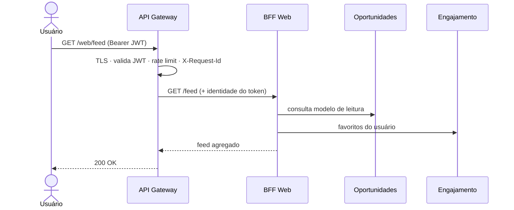

# 4.3 — API Gateway e roteamento

> **Status:** proposta arquitetural da Parte 2. Não implementado.

O API Gateway é o **único ponto de entrada** do ConectaU. Clientes nunca chamam um serviço de domínio diretamente: falam com o gateway, que encaminha a requisição ao BFF correspondente.

## Tecnologia proposta

**Kong** ou **Traefik**. Ambos funcionam como Ingress Controller no Kubernetes, o que evita manter duas camadas distintas de entrada quando a Parte 3 for implantada.

## Regras de roteamento

| Caminho | Destino | Autorização |
|---|---|---|
| `/auth/**` | Identidade (cadastro e login) | Público |
| `/web/**` | BFF Web | JWT válido, exceto nas rotas públicas de consulta |
| `/admin/**` | BFF Admin | JWT válido **com `role=ADMIN`** |
| `/internal/**` | — | **Bloqueado no gateway** |

As rotas `/internal/**` são usadas pelos comandos da SAGA e pelas *tools* do assistente. Elas existem apenas dentro do cluster, autenticadas por identidade de serviço, e nunca são publicadas.

## Responsabilidades

| Responsabilidade | Como é aplicada |
|---|---|
| **Terminação TLS** | Certificado no gateway; tráfego interno do cluster segue em rede privada |
| **Validação de JWT** | O gateway verifica assinatura e expiração usando a chave pública da Identidade e rejeita o que for inválido antes de chegar ao BFF |
| **Autorização de rota** | `role=ADMIN` exigido em todo `/admin/**`; o serviço de destino revalida o papel (defesa em profundidade) |
| **Rate limiting** | Limite geral por token e por IP; limite **mais restrito** em `/web/assistente/**`, porque cada requisição consome crédito de LLM |
| **CORS** | Origens permitidas: domínios do Portal Web e do Painel Admin |
| **Correlação** | Gera `X-Request-Id` quando ausente e propaga em todas as chamadas internas, permitindo rastrear uma publicação ponta a ponta |
| **Logs de acesso** | Método, rota, status, latência e `X-Request-Id`; sem corpo de requisição, para não registrar dados pessoais |

## O que o gateway NÃO faz

- Não agrega respostas de vários serviços — isso é papel do BFF ([4.4](4.4-bff.md)).
- Não aplica regra de negócio nem transforma payload de domínio.
- Não guarda estado de sessão: a autenticação é via JWT, o que mantém o gateway escalável horizontalmente.

## Fluxo de uma requisição

Se o JWT for inválido o gateway responde `401` sem acionar nenhum serviço; se o papel não for `ADMIN` em `/admin/**`, responde `403`.
