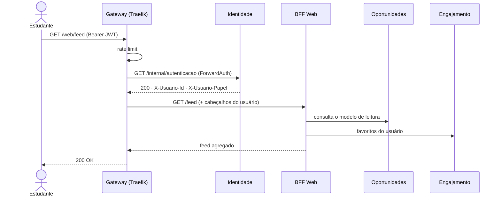

# 4.3 — API Gateway e roteamento

> **Status:** implementado (Parte 3), no Docker Compose e no Kubernetes.

O API Gateway é o **único ponto de entrada** do ConectaU. Clientes nunca chamam um serviço de domínio diretamente: falam com o gateway, que encaminha a requisição à Identidade (login) ou ao BFF correspondente.

## Tecnologia: Traefik

O Traefik foi escolhido porque:

- já é o **Ingress Controller** usado na Parte 3, então o gateway e o Ingress do Kubernetes são a mesma peça, sem duas camadas de entrada;
- roda igual no Docker Compose (configuração por arquivo, em [`dinamico.yml`](../../infrastructure/docker/gateway/dinamico.yml)) e no Kubernetes (Ingress com Middlewares do Traefik, em [`gateway.yaml`](../../infrastructure/kubernetes/gateway.yaml));
- oferece em *middlewares* prontos o que o gateway precisa: `ForwardAuth`, `RateLimit`, `StripPrefix` e `Headers` (CORS).

## Regras de roteamento

| Caminho | Destino | Autorização |
|---|---|---|
| `/auth/**` | Identidade (cadastro e login) | Público |
| `/web/**` | BFF Web | Token opcional; se enviado, precisa ser válido. As rotas pessoais exigem usuário |
| `/admin/**` | BFF Admin | JWT válido **com `role=ADMIN`** |
| `/internal/**` | — | **Sem rota no gateway** |

A rota `/auth/**` é uma exceção deliberada: cadastro e login precisam funcionar antes de existir JWT. As rotas `/internal/**` (comandos da SAGA e verificação de token) existem apenas dentro da rede privada e nunca são publicadas.

## Responsabilidades

| Responsabilidade | Como é aplicada no Traefik |
|---|---|
| **Validação de JWT** | Middleware `ForwardAuth`: antes de encaminhar, o Traefik chama `GET /internal/autenticacao` na Identidade. A Identidade verifica assinatura e expiração e responde `200` com `X-Usuario-Id` e `X-Usuario-Papel`, ou `401`. Token inválido não chega ao BFF |
| **Autorização de rota** | Em `/admin/**`, o `ForwardAuth` usa `/internal/autenticacao?papel=ADMIN`, que responde `403` para outros papéis. O BFF e o serviço revalidam o papel (defesa em profundidade) |
| **Proteção contra cabeçalho forjado** | Os cabeçalhos `X-Usuario-*` são sempre sobrescritos pela resposta do `ForwardAuth`; um cliente não consegue se passar por outro usuário enviando-os |
| **Rate limiting** | Middleware `RateLimit`: limite geral por IP e limite **mais restrito** em `/web/conversas/**`, porque cada pergunta consome crédito de LLM |
| **Roteamento por prefixo** | `StripPrefix` remove `/web` e `/admin` antes de chegar ao BFF |
| **CORS** | Middleware `Headers`: origens permitidas são o Portal Web e o Painel Admin |
| **Correlação** | O gateway repassa `X-Request-Id`; quando ausente, o BFF gera e propaga em todas as chamadas internas, permitindo rastrear uma publicação ponta a ponta |
| **Logs de acesso** | Método, rota, status e latência; sem corpo de requisição, para não registrar dados pessoais |
| **TLS** | Terminação no gateway em produção; no ambiente local de demonstração, HTTP |

## O que o gateway NÃO faz

- Não agrega respostas de vários serviços — isso é papel do BFF ([4.4](4.4-bff.md)).
- Não aplica regra de negócio nem transforma payload de domínio.
- Não guarda estado de sessão: a autenticação é via JWT, o que mantém o gateway escalável horizontalmente.

## Fluxo de uma requisição

Se o JWT for inválido, a Identidade responde `401` ao `ForwardAuth` e o gateway devolve `401` sem acionar o BFF; se o papel não for `ADMIN` em `/admin/**`, devolve `403`.
