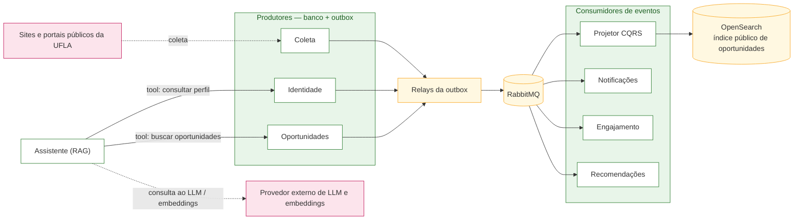

# 4.5 — Database per service, consistência eventual e outbox

> **Status:** proposta arquitetural da Parte 2. Não implementado.

## 1. Database per service

Cada serviço tem **instância própria** de banco (um container, ou um StatefulSet com PVC na Parte 3). Nenhum serviço lê o banco de outro, e não existe join entre bancos: toda cópia local de dado alheio chega por evento.

| Serviço | Banco | Por quê |
|---|---|---|
| Identidade | PostgreSQL | Dados relacionais com integridade forte |
| Coleta | MongoDB | Documentos heterogêneos: cada fonte devolve um formato diferente |
| Oportunidades | PostgreSQL (escrita) + OpenSearch (leitura) | Regras de negócio na escrita, busca textual na leitura ([4.7](4.7-cqrs.md)) |
| Engajamento | PostgreSQL | Relações usuário × oportunidade, escrita frequente |
| Notificações | MongoDB + Redis | Histórico flexível + fila de agendamento |
| Recomendações | PostgreSQL + Redis | Projeções persistidas + scores voláteis |
| Assistente | PostgreSQL + pgvector + Redis | Chunks e embeddings no mesmo banco + cache de respostas |

## 2. Pontos de consistência eventual

| Dado copiado | Origem → destino | Defasagem aceitável |
|---|---|---|
| Oportunidade publicada/editada/encerrada | Oportunidades → Recomendações e Engajamento (`oportunidade_resumo`) | segundos |
| Perfil e interesses | Identidade → Recomendações | segundos |
| Modelo de leitura (CQRS) | Escrita → OpenSearch | ≤ 5 s |
| Prazo alterado | Oportunidades → Engajamento (reagenda lembretes) | ≤ 1 min |

Consequência assumida: por alguns segundos, o feed pode exibir uma versão anterior de uma oportunidade recém-editada. É aceitável porque o ConectaU é uma camada de descoberta — o dado definitivo está sempre no link `fonteOficial`.

## 3. Risco de dual write

*Dual write* é gravar no banco **e** publicar um evento como duas operações separadas: se a segunda falhar, os dois lados ficam divergentes e ninguém percebe.

| Onde ocorre | Risco | Tratamento |
|---|---|---|
| Oportunidades grava no Postgres **e** publica `OportunidadePublicada` | Gravar sem publicar (ninguém é avisado) ou publicar e dar rollback (evento fantasma) | **Outbox** |
| Coleta salva candidato **e** publica `CandidatoColetado` para avisar os administradores | Aviso perdido ou candidato não sinalizado para curadoria | **Outbox**; o BFF Admin consulta a fila pela API de Coleta |
| Identidade altera interesses **e** avisa Recomendações | Recomendação desatualizada | **Outbox** |
| Assistente grava chunks **e** confirma à SAGA | Confirmação sem índice correspondente | Resposta síncrona idempotente por `sagaId` |

## Diagrama — mensageria e integrações externas

Este diagrama mostra os principais produtores e consumidores de eventos. O fluxo de outbox continua detalhado logo abaixo.



### Como explicar o diagrama

- Cada produtor grava o evento na própria outbox junto com a alteração de negócio; um relay publica depois no RabbitMQ.
- Os consumidores recebem apenas os eventos de que precisam e devem ser idempotentes, porque uma mensagem pode ser entregue mais de uma vez.
- O Projetor CQRS atualiza o índice OpenSearch usado pela busca. O índice público deve conter somente oportunidades `PUBLICADA`.
- A Coleta obtém candidatos de fontes públicas, mas eles só entram no catálogo após curadoria administrativa. O evento `CandidatoColetado` pode disparar um aviso aos ADMINs; a fila de curadoria em si é consultada pelo BFF Admin na API de Coleta.
- O Assistente RAG é diferente do Projetor CQRS: ele prepara conteúdo para responder perguntas sobre editais, enquanto o projetor mantém o índice de busca das oportunidades.

## 4. Transactional Outbox

O evento é gravado **na mesma transação** do dado de negócio, numa tabela `outbox` do próprio serviço. Um processo *relay* lê essa tabela e publica no RabbitMQ. Como gravação e registro do evento são atômicos, não existe estado em que um aconteceu e o outro não.

### Detalhe técnico — ciclo de uma mensagem da outbox

```mermaid
sequenceDiagram
  participant OP as Oportunidades
  participant DB as PostgreSQL (OP)
  participant R as Relay (poller)
  participant MQ as RabbitMQ
  participant RE as Recomendações
  OP->>DB: BEGIN; UPDATE oportunidades SET status='PUBLICADA';<br/>INSERT outbox(evento=OportunidadePublicada); COMMIT
  loop a cada 1s
    R->>DB: SELECT * FROM outbox WHERE enviado_em IS NULL FOR UPDATE SKIP LOCKED
    R->>MQ: publish (messageId = outbox.id)
    R->>DB: UPDATE outbox SET enviado_em = now()
  end
  MQ->>RE: OportunidadePublicada
  RE->>RE: ignora se messageId já processado
```

### Preparação e ativação de avisos na SAGA

Durante a SAGA, Oportunidades solicita a Recomendações o público-alvo e chama Notificações para **preparar agendamentos pendentes** identificados por `sagaId`. Esses agendamentos ainda não enviam avisos. Quando `OportunidadePublicada` chega pela Outbox, Notificações ativa os agendamentos preparados; se não houver preparação (por exemplo, durante recuperação ou reprocessamento), cria-os de forma idempotente usando a chave de negócio `oportunidadeId + tipoAviso + destinatarioId`. Assim, a etapa da SAGA não duplica os avisos que o consumidor do evento ativa.

### Entrega e idempotência

A entrega é **at-least-once**: se o relay publicar e falhar antes de marcar `enviado_em`, o mesmo evento será publicado de novo. Por isso todo consumidor é **idempotente** — registra o `messageId` numa tabela `mensagens_processadas` e descarta o que já viu.

### Eventos previstos

| Evento | Publicado por | Consumido por |
|---|---|---|
| `UsuarioCriado`, `InteressesAlterados` | Identidade | Recomendações |
| `CandidatoColetado` | Coleta | Notificações (aviso aos ADMINs); o BFF Admin consulta os candidatos pela API de Coleta |
| `OportunidadeCriada` | Oportunidades | projetor CQRS (mantém fora do índice público até a publicação) |
| `OportunidadePublicada` | Oportunidades | Recomendações, Engajamento, Notificações, projetor do CQRS |
| `OportunidadeEditada`, `OportunidadeEncerrada` | Oportunidades | Engajamento (reagendar/remover lembretes), Recomendações e projetor do CQRS |
| `LembreteVencendo` | Engajamento | Notificações |

## 5. Falhas e recuperação

- **Mensagem envenenada:** após N tentativas, vai para uma *dead letter queue* e gera alerta; não bloqueia a fila.
- **RabbitMQ indisponível:** os eventos ficam acumulados na `outbox` e são publicados quando o broker volta, desde que a persistência e o relay sejam recuperados. O monitoramento alerta sobre acúmulo prolongado.
- **Consumidor fora do ar:** a fila retém as mensagens; ao voltar, ele processa o atraso.
