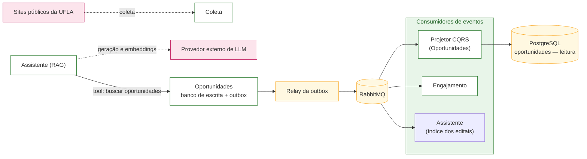

# 4.5 — Database per service, consistência eventual e outbox

> **Status:** arquitetura revisada (ver [4.1](4.1-microsservicos.md)). Implementado (Parte 3).

## 1. Database per service

Cada serviço tem **instância própria** de banco (um container no Compose; um StatefulSet com PersistentVolumeClaim no Kubernetes). Nenhum serviço lê o banco de outro, e não existe `JOIN` entre bancos: toda cópia local de dado alheio chega por evento ou por chamada de API.

O porquê dessa decisão — e do container por serviço — está detalhado em [Por que um banco e um container por serviço](decisoes-isolamento.md). Em resumo: o esquema de cada banco fica privado, uma falha ou sobrecarga num banco não derruba os outros serviços, e cada serviço usa a tecnologia que combina com o seu dado.

| Serviço | Banco | Instância | Por que esta tecnologia |
|---|---|---|---|
| Identidade | PostgreSQL | `identidade-db` | Dados relacionais com integridade forte (e-mail único); dados pessoais isolados dos demais serviços |
| Coleta | MongoDB | `coleta-db` | Cada fonte devolve um formato diferente; o candidato guarda o conteúdo bruto e os campos extraídos sem migração a cada fonte nova |
| Oportunidades — escrita | PostgreSQL | `oportunidades-db` | Transações: mudança de status, estado da SAGA e outbox no mesmo `COMMIT` |
| Oportunidades — leitura | PostgreSQL | `oportunidades-leitura-db` | Tabela desnormalizada com busca textual, escrita apenas pelo projetor ([4.7](4.7-cqrs.md)) |
| Engajamento | PostgreSQL | `engajamento-db` | Relações usuário × oportunidade com unicidade (favorito duplicado é `409`) |
| Assistente | PostgreSQL + pgvector | `assistente-db` | Texto dos chunks e embeddings no mesmo lugar, com busca por similaridade; cache de respostas em tabela |

**Total: 6 instâncias, de 2 tecnologias** (5 PostgreSQL, uma delas com a extensão pgvector, e 1 MongoDB). Limitar a duas tecnologias mantém a operação ao alcance do grupo; o MongoDB fica onde o formato variável dos dados realmente pede um banco de documentos.

## 2. Pontos de consistência eventual

| Dado copiado | Origem → destino | Mecanismo | Defasagem aceitável |
|---|---|---|---|
| Oportunidade publicada, editada ou encerrada | Oportunidades (escrita) → Oportunidades (leitura) | Evento + projetor | ≤ 5 s |
| Título e prazo da oportunidade | Oportunidades → Engajamento (`oportunidade_resumo`) | Evento | segundos |
| Prazo alterado | Oportunidades → Engajamento (reagenda lembretes e avisa quem favoritou) | `OportunidadeEditada` | ≤ 1 min |
| Oportunidade encerrada | Oportunidades → Engajamento (cancela lembretes e avisa quem favoritou) | `OportunidadeEncerrada` | ≤ 1 min |
| Estado do candidato durante a publicação | Coleta ↔ Oportunidades | Comandos da SAGA ([4.6](4.6-saga.md)) | até a SAGA terminar (segundos) |

**Consequência assumida:** por alguns segundos, o feed pode exibir uma versão anterior de uma oportunidade recém-editada. É aceitável porque o ConectaU é uma camada de descoberta — o dado definitivo está sempre no link `fonteOficial`.

## 3. Risco de dual write

*Dual write* é gravar no banco **e** avisar outro sistema como duas operações separadas: se a segunda falhar, os dois lados divergem e ninguém percebe.

| Onde ocorre | Risco | Tratamento |
|---|---|---|
| Oportunidades muda o status **e** publica `OportunidadePublicada` | Gravar sem publicar (modelo de leitura nunca é atualizado) ou publicar e dar rollback (evento fantasma) | **Transactional Outbox** |
| Orquestrador grava o estado da SAGA **e** chama um participante | Chamada feita sem o estado gravado, ou o contrário | Estado do passo gravado antes e depois da chamada; comandos idempotentes por `sagaId`; o worker retoma do último passo gravado |
| Assistente grava chunks **e** responde à SAGA | Resposta perdida por timeout com os chunks já gravados | `PUT` idempotente; em timeout, o orquestrador também envia a compensação (`DELETE` idempotente) |
| Engajamento recebe um evento **e** atualiza a cópia | Evento processado duas vezes | Consumidor idempotente com a tabela `mensagens_processadas` |

Identidade e Coleta **não publicam eventos** nesta versão; por isso não têm dual write.

## Diagrama — mensageria e integrações externas



- Oportunidades grava o evento na própria outbox junto com a alteração de negócio; o relay publica depois no RabbitMQ.
- Os consumidores são idempotentes, porque uma mensagem pode ser entregue mais de uma vez.
- O projetor do CQRS atualiza o modelo de leitura, que contém somente oportunidades `PUBLICADA`.
- A Coleta obtém candidatos de fontes públicas, mas eles só entram no catálogo após curadoria administrativa.

## 4. Transactional Outbox

O evento é gravado **na mesma transação** do dado de negócio, numa tabela `outbox` do próprio serviço. Um processo *relay* lê essa tabela e publica no RabbitMQ. Como a gravação e o registro do evento são atômicos, não existe estado em que um aconteceu e o outro não.

### Ciclo de uma mensagem da outbox

```mermaid
sequenceDiagram
  participant OP as Oportunidades
  participant DB as PostgreSQL (escrita)
  participant R as Relay
  participant MQ as RabbitMQ
  participant PR as Projetor CQRS
  OP->>DB: BEGIN; UPDATE oportunidades SET status='PUBLICADA';<br/>INSERT outbox(evento=OportunidadePublicada); COMMIT
  loop a cada 1 s
    R->>DB: SELECT * FROM outbox WHERE enviado_em IS NULL FOR UPDATE SKIP LOCKED
    R->>MQ: publish (messageId = outbox.id)
    R->>DB: UPDATE outbox SET enviado_em = now()
  end
  MQ->>PR: OportunidadePublicada
  PR->>PR: ignora se messageId já processado
```

### Entrega e idempotência

A entrega é **at-least-once**: se o relay publicar e falhar antes de marcar `enviado_em`, o mesmo evento será publicado de novo. Por isso todo consumidor é **idempotente** — registra o `messageId` numa tabela `mensagens_processadas` e descarta o que já viu.

### Eventos

| Evento | Publicado por | Consumido por |
|---|---|---|
| `OportunidadePublicada` | Oportunidades | Projetor CQRS, Engajamento |
| `OportunidadeEditada` | Oportunidades | Projetor CQRS, Engajamento (reagenda lembretes), Assistente (reindexa o edital) |
| `OportunidadeEncerrada` | Oportunidades | Projetor CQRS (remove do modelo de leitura), Engajamento (cancela lembretes), Assistente (tira o edital do índice) |

Todo evento carrega `messageId`, `oportunidadeId`, `versao` e `ocorridoEm`. A `versao` permite descartar eventos fora de ordem; o `ocorridoEm` permite medir a defasagem do modelo de leitura.

## 5. Falhas e recuperação

- **Mensagem envenenada:** após 3 tentativas, vai para uma *dead letter queue*; não bloqueia a fila.
- **RabbitMQ indisponível:** os eventos ficam acumulados na `outbox` e são publicados quando o broker volta.
- **Consumidor fora do ar:** a fila retém as mensagens; ao voltar, ele processa o atraso.
- **Modelo de leitura perdido ou corrompido:** é reconstruído do zero a partir do banco de escrita ([4.7](4.7-cqrs.md)).
