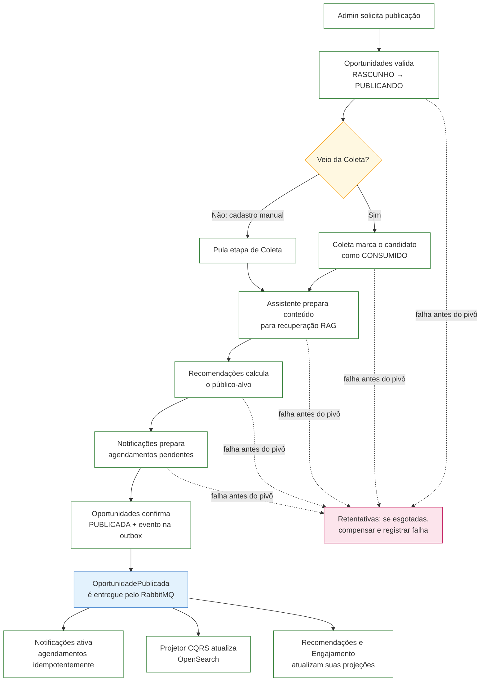

# 4.6 — SAGA: publicação de oportunidade

> **Status:** proposta arquitetural da Parte 2. Não implementado.

## 1. Qual é a transação distribuída

Como o ConectaU **não faz inscrição** — o usuário se inscreve no canal oficial, pelo link `fonteOficial` —, a transação de negócio que atravessa serviços não é a candidatura, e sim **tornar uma oportunidade pública**.

Uma oportunidade só deve aparecer como publicada se, ao mesmo tempo:

1. o candidato que a originou foi consumido na Coleta (trava contra publicação duplicada);
2. o Assistente conseguiu indexá-la (senão o estudante pergunta e não há resposta);
3. os avisos ao público-alvo foram agendados.

A SAGA coordena os participantes para que uma falha não deixe um resultado parcial permanente. Durante o processamento, estados intermediários como `PUBLICANDO` podem existir; em caso de falha, há novas tentativas e compensações. Participam **5 serviços**: Oportunidades (orquestrador), Coleta (quando há candidato), Assistente, Recomendações (calcula o público-alvo) e Notificações (prepara os avisos).

## 2. Variante escolhida: SAGA orquestrada

O orquestrador vive **dentro do serviço Oportunidades**, com o estado na tabela `saga_publicacao`.

| Por que orquestrada | Por que não coreografada |
|---|---|
| Fluxo linear, com ordem de compensação explícita | Com vários participantes, a lógica ficaria espalhada em handlers de eventos, difícil de rastrear |
| O admin precisa ver o **estado da publicação** no painel | Não haveria um lugar único com o estado da transação |
| Facilita provocar e demonstrar a falha | Risco de ciclos de eventos |

**Custo aceito:** o orquestrador fica acoplado aos contratos dos participantes. É mitigado porque os comandos são poucos, versionados e expostos apenas em `/internal/**`.

## 3. Passos e compensações

| # | Serviço | Ação | Compensação |
|---|---|---|---|
| 1 | Oportunidades | Inicia a publicação de uma oportunidade em `RASCUNHO`, mudando-a para `PUBLICANDO` | Volta para `RASCUNHO` e registra `FALHA_PUBLICACAO` |
| 2 | Coleta | Marca o candidato como `CONSUMIDO` | Volta o candidato para `PENDENTE` |
| 3 | Assistente | Indexa descrição/edital (chunks + embeddings) | Remove os chunks da oportunidade |
| 4 | Recomendações + Notificações | Recomendações calcula o público-alvo; Notificações prepara agendamentos **pendentes**, identificados por `sagaId` | Cancela os agendamentos pendentes |
| 5 | Oportunidades | `PUBLICADA` + evento pela outbox (**pivô**, sem volta) | — |

- O passo 2 é **pulado** quando a oportunidade é cadastrada manualmente (não há candidato).
- O fluxo descrito é exclusivamente `RASCUNHO → PUBLICANDO → PUBLICADA`. Edições e encerramentos de oportunidades já publicadas são fluxos separados; uma compensação nunca rebaixa uma oportunidade previamente publicada para `RASCUNHO`.
- Os avisos preparados pela SAGA não são enviados imediatamente. O evento `OportunidadePublicada`, emitido pelo pivô via Outbox, ativa os agendamentos pendentes; Notificações usa `sagaId` e chaves idempotentes para evitar duplicação.
- Todos os comandos são **idempotentes por `sagaId`**: reexecutar um passo não duplica efeito.
- O passo 5 é o **pivô**: depois dele a transação é irreversível; uma retirada posterior é um novo fluxo (encerramento), não compensação.

## 4. Diagrama — fluxo de publicação

O diagrama resume o caminho feliz e indica o que acontece se uma etapa falhar antes da publicação. Os detalhes de idempotência, retentativas e compensações estão descritos nas seções anteriores.

### Como explicar o diagrama

- Oportunidades coordena o fluxo e mantém o estado da SAGA.
- Se a oportunidade veio da Coleta, o candidato é marcado como consumido; no cadastro manual, essa etapa é pulada.
- Antes do pivô, o Assistente prepara o conteúdo para RAG, Recomendações calcula o público-alvo e Notificações prepara os agendamentos sem enviar avisos ainda.
- O pivô é a confirmação `PUBLICADA` com o evento registrado na outbox. Depois disso, uma falha de consumidor é resolvida por retentativa/reprocessamento; não se compensa a publicação voltando para rascunho.
- O evento ativa os agendamentos e atualiza as projeções, incluindo o índice OpenSearch do CQRS.
- Se uma etapa falhar antes do pivô e as retentativas se esgotarem, Oportunidades compensa as etapas já concluídas em ordem reversa. Por exemplo, pode liberar o candidato para voltar a `PENDENTE` e remover os chunks preparados no Assistente.

## 5. Exemplo de falha com compensação

Se o provedor de embeddings ficar indisponível, Oportunidades tenta novamente com backoff. Se as tentativas se esgotarem antes do pivô, a SAGA desfaz as etapas já concluídas: remove os chunks preparados no Assistente, libera o candidato da Coleta quando houver um e registra a publicação como compensada. O painel informa ao administrador que a publicação falhou. A oportunidade permanece em `RASCUNHO` porque ainda não chegou ao estado `PUBLICADA`.

## 6. Estados da SAGA

| Estado | Significado |
|---|---|
| `INICIADA` | Registro criado, passo 1 concluído |
| `EM_ANDAMENTO` | Executando os passos da SAGA antes do pivô |
| `COMPENSANDO` | Um passo falhou; desfazendo os anteriores |
| `COMPENSADA` | Compensação concluída; oportunidade de volta a `RASCUNHO` |
| `CONCLUIDA` | Passo pivô executado; oportunidade `PUBLICADA` |
| `FALHA_COMPENSACAO` | A própria compensação falhou; exige intervenção manual e gera alerta |
