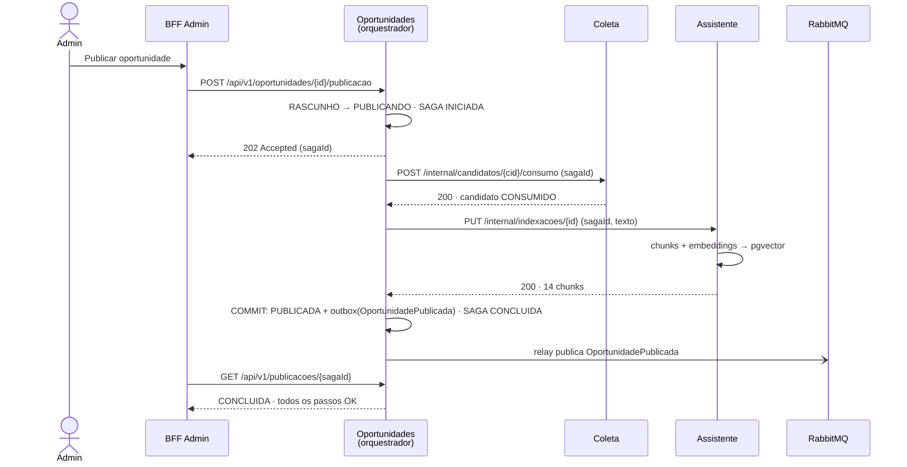
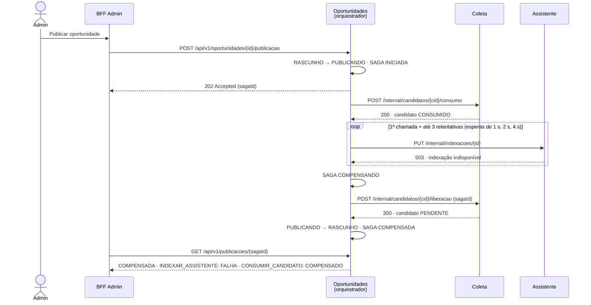

# 4.6 — SAGA: publicação de oportunidade

> **Status:** arquitetura revisada (ver [4.1](4.1-microsservicos.md)). Implementado (Parte 3).

## 1. Qual é a transação distribuída

Como o ConectaU **não faz inscrição** — o usuário se inscreve no canal oficial, pelo link `fonteOficial` —, a transação de negócio que atravessa serviços é **tornar uma oportunidade pública**.

Uma oportunidade só pode aparecer como publicada se:

1. o candidato que a originou foi **consumido** na Coleta — trava contra publicar o mesmo candidato duas vezes;
2. o Assistente conseguiu **indexá-la** — senão o estudante clica em "perguntar" e o assistente não sabe nada sobre ela.

Participam **3 serviços**: Oportunidades (orquestrador e dono do passo final), Coleta e Assistente. Como toda oportunidade nasce de um candidato, inclusive no cadastro manual ([4.1](4.1-microsservicos.md)), os três participam de **toda** publicação.

## 2. Variante escolhida: SAGA orquestrada

| Por que orquestrada | Por que não coreografada |
|---|---|
| Fluxo linear, com ordem de compensação explícita | A lógica ficaria espalhada em handlers de eventos nos três serviços, difícil de rastrear |
| O admin precisa ver o **estado da publicação** no painel | Não haveria um lugar único com o estado da transação |
| Facilita provocar e demonstrar a falha | Risco de ciclos de eventos e de compensações disparadas em duplicidade |

**Onde vive o orquestrador:** dentro do serviço **Oportunidades**, com o estado nas tabelas `saga_publicacao` e `saga_passos`. O status da oportunidade e o estado da SAGA mudam juntos, na mesma transação local. Um orquestrador separado, com banco próprio, precisaria sincronizar esses dois estados entre bancos — uma nova transação distribuída só para coordenar a primeira.

**Custo aceito:** o orquestrador fica acoplado aos contratos dos participantes. É mitigado porque os comandos são poucos, idempotentes e expostos apenas em `/internal/**` ([4.2](4.2-api-rest.md)).

## 3. Passos e compensações

| # | Serviço | Comando | Compensação |
|---|---|---|---|
| 1 | Oportunidades (local) | `RASCUNHO → PUBLICANDO`; cria a SAGA em `INICIADA` | `PUBLICANDO → RASCUNHO`; SAGA em `COMPENSADA` |
| 2 | Coleta | `POST /internal/candidatos/{id}/consumo` → candidato `CONSUMIDO` | `POST /internal/candidatos/{id}/liberacao` → candidato `PENDENTE` |
| 3 | Assistente | `PUT /internal/indexacoes/{oportunidadeId}` → chunks + embeddings | `DELETE /internal/indexacoes/{oportunidadeId}` → remove os chunks |
| 4 | Oportunidades (local) | `PUBLICADA` + evento `OportunidadePublicada` na outbox, no mesmo `COMMIT` (**pivô**) | — |

### Regras

- **Idempotência:** todo comando recebe o `sagaId`; repetir um comando já aplicado devolve o mesmo resultado sem duplicar efeito.
- **Retentativas:** além da primeira chamada, até 3 retentativas por passo, com backoff exponencial (esperas de 1 s, 2 s e 4 s) e timeout de 10 s por chamada. Os valores são configuráveis (`SAGA_RETENTATIVAS`, `SAGA_ESPERA_INICIAL_MS`, `SAGA_TIMEOUT_MS`). Erros de negócio — por exemplo, `409` porque o candidato já foi consumido por outra publicação — **não** são retentados.
- **Compensação:** esgotadas as tentativas, o orquestrador compensa **em ordem reversa** os passos já concluídos.
- **Resultado incerto:** se o passo falhou por **timeout**, ele pode ter sido aplicado sem que a resposta chegasse. Nesse caso, o orquestrador compensa também o passo que falhou — as compensações são idempotentes, então desfazer algo que não aconteceu é inofensivo. Erros como `503` ou conexão recusada indicam que nada foi aplicado.
- **Compensação que falha:** é retentada; se as tentativas se esgotarem, a SAGA vai para `FALHA_COMPENSACAO` e exige intervenção manual.
- **Pivô:** depois do passo 4 a publicação é irreversível. Uma retirada posterior é um novo fluxo (encerramento), não uma compensação.
- **Retomada:** como o estado de cada passo é gravado no banco, se o container de Oportunidades reiniciar no meio da SAGA, o worker retoma do último passo registrado. Com várias réplicas, cada SAGA é reservada com `FOR UPDATE SKIP LOCKED`, e nenhuma é executada duas vezes ao mesmo tempo.
- Edição e encerramento de oportunidades já publicadas são fluxos separados; uma compensação nunca rebaixa uma oportunidade já publicada.

## 4. Diagrama de sequência — caminho feliz

## 5. Diagrama de sequência — falha com compensação

**Cenário:** o Assistente está indisponível (container ou pod fora do ar, ou falha ao gerar os embeddings). O candidato já foi consumido no passo 2 e precisa ser devolvido à fila.

Como o pivô não foi alcançado, **nenhum evento é publicado**: a oportunidade não aparece no modelo de leitura e o candidato volta à fila de curadoria, pronto para uma nova tentativa.

**Outro cenário de falha:** se o candidato já tiver sido consumido por outra publicação, a Coleta responde `409` no passo 2. Erro de negócio não é retentado; o orquestrador compensa apenas o passo 1, e a oportunidade volta para `RASCUNHO`.

## 6. Como provocar a falha na demonstração

| Ambiente | Comando |
|---|---|
| Kubernetes | `kubectl scale deployment assistente -n conectau --replicas=0`, publicar, depois voltar para `--replicas=1` |
| Docker Compose | `docker compose stop assistente`, publicar, depois `docker compose start assistente` |
| Falha controlada | Variável `SIMULAR_FALHA_INDEXACAO=true` no Assistente faz o `PUT` responder `503` |

O Painel Admin mostra os passos da SAGA mudando de estado durante a demonstração.

## 7. Estados

**Estados da SAGA:**

| Estado | Significado |
|---|---|
| `INICIADA` | Registro criado, passo 1 concluído |
| `EM_ANDAMENTO` | Executando os passos 2 e 3 |
| `COMPENSANDO` | Um passo falhou; desfazendo os anteriores |
| `COMPENSADA` | Compensação concluída; oportunidade de volta a `RASCUNHO` |
| `CONCLUIDA` | Pivô executado; oportunidade `PUBLICADA` |
| `FALHA_COMPENSACAO` | A própria compensação falhou; exige intervenção manual |

**Estados de cada passo:** `PENDENTE`, `OK`, `FALHA` e `COMPENSADO`.
