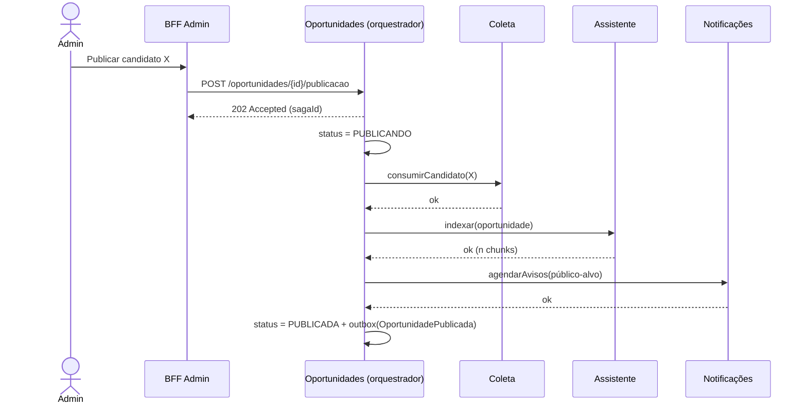
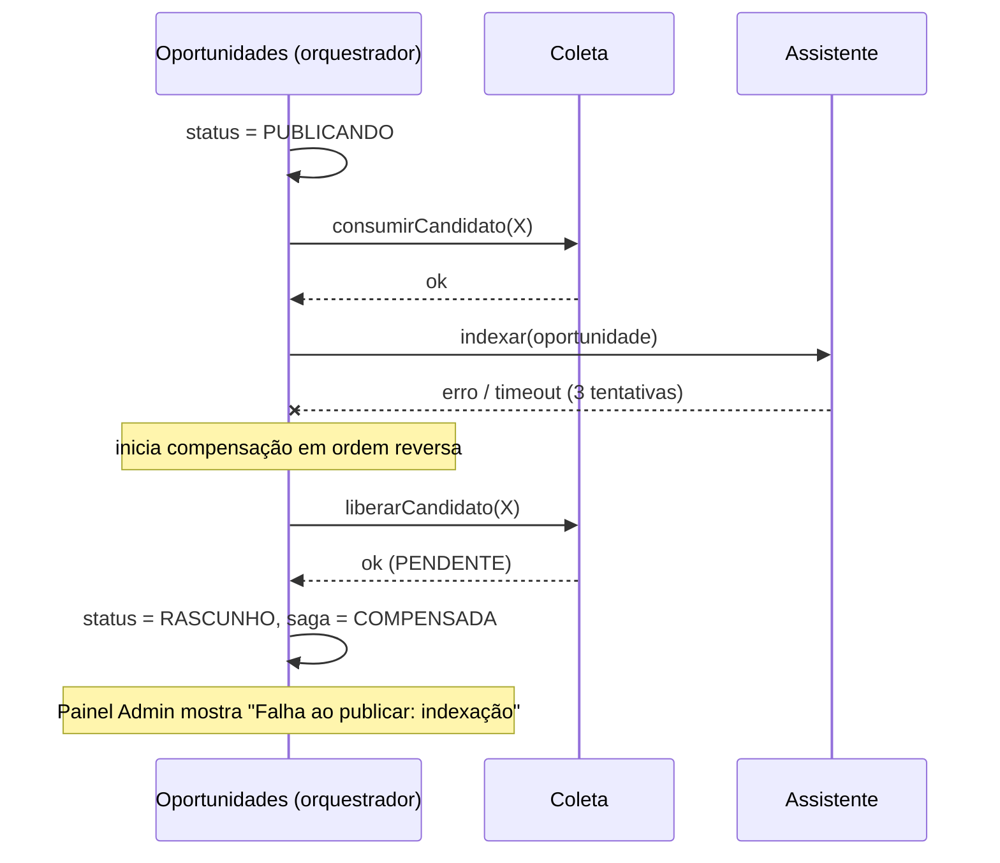

# 4.6 — SAGA: publicação de oportunidade

> **Status:** proposta arquitetural da Parte 2. Não implementado.

## 1. Qual é a transação distribuída

Como o ConectaU **não faz inscrição** — o usuário se inscreve no canal oficial, pelo link `fonteOficial` —, a transação de negócio que atravessa serviços não é a candidatura, e sim **tornar uma oportunidade pública**.

Uma oportunidade só deve aparecer como publicada se, ao mesmo tempo:

1. o candidato que a originou foi consumido na Coleta (trava contra publicação duplicada);
2. o Assistente conseguiu indexá-la (senão o estudante pergunta e não há resposta);
3. os avisos ao público-alvo foram agendados.

Se qualquer etapa falhar, nada pode ficar pela metade. São **4 serviços** envolvidos (Oportunidades, Coleta, Assistente, Notificações — com Recomendações fornecendo o público-alvo), acima do mínimo de 3.

## 2. Variante escolhida: SAGA orquestrada

O orquestrador vive **dentro do serviço Oportunidades**, com o estado na tabela `saga_publicacao`.

| Por que orquestrada | Por que não coreografada |
|---|---|
| Fluxo linear, com ordem de compensação explícita | Com 4 participantes, a lógica ficaria espalhada em handlers de eventos, difícil de rastrear |
| O admin precisa ver o **estado da publicação** no painel | Não haveria um lugar único com o estado da transação |
| Facilita provocar e demonstrar a falha | Risco de ciclos de eventos |

**Custo aceito:** o orquestrador fica acoplado aos contratos dos participantes. É mitigado porque os comandos são poucos, versionados e expostos apenas em `/internal/**`.

## 3. Passos e compensações

| # | Serviço | Ação | Compensação |
|---|---|---|---|
| 1 | Oportunidades | Cria/atualiza a oportunidade com status `PUBLICANDO` | Volta para `RASCUNHO` e registra `FALHA_PUBLICACAO` |
| 2 | Coleta | Marca o candidato como `CONSUMIDO` | Volta o candidato para `PENDENTE` |
| 3 | Assistente | Indexa descrição/edital (chunks + embeddings) | Remove os chunks da oportunidade |
| 4 | Recomendações → Notificações | Calcula o público-alvo e **agenda** os avisos | Cancela os agendamentos |
| 5 | Oportunidades | `PUBLICADA` + evento pela outbox (**pivô**, sem volta) | — |

- O passo 2 é **pulado** quando a oportunidade é cadastrada manualmente (não há candidato).
- Todos os comandos são **idempotentes por `sagaId`**: reexecutar um passo não duplica efeito.
- O passo 5 é o **pivô**: depois dele a transação é irreversível; uma retirada posterior é um novo fluxo (encerramento), não compensação.

## 4. Caminho feliz

A resposta é `202 Accepted` com um `sagaId`: o admin acompanha o andamento em `GET /api/v1/publicacoes/{sagaId}`.

## 5. Falha com compensação

Cenário demonstrável: o **provedor de embeddings fica indisponível**. O orquestrador tenta novamente com backoff; esgotadas as tentativas, compensa em ordem reversa.

Resultado: nenhum estudante viu uma oportunidade sem suporte do assistente, nenhum aviso foi enviado, e o candidato voltou à fila de curadoria para nova tentativa.

## 6. Estados da SAGA

| Estado | Significado |
|---|---|
| `INICIADA` | Registro criado, passo 1 concluído |
| `EM_ANDAMENTO` | Executando os passos 2 a 4 |
| `COMPENSANDO` | Um passo falhou; desfazendo os anteriores |
| `COMPENSADA` | Compensação concluída; oportunidade de volta a `RASCUNHO` |
| `CONCLUIDA` | Passo pivô executado; oportunidade `PUBLICADA` |
| `FALHA_COMPENSACAO` | A própria compensação falhou; exige intervenção manual e gera alerta |
