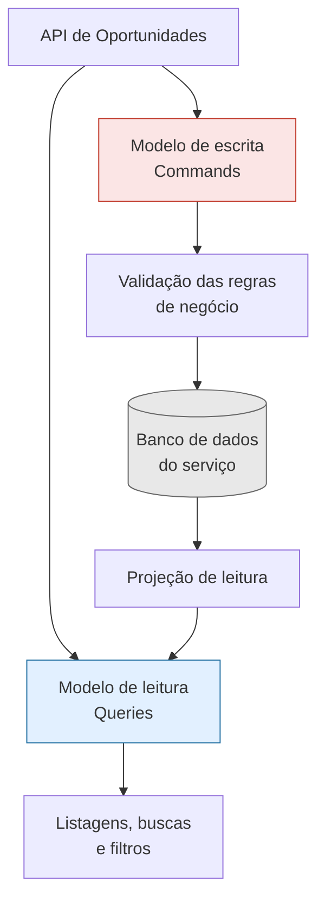
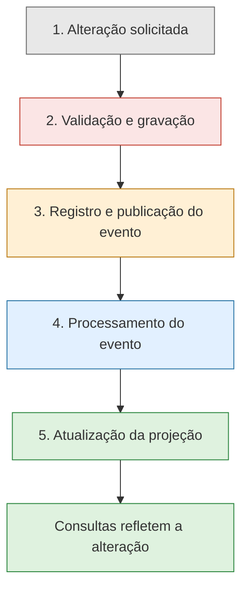

# 4.7 — CQRS no ConectaU

> **Status:** Proposta arquitetural — padrão ainda não implementado.

O CQRS (*Command Query Responsibility Segregation*) é um padrão arquitetural que separa as operações que modificam dados das operações que consultam dados.

No ConectaU, esse padrão será aplicado ao **serviço de oportunidades (`oportunidades-service`)**, responsável pelo cadastro, gerenciamento e consulta das oportunidades disponíveis para a comunidade acadêmica.

## 1. Por que utilizar CQRS?

A plataforma precisa lidar com dois tipos de operação:

- **Escrita:** cadastrar, editar, publicar e encerrar oportunidades.
- **Leitura:** pesquisar, filtrar, ordenar e consultar oportunidades.

Essas operações possuem necessidades diferentes. A escrita precisa validar regras de negócio e preservar a integridade dos dados, enquanto a leitura deve facilitar consultas frequentes e eficientes.

A separação permite otimizar cada modelo de acordo com sua responsabilidade.

## 2. Separação dos modelos

### Modelo de escrita — Commands

Responsável pelas operações que alteram o estado das oportunidades.

- Cadastrar e editar oportunidades.
- Publicar e encerrar oportunidades.
- Validar dados e regras de negócio.
- Garantir que as alterações sejam registradas corretamente.

### Modelo de leitura — Queries

Responsável por fornecer dados para as consultas dos usuários.

- Listar oportunidades publicadas.
- Pesquisar por palavras-chave.
- Filtrar por campus, categoria e prazo.
- Consultar os detalhes de uma oportunidade.
- Ordenar resultados conforme critérios relevantes.

Os modelos possuem responsabilidades distintas, mas **não precisam utilizar bancos de dados separados**. Nesta proposta, ambos podem utilizar o banco de dados pertencente ao próprio serviço de oportunidades.

## 3. Fluxo de atualização dos dados

Quando uma oportunidade é alterada, o modelo de leitura precisa receber essa atualização para que as consultas apresentem os dados mais recentes.

O fluxo proposto funciona da seguinte forma:

1. Uma solicitação de alteração chega à API.
2. O modelo de escrita valida a solicitação e registra a alteração.
3. Um evento é disponibilizado para informar que os dados mudaram.
4. Um componente processa o evento e atualiza a projeção de leitura.
5. As consultas passam a refletir a nova informação.

Para reduzir o risco de uma alteração ser gravada sem que o evento correspondente seja publicado, propõe-se avaliar o uso do padrão **Transactional Outbox**, descrito em conjunto com a estratégia de mensageria da arquitetura.

A tecnologia de mensageria e os detalhes de implementação deverão ser definidos em conjunto com a seção 4.5.

## 4. Consistência eventual

Como a atualização do modelo de leitura ocorre de forma assíncrona, pode existir um intervalo entre a gravação de uma alteração e sua disponibilização nas consultas.

<table>
  <table-row>
    <table-cell>
      **Meta inicial**
    </table-cell>
    <table-cell>
      Até 5 segundos para refletir alterações em condições normais de operação.
    </table-cell>
  </table-row>
  <table-row>
    <table-cell>
      **Tipo de consistência**
    </table-cell>
    <table-cell>
      Consistência eventual: os modelos convergem após o processamento das atualizações pendentes.
    </table-cell>
  </table-row>
  <table-row>
    <table-cell>
      **Tratamento de falhas**
    </table-cell>
    <table-cell>
      Prever novas tentativas, tratamento de eventos duplicados e recuperação de falhas.
    </table-cell>
  </table-row>
</table>

O prazo de cinco segundos é um **objetivo inicial de projeto**, ainda não validado por testes. Em situações de falha ou sobrecarga, a atualização poderá levar mais tempo.

## 5. Benefícios esperados

| Benefício | Aplicação no ConectaU |
|---|---|
| Separação de responsabilidades | Escrita e leitura possuem funções bem definidas. |
| Consultas otimizadas | Pesquisas e filtros podem utilizar uma projeção adequada às necessidades dos estudantes. |
| Evolução independente | Cada modelo pode ser aprimorado conforme suas necessidades. |
| Atualização assíncrona | A projeção de leitura pode ser atualizada por meio de eventos. |

## Conclusão

A adoção do CQRS no serviço de oportunidades busca equilibrar a integridade das alterações com a eficiência das consultas. A proposta separa as responsabilidades de escrita e leitura, prevê a atualização assíncrona da projeção e estabelece uma meta inicial de consistência que poderá ser validada durante a implementação.

**Importante:** esta documentação descreve uma proposta arquitetural. A implementação e a validação do comportamento ainda deverão ocorrer nas próximas etapas do projeto.
