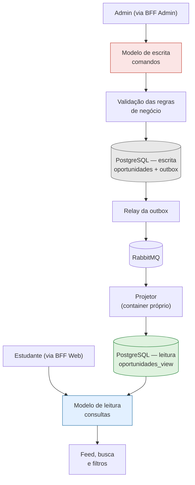

# 4.7 — CQRS no ConectaU

> **Status:** arquitetura revisada (ver [4.1](4.1-microsservicos.md)). Implementado (Parte 3).

O CQRS (*Command Query Responsibility Segregation*) separa o modelo que **modifica** dados do modelo que **consulta** dados. No ConectaU, o padrão é aplicado ao serviço **Oportunidades**, dono do catálogo oficial.

## 1. Por que aqui

É o serviço com a **maior razão entre leitura e escrita**: muitos estudantes buscando, poucos admins escrevendo. E os dois lados têm exigências opostas:

- **Escrita:** cadastrar, editar, publicar e encerrar. Precisa validar regras (prazo de inscrição ≤ data de início, transições de status válidas, apenas `ADMIN`), manter a SAGA e a outbox na mesma transação e preservar integridade.
- **Leitura:** pesquisar por texto livre, filtrar por campus, categoria, tags e prazo, ordenar por relevância. Precisa ser rápida, mostrar só o que está `PUBLICADA` e tolerar desnormalização.

## 2. Separação dos modelos

| | Modelo de escrita | Modelo de leitura |
|---|---|---|
| Instância | `oportunidades-db` | `oportunidades-leitura-db` (instância separada) |
| Tecnologia | PostgreSQL normalizado | PostgreSQL desnormalizado, com busca textual |
| Conteúdo | `oportunidades`, `saga_publicacao`, `saga_passos`, `outbox` | `oportunidades_view`: uma linha por oportunidade **publicada**, com todos os campos que o feed e a busca usam e uma coluna `busca` (`tsvector` em português) |
| Índices | Chaves e restrições de integridade | Índice GIN na coluna `busca`; índice por campus, categoria e prazo |
| Otimizado para | Invariantes e transações | Busca textual, filtros e ordenação |
| Quem escreve | Comandos do ADMIN e a SAGA | **Apenas o projetor** |
| Quem lê | Painel Admin (via BFF Admin) | Portal Web (via BFF Web) e a *tool* do Assistente |

### Por que PostgreSQL também na leitura

Na Parte 2, o modelo de leitura era um OpenSearch. A revisão trocou por um PostgreSQL em instância separada porque:

- o volume de oportunidades da UFLA (centenas a poucos milhares de registros) é atendido com folga pela busca textual do PostgreSQL;
- o OpenSearch exige 1 a 2 GB de memória só para ele, o que pesa no Kubernetes local usado nas demonstrações;
- uma tecnologia a menos para o grupo operar.

**O que continua sendo CQRS:** os dois modelos têm **formatos diferentes** (normalizado × desnormalizado com índice de busca), **instâncias diferentes** (a carga de busca não disputa recursos com a publicação) e **um só caminho de atualização** (o projetor). Isso é diferente de uma réplica de leitura do PostgreSQL, que copiaria o mesmo esquema normalizado, incluindo rascunhos.

Como o modelo de leitura é derivado e pode ser reconstruído, trocar sua tecnologia no futuro (por exemplo, de volta para OpenSearch) não exige nenhuma mudança no lado de escrita.

## 3. Fluxo de atualização

1. Um comando chega à API (`POST`/`PATCH /api/v1/oportunidades`, encerramento ou o pivô da SAGA).
2. O modelo de escrita valida e grava no banco de escrita — **na mesma transação**, insere o evento na tabela `outbox` ([4.5](4.5-dados-outbox.md)).
3. O relay publica o evento no RabbitMQ.
4. O **projetor** consome `OportunidadePublicada`, `OportunidadeEditada` ou `OportunidadeEncerrada` e atualiza `oportunidades_view`:
   - `OportunidadePublicada` → insere a linha;
   - `OportunidadeEditada` → atualiza a linha, se ela existir (rascunhos editados não entram);
   - `OportunidadeEncerrada` → remove a linha.
5. As consultas passam a refletir a alteração.

Criar ou editar um **rascunho** não gera nada no modelo de leitura: ele só conhece oportunidades publicadas.

Como a entrega é *at-least-once*, o projetor é **idempotente**: grava com `INSERT … ON CONFLICT (id) DO UPDATE` e só aplica o evento se a sua `versao` for maior que a gravada, descartando eventos repetidos ou fora de ordem.

O projetor roda num **container separado** da API de Oportunidades, usando a mesma imagem com outro comando ([por quê](decisoes-isolamento.md#um-processo-principal-por-container)).

## 4. Consistência eventual

| Aspecto | Definição |
|---|---|
| **Meta** | Até 5 segundos para refletir alterações em condições normais |
| **Como medir** | O projetor registra a diferença entre o `ocorridoEm` do evento e o momento da gravação na leitura |
| **Tipo de consistência** | Eventual: os modelos convergem após o processamento dos eventos pendentes |
| **Tratamento de falhas** | Novas tentativas, descarte de eventos duplicados, *dead letter queue* e reprocessamento |
| **Reconstrução** | O modelo de leitura é descartável: pode ser recriado do zero relendo o banco de escrita e inserindo apenas as oportunidades com status `PUBLICADA` |

**Consequência assumida:** logo após um admin editar ou encerrar uma oportunidade, o feed pode exibir por alguns segundos a versão anterior. É aceitável porque o dado definitivo está sempre no canal oficial, acessível pelo link `fonteOficial`.

## 5. Benefícios esperados

| Benefício | Aplicação no ConectaU |
|---|---|
| Separação de responsabilidades | A escrita protege invariantes; a leitura serve o feed |
| Consultas otimizadas | Busca textual e filtros numa tabela feita para isso |
| Escala independente | O lado de leitura aguenta a demanda dos estudantes sem afetar a publicação |
| Resiliência | Uma sobrecarga de leitura não compromete a publicação, e vice-versa |
