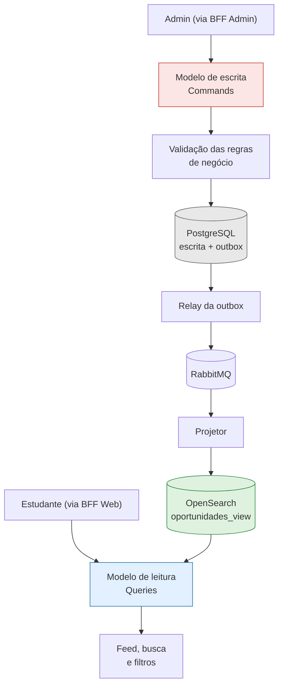

# 4.7 — CQRS no ConectaU

> **Status:** proposta arquitetural — padrão ainda não implementado.

O CQRS (*Command Query Responsibility Segregation*) separa as operações que modificam dados das operações que consultam dados.

No ConectaU, o padrão é aplicado ao **serviço de Oportunidades**, dono do catálogo oficial.

## 1. Por que aqui

É o serviço com a **maior razão leitura/escrita** da plataforma: muitos estudantes buscando, poucos admins escrevendo. E os dois lados têm exigências opostas:

- **Escrita:** cadastrar, editar, publicar e encerrar. Precisa validar regras (prazo ≥ data de início, transições de status válidas, apenas `ADMIN`) e preservar integridade.
- **Leitura:** pesquisar por texto livre, filtrar por campus, categoria e prazo, ordenar por relevância. Precisa ser rápida e tolerar desnormalização.

Busca textual com filtros combinados é justamente o que um modelo relacional normalizado atende mal. Separar permite otimizar cada lado conforme sua responsabilidade.

## 2. Separação dos modelos

Diferente de versões anteriores desta proposta, os dois modelos usam **tecnologias distintas**:

| | Modelo de escrita | Modelo de leitura |
|---|---|---|
| Tecnologia | PostgreSQL normalizado | **OpenSearch** |
| Conteúdo | `oportunidades`, `saga_publicacao`, `outbox` | `oportunidades_view`: documento desnormalizado com texto completo, campus, categoria, curso-alvo, prazo e popularidade |
| Otimizado para | Invariantes e transações | Busca full-text, filtros facetados, ordenação |
| Quem escreve | Comandos do ADMIN e a SAGA | Apenas o projetor de eventos |

## 3. Fluxo de atualização

1. Um comando chega à API (`POST`/`PATCH /api/v1/oportunidades`, ou um passo da SAGA).
2. O modelo de escrita valida e grava no PostgreSQL — **na mesma transação**, insere o evento na tabela `outbox` ([4.5](4.5-dados-outbox.md)).
3. O relay publica o evento no RabbitMQ.
4. O **projetor** consome `OportunidadeCriada`, `OportunidadeEditada`, `OportunidadePublicada` ou `OportunidadeEncerrada` e faz *upsert* no índice do OpenSearch.
5. As consultas passam a refletir a alteração.

O uso da **Transactional Outbox** não é opcional neste fluxo: sem ela, uma alteração poderia ser gravada sem que o evento correspondente fosse publicado, e o índice ficaria permanentemente divergente do banco de escrita.

Como a entrega é *at-least-once*, o projetor é **idempotente**: o upsert usa o `id` da oportunidade como chave do documento, e eventos repetidos apenas reescrevem o mesmo conteúdo. Eventos fora de ordem são descartados comparando um número de versão do registro.

## 4. Consistência eventual

| Aspecto | Definição |
|---|---|
| **Meta inicial** | Até 5 segundos para refletir alterações em condições normais |
| **Tipo de consistência** | Eventual: os modelos convergem após o processamento das atualizações pendentes |
| **Tratamento de falhas** | Novas tentativas, descarte de eventos duplicados, *dead letter queue* e reprocessamento |
| **Reconstrução** | O índice de leitura é descartável: pode ser recriado do zero relendo o PostgreSQL de escrita |

O prazo de cinco segundos é um **objetivo de projeto**, ainda não validado por testes; em falha ou sobrecarga, pode levar mais tempo.

**Consequência assumida:** logo após um admin editar uma oportunidade, o feed pode exibir por alguns segundos a versão anterior. É aceitável porque o dado definitivo está sempre no canal oficial, acessível pelo link `fonteOficial`.

## 5. Benefícios esperados

| Benefício | Aplicação no ConectaU |
|---|---|
| Separação de responsabilidades | Escrita protege invariantes; leitura serve o feed |
| Consultas otimizadas | Busca textual e filtros em um índice feito para isso |
| Escala independente | O lado de leitura escala com a demanda dos estudantes sem afetar a escrita |
| Resiliência | Uma sobrecarga de leitura não compromete a publicação |

## Conclusão

A adoção do CQRS em Oportunidades equilibra integridade de escrita e eficiência de consulta: PostgreSQL para comandos, OpenSearch para queries, e sincronização assíncrona via outbox com meta de defasagem de 5 segundos. A implementação e a validação do comportamento ocorrerão nas próximas etapas do projeto.
