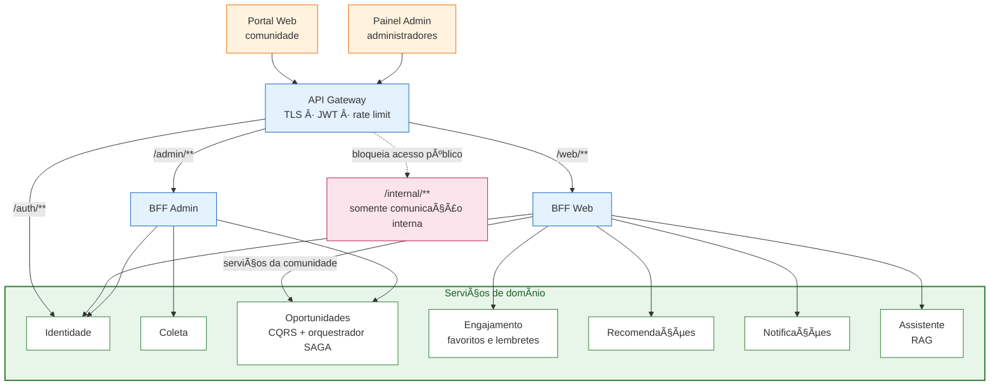
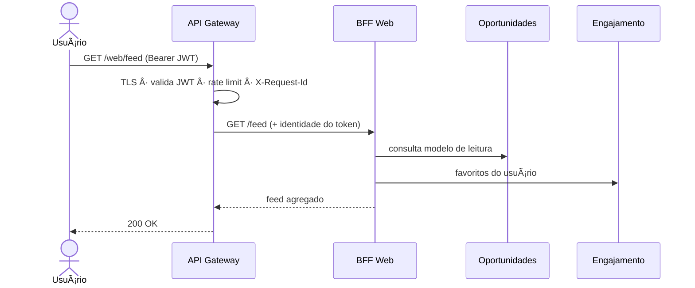
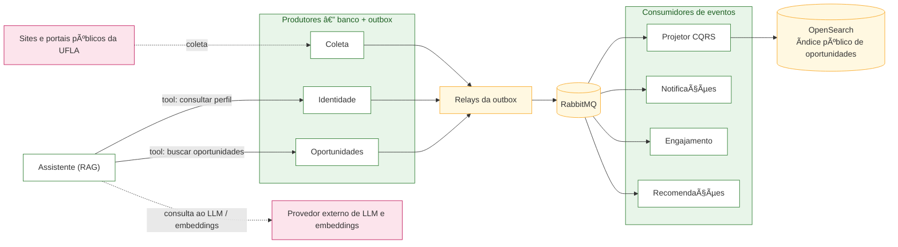
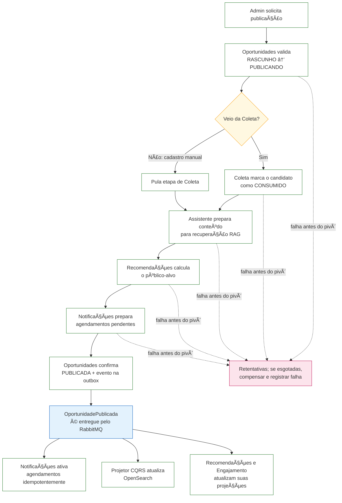
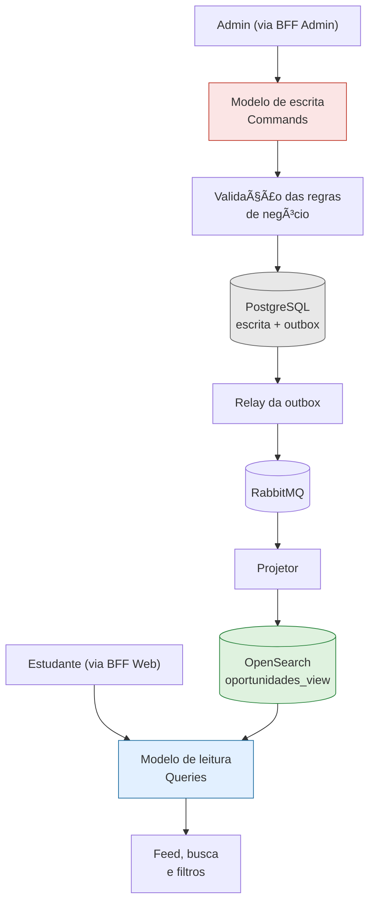

# Arquitetura do ConectaU
## Documento consolidado — Parte 2 (itens 4.1 a 4.7)

> **Status geral:** proposta arquitetural. Os serviços e fluxos descritos neste documento representam o projeto definido para a Parte 2 e não significam que estejam implementados.

## Objetivo deste documento

Este arquivo reúne em um único lugar a arquitetura do ConectaU, consolidando a decomposição em microsserviços, os contratos REST, o API Gateway, os BFFs, a estratégia de dados e mensageria, a SAGA de publicação e o CQRS. Ele serve como documento central de apresentação e consulta da arquitetura.

A especificação completa dos contratos e schemas da API permanece no arquivo [`openapi.yaml`](docs/arquitetura/openapi.yaml), que complementa esta visão consolidada.

## Sumário

1. [4.1 — Decomposição em microsserviços](#41-decomposicao-em-microsservicos)
2. [4.2 — API REST](#42-api-rest)
3. [4.3 — API Gateway e roteamento](#43-api-gateway-e-roteamento)
4. [4.4 — Backend for Frontend (BFF)](#44-backend-for-frontend-bff)
5. [4.5 — Dados, consistência eventual e Outbox](#45-dados-consistencia-eventual-e-outbox)
6. [4.6 — SAGA de publicação](#46-saga-de-publicacao)
7. [4.7 — CQRS](#47-cqrs)

---

## 4.1 Decomposição em microsserviços

> **Status:** Proposta arquitetural.

## Decisões de produto que guiam a decomposição

A decomposição parte de cinco decisões de produto. Elas explicam por que não existem serviços de *Inscrições* e *Vagas*:

| Decisão | Consequência arquitetural |
|---|---|
| O ConectaU é uma **camada de descoberta**: a inscrição acontece no canal oficial (link `fonteOficial`) | Não há serviço de inscrições nem de vagas. A transação distribuída do sistema passa a ser o fluxo de **publicação** de uma oportunidade |
| Oportunidades entram por **coleta automática** de eventos da UFLA (palestras, workshops, minicursos) **e** por cadastro manual | Serviço próprio de **Coleta**, com fontes, execuções, deduplicação e fila de curadoria |
| **Não existe usuário publicador.** Quem quer divulgar fala com um **admin** da plataforma, que publica | Apenas dois papéis: `ESTUDANTE` e `ADMIN`. Toda publicação passa por curadoria humana, o que evita oportunidades falsas sem um motor de verificação |
| O cliente da comunidade é **web responsivo** (funciona no celular, sem app de loja) | Dois clientes distintos — Portal Web e Painel Admin — e, portanto, dois BFFs |
| Funcionalidade de LLM: **assistente de editais** (RAG) | Serviço **Assistente** com base vetorial própria, alimentada pela SAGA de publicação |

## Contextos Delimitados

| # | Serviço | Responsabilidade exclusiva | Dados que possui | Banco | O que NÃO deve fazer |
|---|---|---|---|---|---|
| 1 | **Identidade** | Cadastro/login, perfil (curso, campus, vínculo, interesses), papéis `ESTUDANTE`/`ADMIN`, emissão de JWT | `usuarios`, `interesses`, `papeis`, `outbox` | PostgreSQL | Guardar favoritos ou oportunidades |
| 2 | **Coleta** | Fontes cadastradas, execução do coletor, normalização, **deduplicação** e fila de candidatos para curadoria | `fontes`, `execucoes`, `candidatos` (bruto + campos extraídos), `outbox` | MongoDB (documentos heterogêneos) | Publicar por conta própria; apenas sugere candidatos |
| 3 | **Oportunidades** | Catálogo oficial: criar, editar, publicar e encerrar; **orquestrar a SAGA de publicação**; manter o modelo de leitura (CQRS) | Escrita: `oportunidades`, `saga_publicacao`, `outbox`. Leitura: `oportunidades_view` | PostgreSQL (escrita) + OpenSearch (leitura) | Calcular ranking ou enviar avisos |
| 4 | **Engajamento** | Favoritos ("salvar para ver depois") e **lembretes de prazo** configurados pelo usuário | `favoritos`, `lembretes`, `oportunidade_resumo` (cópia via evento) | PostgreSQL | Alterar a oportunidade |
| 5 | **Notificações** | Agendar, enviar (in-app e e-mail) e registrar entregas; janelas de envio | `notificacoes`, `agendamentos`, `tentativas_entrega` | MongoDB + Redis (fila de agendamento) | Decidir sozinho quem é o público-alvo (recebe a lista pronta) |
| 6 | **Recomendações** | Projeção de oportunidades × perfis; ranking personalizado com motivos; público-alvo de uma oportunidade | `projecao_oportunidades`, `projecao_perfis`, `scores` | Redis (scores) + PostgreSQL (projeções) | Ser fonte oficial de oportunidades ou de perfis |
| 7 | **Assistente** | Ingestão de editais na base vetorial, recuperação, geração de respostas, histórico de conversas | `chunks` + embeddings, `conversas`, `cache_respostas` | PostgreSQL + pgvector + Redis (cache) | Gravar em outros serviços; só lê por *tools* |


> **Decisão sobre o orquestrador:** **Oportunidades** é o orquestrador da SAGA de publicação e também o dono do catálogo. Não existe um banco separado "do orquestrador": o estado da SAGA vive na tabela `saga_publicacao`, dentro do banco de Oportunidades.

## Justificativa das fronteiras

- **Coleta × Oportunidades:** dados coletados são *não confiáveis* (duplicados, incompletos, de formato variável); o catálogo contém apenas dados *curados por um admin*. Separar impede que uma falha do coletor polua o catálogo e permite escalar os jobs pesados de coleta de forma independente.
- **Oportunidades × Engajamento:** o catálogo muda pouco e é lido muito; favoritos e lembretes são dados *por usuário*, escritos com frequência. São invariantes e cargas diferentes.
- **Notificações isolado:** absorve falhas de e-mail e novas tentativas sem travar a publicação nem os favoritos.
- **Recomendações isolado:** o algoritmo evolui (de regras para embeddings) sem tocar no catálogo.
- **Assistente isolado:** depende de um provedor remoto caro e falível (LLM); precisa de *circuit breaker*, cache e escala próprios.
- **Identidade isolado:** concentra dados pessoais e permissões, com ciclo de vida e requisitos de proteção próprios.
- **Alternativas descartadas:** um monólito teria menor custo operacional, mas não atenderia aos objetivos da disciplina; um serviço por entidade (ex.: "Favoritos" e "Lembretes" separados) geraria chamadas extras e transações distribuídas sem proteger nenhuma regra de negócio adicional.
- **Trade-off reconhecido:** infraestrutura mais cara, consistência eventual e maior complexidade operacional. Para uma implantação pequena, um monólito modular poderia ser economicamente superior.

## Componentes e comunicação



## Contratos e ownership

- Não há joins SQL entre bancos de serviços; consultas cruzadas são feitas por APIs ou por projeções alimentadas por eventos.
- Os serviços guardam referências (`usuarioId`, `oportunidadeId`, `candidatoId`), nunca chaves estrangeiras interbancos.
- Dados recebidos por eventos são cópias derivadas e podem estar defasados (ver [4.5](#45-dados-consistencia-eventual-e-outbox)).
- **Exceção de roteamento de autenticação:** `/auth/**` é encaminhado pelo gateway diretamente ao serviço Identidade para cadastro e login; não passa pelos BFFs. O contrato OpenAPI descreve os endpoints lógicos dos serviços (`/api/v1/**`), enquanto os clientes usam as rotas de entrada do gateway e os contratos dos BFFs.
- Endpoint interno não é endpoint público: rotas `/internal/**` (comandos da SAGA, *tools* do assistente e chamadas internas de serviço) exigem identidade de serviço e não são publicadas no gateway.

## Documentos relacionados

| Item | Documento |
|---|---|
| 4.2 — API REST | [`4.2-api-rest.md`](#42-api-rest) · [`openapi.yaml`](docs/arquitetura/openapi.yaml) |
| 4.3 — API Gateway | [`4.3-gateway.md`](#43-api-gateway-e-roteamento) |
| 4.4 — BFF | [`4.4-bff.md`](#44-backend-for-frontend-bff) |
| 4.5 — Dados e outbox | [`4.5-dados-outbox.md`](#45-dados-consistencia-eventual-e-outbox) |
| 4.6 — SAGA | [`4.6-saga.md`](#46-saga-de-publicacao) |
| 4.7 — CQRS | [`4.7-cqrs.md`](#47-cqrs) |

---

## 4.2 API REST

> **Status:** contrato projetado, ainda não implementado. Especificação formal: [`openapi.yaml`](docs/arquitetura/openapi.yaml).

> **Escopo:** este OpenAPI descreve os contratos lógicos dos serviços de domínio, não uma API única exposta diretamente aos navegadores. Os clientes acessam o API Gateway: `/auth/**` encaminha para Identidade, `/web/**` para o BFF Web e `/admin/**` para o BFF Admin. Os BFFs chamam os contratos de serviço internamente. Rotas `/internal/**` exigem identidade de serviço e nunca são expostas no gateway.

## Convenções do contrato

- **Estilo:** REST com recursos em plural, JSON (`application/json`) e HTTPS.
- **Versão:** versão principal na URL, `/api/v1`. Mudanças compatíveis (novos campos opcionais) permanecem na v1; alterações incompatíveis exigem `/api/v2`. Isso permite migração gradual dos clientes.
- **Identificadores:** UUID em formato de string; datas/horas em ISO 8601 com fuso (`date-time`).
- **Papéis:** apenas dois — `ESTUDANTE` (comunidade) e `ADMIN`. **Não existe papel de publicador:** quem quer divulgar uma oportunidade fala com um admin, que a cadastra e publica. Toda escrita no catálogo é exclusiva de `ADMIN`.
- **Autenticação:** token Bearer (JWT) para dados pessoais e operações de escrita. A consulta e a leitura de oportunidades publicadas são públicas.
- **Autorização pela identidade do token:** recursos pessoais (favoritos, lembretes, recomendações, notificações, conversas) **não aceitam `usuarioId` em query**. O servidor usa sempre o `sub` do token, o que elimina a classe de falha IDOR (consultar dados de outro usuário trocando o id na URL).
- **Rotas internas:** `/internal/**` (comandos da SAGA, *tools* do assistente) exigem identidade de serviço e **não são expostas no gateway** ([4.3](#43-api-gateway-e-roteamento)).
- **Resposta de erro:** `{ "codigo": "RECURSO_NAO_ENCONTRADO", "mensagem": "Oportunidade não encontrada" }`.
- **Paginação:** nas listagens há `pagina` (a partir de 1) e `limite` (1–100); retorno com `itens`, `pagina`, `limite` e `total`.
- **Status HTTP:** `200` leitura/atualização, `201` criação com cabeçalho `Location`, `202` aceito para processamento assíncrono (publicação via SAGA), `204` remoção sem corpo, `400` requisição inválida, `401` sem autenticação, `403` sem permissão, `404` não encontrado, `409` conflito (ex.: favorito duplicado), `422` regra de negócio (ex.: prazo anterior à data de início).

## Contratos por serviço

| Serviço | Método | Endpoint | Função | Acesso | Sucesso |
|---|---|---|---|---|---|
| Identidade | POST | `/api/v1/usuarios` | Criar perfil | Público | 201 |
| Identidade | POST | `/api/v1/sessoes` | Autenticar e obter JWT | Público | 201 |
| Identidade | GET | `/api/v1/usuarios/{usuarioId}` | Consultar perfil | Dono | 200 |
| Identidade | PATCH | `/api/v1/usuarios/{usuarioId}` | Alterar curso, campus e interesses | Dono | 200 |
| Oportunidades | GET | `/api/v1/oportunidades` | Listar e filtrar (modelo de leitura) | Público | 200 |
| Oportunidades | GET | `/api/v1/oportunidades/{oportunidadeId}` | Consultar detalhes | Público | 200 |
| Oportunidades | POST | `/api/v1/oportunidades` | Cadastrar oportunidade | **ADMIN** | 201 |
| Oportunidades | PATCH | `/api/v1/oportunidades/{oportunidadeId}` | Atualizar dados da oportunidade (sem alterar status) | **ADMIN** | 200 |
| Oportunidades | POST | `/api/v1/oportunidades/{oportunidadeId}/encerramento` | Encerrar oportunidade publicada | **ADMIN** | 200 |
| Oportunidades | DELETE | `/api/v1/oportunidades/{oportunidadeId}` | Excluir cadastro ainda em `RASCUNHO` (não substitui encerramento) | **ADMIN** | 204 |
| Oportunidades | POST | `/api/v1/oportunidades/{oportunidadeId}/publicacao` | Disparar a SAGA de publicação | **ADMIN** | 202 |
| Oportunidades | GET | `/api/v1/publicacoes/{sagaId}` | Acompanhar o estado da SAGA | **ADMIN** | 200 |
| Coleta | GET | `/api/v1/fontes` | Listar fontes de coleta | **ADMIN** | 200 |
| Coleta | POST | `/api/v1/fontes` | Cadastrar fonte | **ADMIN** | 201 |
| Coleta | GET | `/api/v1/execucoes` | Histórico de execuções do coletor | **ADMIN** | 200 |
| Coleta | GET | `/api/v1/candidatos` | Fila de curadoria (`?status=PENDENTE`) | **ADMIN** | 200 |
| Coleta | PATCH | `/api/v1/candidatos/{candidatoId}` | Descartar ou marcar como duplicado | **ADMIN** | 200 |
| Engajamento | GET | `/api/v1/favoritos` | Listar oportunidades salvas | Dono (token) | 200 |
| Engajamento | POST | `/api/v1/favoritos` | Salvar oportunidade | Dono (token) | 201 |
| Engajamento | DELETE | `/api/v1/favoritos/{favoritoId}` | Remover dos favoritos | Dono | 204 |
| Engajamento | GET | `/api/v1/lembretes` | Listar lembretes de prazo | Dono (token) | 200 |
| Engajamento | POST | `/api/v1/lembretes` | Criar lembrete de prazo | Dono (token) | 201 |
| Engajamento | DELETE | `/api/v1/lembretes/{lembreteId}` | Remover lembrete | Dono | 204 |
| Recomendações | GET | `/api/v1/recomendacoes` | Oportunidades ordenadas para o usuário do token | Dono (token) | 200 |
| Notificações | GET | `/api/v1/notificacoes` | Listar avisos | Dono (token) | 200 |
| Notificações | GET | `/api/v1/notificacoes/{notificacaoId}` | Consultar aviso | Dono | 200 |
| Notificações | PATCH | `/api/v1/notificacoes/{notificacaoId}` | Marcar aviso como lido | Dono | 200 |
| Assistente | POST | `/api/v1/conversas` | Abrir conversa sobre editais | Autenticado | 201 |
| Assistente | POST | `/api/v1/conversas/{conversaId}/mensagens` | Enviar pergunta e obter resposta com citações | Dono | 201 |

**Restrições principais:** `GET /oportunidades` aceita `busca`, `campus`, `categoria`, `pagina`, `limite` e retorna apenas oportunidades em `PUBLICADA`. Não aceita filtro público de status, evitando exposição de `RASCUNHO` ou `PUBLICANDO`. O detalhe público também responde apenas para oportunidades `PUBLICADA`; rascunhos e publicações em andamento são inacessíveis pelas consultas públicas. `GET /candidatos` aceita `status`, `fonteId`, `pagina`, `limite`; `GET /notificacoes` aceita `lida`, `pagina`, `limite`. Nenhuma listagem pessoal aceita `usuarioId`. Os corpos e tipos constam integralmente no YAML OpenAPI.

## Exemplos de requisição e resposta

**Cadastro de oportunidade — `POST /api/v1/oportunidades`** (token com `role=ADMIN`):

```json
{
  "titulo": "Workshop de Docker",
  "descricao": "Workshop prático de containers para a comunidade acadêmica.",
  "categoria": "EVENTO",
  "campus": "LAVRAS",
  "dataInicio": "2026-11-12T14:00:00-03:00",
  "prazoInscricao": "2026-11-10T23:59:00-03:00",
  "fonteUrl": "https://www.ufla.br/",
  "tags": ["tecnologia", "containers"],
  "candidatoId": "0f1d8f2c-2b8e-4f1a-9f3a-9a1b2c3d4e5f"
}
```

A oportunidade nasce em `RASCUNHO`: **o status não é definido pelo cliente**. A transição para `PUBLICADA` acontece apenas pela SAGA. Consultas públicas retornam somente oportunidades `PUBLICADA`; o contrato administrativo pode consultar os estados internos.

**Resposta `201 Created`** — `Location: /api/v1/oportunidades/550e8400-e29b-41d4-a716-446655440002`:

```json
{
  "id": "550e8400-e29b-41d4-a716-446655440002",
  "titulo": "Workshop de Docker",
  "categoria": "EVENTO",
  "campus": "LAVRAS",
  "prazoInscricao": "2026-11-10T23:59:00-03:00",
  "fonteUrl": "https://www.ufla.br/",
  "status": "RASCUNHO",
  "_links": {
    "self": { "href": "/api/v1/oportunidades/550e8400-e29b-41d4-a716-446655440002", "method": "GET" },
    "colecao": { "href": "/api/v1/oportunidades", "method": "GET" },
    "publicar": { "href": "/api/v1/oportunidades/550e8400-e29b-41d4-a716-446655440002/publicacao", "method": "POST" },
    "fonteOficial": { "href": "https://www.ufla.br/", "method": "GET" }
  }
}
```

**Publicação — `POST /api/v1/oportunidades/{id}/publicacao`** responde `202 Accepted`, porque o trabalho é assíncrono e distribuído ([4.6](#46-saga-de-publicacao)):

```json
{
  "sagaId": "9a7c1b44-6c2e-4a9b-9a1e-7f0c2d3e4a55",
  "estado": "INICIADA",
  "_links": { "estado": { "href": "/api/v1/publicacoes/9a7c1b44-6c2e-4a9b-9a1e-7f0c2d3e4a55", "method": "GET" } }
}
```

**Recomendações — `GET /api/v1/recomendacoes`** (sem `usuarioId`; a identidade vem do token):

```json
{
  "itens": [
    {
      "oportunidadeId": "550e8400-e29b-41d4-a716-446655440002",
      "pontuacao": 0.92,
      "motivos": ["Interesse em tecnologia", "Campus compatível"]
    }
  ],
  "pagina": 1,
  "limite": 20,
  "total": 1
}
```

O endereço de fonte usado nos exemplos é **apenas ilustrativo**, não representa um edital real.

## HATEOAS: navegação a partir do recurso Oportunidade

HATEOAS (*Hypermedia as the Engine of Application State*) significa que a resposta traz **links para as ações possíveis naquele estado e para aquele papel**. Os links dependem do estado da oportunidade e do papel de quem consulta:

| Relação | Navegação ou ação | Condição |
|---|---|---|
| `self` | Consultar novamente a mesma oportunidade | Sempre |
| `colecao` | Voltar à listagem | Sempre |
| `salvar` | Criar favorito apontando para essa oportunidade | Autenticado e prazo em aberto |
| `lembrar` | Criar lembrete de prazo | Autenticado e prazo em aberto |
| `perguntar` | Abrir conversa com o assistente sobre o edital | Autenticado e oportunidade indexada |
| `fonteOficial` | **Abrir o canal oficial, onde a inscrição acontece** | Sempre |
| `publicar` | Disparar a SAGA de publicação | `ADMIN` **e** status `RASCUNHO` |
| `encerrar` | Encerrar oportunidade publicada | `ADMIN` **e** status `PUBLICADA` |

```json
"_links": {
  "self":         { "href": "/web/oportunidades/{id}", "method": "GET" },
  "colecao":      { "href": "/web/oportunidades", "method": "GET" },
  "salvar":       { "href": "/web/favoritos", "method": "POST" },
  "lembrar":      { "href": "/web/lembretes", "method": "POST" },
  "perguntar":    { "href": "/web/conversas", "method": "POST" },
  "fonteOficial": { "href": "https://www.ufla.br/", "method": "GET" }
}
```

`salvar` e `lembrar` desaparecem quando o prazo já passou; `publicar` só aparece para `ADMIN` com a oportunidade em `RASCUNHO`, e `encerrar` só aparece para `ADMIN` quando a oportunidade está em `PUBLICADA`. A API pública nunca retorna rascunhos ou oportunidades em `PUBLICANDO`; para operações administrativas, o BFF Admin usa o contrato autenticado do serviço Oportunidades. Os links são metadados de navegação — não executam ações automaticamente. Note que **não existe link de "inscrever-se"**: o ConectaU é camada de descoberta, e a inscrição ocorre fora da plataforma, pelo `fonteOficial`.

## Regras de validação e erros esperados

- Criar oportunidade sem `titulo`, `categoria`, `campus`, `prazoInscricao` ou `fonteUrl`: **400**.
- Prazo anterior à data de início ou outra regra violada: **422**.
- Consultar uma oportunidade inexistente: **404**.
- Cadastrar ou publicar oportunidade sem token: **401**; autenticado como `ESTUDANTE`: **403**.
- Acessar qualquer rota de Coleta sem papel `ADMIN`: **403**.
- Publicar uma oportunidade que não está em `RASCUNHO`: **409**.
- Encerrar uma oportunidade que não está em `PUBLICADA`: **409**.
- Consultar uma oportunidade não publicada pela API pública: **404**.
- Salvar duas vezes o mesmo par usuário/oportunidade: **409**.
- Criar lembrete para oportunidade já encerrada: **422**.

O arquivo [`openapi.yaml`](docs/arquitetura/openapi.yaml) define os **schemas**, parâmetros de path/query, corpos e respostas de cada endpoint e pode ser importado no [Swagger Editor](https://editor.swagger.io/). Nenhum endpoint aqui é afirmado como já disponível em produção.

---

## 4.3 API Gateway e roteamento

> **Status:** proposta arquitetural da Parte 2. Não implementado.

O API Gateway é o **único ponto de entrada** do ConectaU. Clientes nunca chamam um serviço de domínio diretamente: falam com o gateway, que encaminha a requisição ao BFF correspondente.

## Tecnologia proposta

**Kong** ou **Traefik**. Ambos funcionam como Ingress Controller no Kubernetes, o que evita manter duas camadas distintas de entrada quando a Parte 3 for implantada.

## Regras de roteamento

| Caminho | Destino | Autorização |
|---|---|---|
| `/auth/**` | Identidade (cadastro e login) | Público |
| `/web/**` | BFF Web | JWT válido, exceto nas rotas públicas de consulta |
| `/admin/**` | BFF Admin | JWT válido **com `role=ADMIN`** |
| `/internal/**` | — | **Bloqueado no gateway** |

A rota `/auth/**` é uma exceção deliberada: encaminha cadastro e login diretamente à Identidade, pois essas operações precisam funcionar antes de existir JWT. As rotas `/internal/**` são usadas pelos comandos da SAGA, pelas *tools* do assistente e por chamadas internas entre serviços. Elas existem apenas dentro da rede privada, autenticadas por identidade de serviço, e nunca são publicadas.

O [`openapi.yaml`](docs/arquitetura/openapi.yaml) descreve os contratos lógicos dos serviços em `/api/v1/**`; ele não significa que o navegador possa chamar os microsserviços diretamente. O cliente chama `/auth/**`, `/web/**` ou `/admin/**`, e os BFFs encaminham chamadas internas aos serviços correspondentes.

## Responsabilidades

| Responsabilidade | Como é aplicada |
|---|---|
| **Terminação TLS** | Certificado no gateway; tráfego interno do cluster segue em rede privada |
| **Validação de JWT** | O gateway verifica assinatura e expiração usando a chave pública da Identidade e rejeita o que for inválido antes de chegar ao BFF |
| **Autorização de rota** | `role=ADMIN` exigido em todo `/admin/**`; o serviço de destino revalida o papel (defesa em profundidade) |
| **Rate limiting** | Limite geral por token e por IP; limite **mais restrito** em `/web/assistente/**`, porque cada requisição consome crédito de LLM |
| **CORS** | Origens permitidas: domínios do Portal Web e do Painel Admin |
| **Correlação** | Gera `X-Request-Id` quando ausente e propaga em todas as chamadas internas, permitindo rastrear uma publicação ponta a ponta |
| **Logs de acesso** | Método, rota, status, latência e `X-Request-Id`; sem corpo de requisição, para não registrar dados pessoais |

## O que o gateway NÃO faz

- Não agrega respostas de vários serviços — isso é papel do BFF ([4.4](#44-backend-for-frontend-bff)).
- Não aplica regra de negócio nem transforma payload de domínio.
- Não guarda estado de sessão: a autenticação é via JWT, o que mantém o gateway escalável horizontalmente.

## Fluxo de uma requisição



Se o JWT for inválido o gateway responde `401` sem acionar nenhum serviço; se o papel não for `ADMIN` em `/admin/**`, responde `403`.

---

## 4.4 Backend for Frontend (BFF)

> **Status:** proposta arquitetural da Parte 2. Não implementado.

O ConectaU tem **dois clientes com necessidades opostas**: o Portal Web da comunidade (uso em celular, descoberta rápida, payload pequeno) e o Painel Admin (curadoria, tabelas grandes, dados brutos de coleta). Servir os dois com a mesma API levaria a respostas grandes demais para um e incompletas para o outro. Por isso há **um BFF por cliente**.

## Comparação

| | **BFF Web** (comunidade, mobile-first) | **BFF Admin** (administradores) |
|---|---|---|
| Foco | Descoberta rápida em tela pequena | Curadoria e operação |
| Agrega | Oportunidades (leitura) + Engajamento (estado "salvo") + Recomendações + Notificações não lidas + Assistente | Coleta (candidatos) + Oportunidades (escrita) + estado da SAGA + métricas |
| Resposta | Cards compactos: título, data, campus, categoria, `salvo`, `motivo` da recomendação, `prazoEmDias` | Registro completo: fonte de origem, conteúdo extraído, score de duplicidade, histórico de status, passos da SAGA |
| Payload | Pequeno; paginação curta (10 itens); imagens reduzidas | Tabelas grandes, filtros avançados, exportação |
| Autorização | JWT de `ESTUDANTE` ou `ADMIN` | Somente `ADMIN` |

## Por que BFF e não uma API única

- **Número de chamadas.** O feed precisa de 3 serviços (catálogo, favoritos, recomendações). Sem BFF, o celular faria 3 requisições e juntaria os dados no cliente — mais latência em rede móvel.
- **Formato.** O mesmo recurso `Oportunidade` tem representações diferentes: o estudante vê um card, o admin vê a procedência e a auditoria.
- **Evolução.** O Painel Admin pode mudar sem forçar mudança no contrato consumido pelo Portal Web.

O custo aceito é manter dois componentes em vez de um. Ele é mitigado porque ambos os BFFs são finos: não têm banco próprio e não são donos das regras de negócio. Eles agregam respostas, adaptam formatos para cada cliente e aplicam regras de composição da resposta; as validações de domínio permanecem nos serviços responsáveis. O BFF não substitui o RabbitMQ nem a comunicação assíncrona da SAGA.

## Exemplos

```jsonc
// GET /web/feed  (BFF Web)
{
  "itens": [
    {
      "id": "550e8400-e29b-41d4-a716-446655440002",
      "titulo": "Workshop de Docker",
      "quando": "2026-11-12",
      "campus": "LAVRAS",
      "categoria": "EVENTO",
      "salvo": false,
      "motivo": "Interesse em tecnologia",
      "prazoEmDias": 3
    }
  ],
  "pagina": 1,
  "limite": 10,
  "total": 1
}
```

```jsonc
// GET /admin/oportunidades/{id}  (BFF Admin)
{
  "id": "550e8400-e29b-41d4-a716-446655440002",
  "titulo": "Workshop de Docker",
  "status": "PUBLICADA",
  "origem": {
    "tipo": "COLETA",
    "fonte": "Agenda DCC",
    "candidatoId": "0f1d…",
    "coletadoEm": "2026-10-30T08:12:00-03:00",
    "scoreDuplicidade": 0.12
  },
  "saga": {
    "id": "9a7c…",
    "estado": "CONCLUIDA",
    "passos": [
      { "passo": "CONSUMIR_CANDIDATO", "estado": "OK" },
      { "passo": "INDEXAR_ASSISTENTE", "estado": "OK", "chunks": 14 },
      { "passo": "AGENDAR_AVISOS", "estado": "OK", "destinatarios": 128 }
    ]
  },
  "metricas": { "visualizacoes": 312, "favoritos": 41 }
}
```

## Regras comuns aos dois BFFs

- A identidade vem **sempre do JWT**, nunca de um parâmetro `usuarioId` enviado pelo cliente (ver [4.2](#42-api-rest)).
- Nenhum BFF tem banco de dados; um cache curto em memória (segundos) é aceitável para o feed.
- Falha de um serviço secundário degrada o BFF em vez de derrubá-lo: se Recomendações não responde, o feed sai sem o campo `motivo`; se o Assistente está indisponível, o card da oportunidade continua visível; apenas a ação de perguntar ao assistente fica indisponível.

---

## 4.5 Dados, consistência eventual e Outbox

> **Status:** proposta arquitetural da Parte 2. Não implementado.

## 1. Database per service

Cada serviço tem **instância própria** de banco (um container, ou um StatefulSet com PVC na Parte 3). Nenhum serviço lê o banco de outro, e não existe join entre bancos: toda cópia local de dado alheio chega por evento.

| Serviço | Banco | Por quê |
|---|---|---|
| Identidade | PostgreSQL | Dados relacionais com integridade forte |
| Coleta | MongoDB | Documentos heterogêneos: cada fonte devolve um formato diferente |
| Oportunidades | PostgreSQL (escrita) + OpenSearch (leitura) | Regras de negócio na escrita, busca textual na leitura ([4.7](#47-cqrs)) |
| Engajamento | PostgreSQL | Relações usuário × oportunidade, escrita frequente |
| Notificações | MongoDB + Redis | Histórico flexível + fila de agendamento |
| Recomendações | PostgreSQL + Redis | Projeções persistidas + scores voláteis |
| Assistente | PostgreSQL + pgvector + Redis | Chunks e embeddings no mesmo banco + cache de respostas |

## 2. Pontos de consistência eventual

| Dado copiado | Origem → destino | Defasagem aceitável |
|---|---|---|
| Oportunidade publicada/editada/encerrada | Oportunidades → Recomendações e Engajamento (`oportunidade_resumo`) | segundos |
| Perfil e interesses | Identidade → Recomendações | segundos |
| Modelo de leitura (CQRS) | Escrita → OpenSearch | ≤ 5 s |
| Prazo alterado | Oportunidades → Engajamento (reagenda lembretes) | ≤ 1 min |

Consequência assumida: por alguns segundos, o feed pode exibir uma versão anterior de uma oportunidade recém-editada. É aceitável porque o ConectaU é uma camada de descoberta — o dado definitivo está sempre no link `fonteOficial`.

## 3. Risco de dual write

*Dual write* é gravar no banco **e** publicar um evento como duas operações separadas: se a segunda falhar, os dois lados ficam divergentes e ninguém percebe.

| Onde ocorre | Risco | Tratamento |
|---|---|---|
| Oportunidades grava no Postgres **e** publica `OportunidadePublicada` | Gravar sem publicar (ninguém é avisado) ou publicar e dar rollback (evento fantasma) | **Outbox** |
| Coleta salva candidato **e** publica `CandidatoColetado` para avisar os administradores | Aviso perdido ou candidato não sinalizado para curadoria | **Outbox**; o BFF Admin consulta a fila pela API de Coleta |
| Identidade altera interesses **e** avisa Recomendações | Recomendação desatualizada | **Outbox** |
| Assistente grava chunks **e** confirma à SAGA | Confirmação sem índice correspondente | Resposta síncrona idempotente por `sagaId` |

## Diagrama — mensageria e integrações externas

Este diagrama mostra os principais produtores e consumidores de eventos. O fluxo de outbox continua detalhado logo abaixo.



### Como explicar o diagrama

- Cada produtor grava o evento na própria outbox junto com a alteração de negócio; um relay publica depois no RabbitMQ.
- Os consumidores recebem apenas os eventos de que precisam e devem ser idempotentes, porque uma mensagem pode ser entregue mais de uma vez.
- O Projetor CQRS atualiza o índice OpenSearch usado pela busca. O índice público deve conter somente oportunidades `PUBLICADA`.
- A Coleta obtém candidatos de fontes públicas, mas eles só entram no catálogo após curadoria administrativa. O evento `CandidatoColetado` pode disparar um aviso aos ADMINs; a fila de curadoria em si é consultada pelo BFF Admin na API de Coleta.
- O Assistente RAG é diferente do Projetor CQRS: ele prepara conteúdo para responder perguntas sobre editais, enquanto o projetor mantém o índice de busca das oportunidades.

## 4. Transactional Outbox

O evento é gravado **na mesma transação** do dado de negócio, numa tabela `outbox` do próprio serviço. Um processo *relay* lê essa tabela e publica no RabbitMQ. Como gravação e registro do evento são atômicos, não existe estado em que um aconteceu e o outro não.

### Detalhe técnico — ciclo de uma mensagem da outbox

```mermaid
sequenceDiagram
  participant OP as Oportunidades
  participant DB as PostgreSQL (OP)
  participant R as Relay (poller)
  participant MQ as RabbitMQ
  participant RE as Recomendações
  OP->>DB: BEGIN; UPDATE oportunidades SET status='PUBLICADA';<br/>INSERT outbox(evento=OportunidadePublicada); COMMIT
  loop a cada 1s
    R->>DB: SELECT * FROM outbox WHERE enviado_em IS NULL FOR UPDATE SKIP LOCKED
    R->>MQ: publish (messageId = outbox.id)
    R->>DB: UPDATE outbox SET enviado_em = now()
  end
  MQ->>RE: OportunidadePublicada
  RE->>RE: ignora se messageId já processado
```

### Preparação e ativação de avisos na SAGA

Durante a SAGA, Oportunidades solicita a Recomendações o público-alvo e chama Notificações para **preparar agendamentos pendentes** identificados por `sagaId`. Esses agendamentos ainda não enviam avisos. Quando `OportunidadePublicada` chega pela Outbox, Notificações ativa os agendamentos preparados; se não houver preparação (por exemplo, durante recuperação ou reprocessamento), cria-os de forma idempotente usando a chave de negócio `oportunidadeId + tipoAviso + destinatarioId`. Assim, a etapa da SAGA não duplica os avisos que o consumidor do evento ativa.

### Entrega e idempotência

A entrega é **at-least-once**: se o relay publicar e falhar antes de marcar `enviado_em`, o mesmo evento será publicado de novo. Por isso todo consumidor é **idempotente** — registra o `messageId` numa tabela `mensagens_processadas` e descarta o que já viu.

### Eventos previstos

| Evento | Publicado por | Consumido por |
|---|---|---|
| `UsuarioCriado`, `InteressesAlterados` | Identidade | Recomendações |
| `CandidatoColetado` | Coleta | Notificações (aviso aos ADMINs); o BFF Admin consulta os candidatos pela API de Coleta |
| `OportunidadeCriada` | Oportunidades | projetor CQRS (mantém fora do índice público até a publicação) |
| `OportunidadePublicada` | Oportunidades | Recomendações, Engajamento, Notificações, projetor do CQRS |
| `OportunidadeEditada`, `OportunidadeEncerrada` | Oportunidades | Engajamento (reagendar/remover lembretes), Recomendações e projetor do CQRS |
| `LembreteVencendo` | Engajamento | Notificações |

## 5. Falhas e recuperação

- **Mensagem envenenada:** após N tentativas, vai para uma *dead letter queue* e gera alerta; não bloqueia a fila.
- **RabbitMQ indisponível:** os eventos ficam acumulados na `outbox` e são publicados quando o broker volta, desde que a persistência e o relay sejam recuperados. O monitoramento alerta sobre acúmulo prolongado.
- **Consumidor fora do ar:** a fila retém as mensagens; ao voltar, ele processa o atraso.

---

## 4.6 SAGA de publicação

> **Status:** proposta arquitetural da Parte 2. Não implementado.

## 1. Qual é a transação distribuída

Como o ConectaU **não faz inscrição** — o usuário se inscreve no canal oficial, pelo link `fonteOficial` —, a transação de negócio que atravessa serviços não é a candidatura, e sim **tornar uma oportunidade pública**.

Uma oportunidade só deve aparecer como publicada se, ao mesmo tempo:

1. o candidato que a originou foi consumido na Coleta (trava contra publicação duplicada);
2. o Assistente conseguiu indexá-la (senão o estudante pergunta e não há resposta);
3. os avisos ao público-alvo foram agendados.

A SAGA coordena os participantes para que uma falha não deixe um resultado parcial permanente. Durante o processamento, estados intermediários como `PUBLICANDO` podem existir; em caso de falha, há novas tentativas e compensações. Participam **5 serviços**: Oportunidades (orquestrador), Coleta (quando há candidato), Assistente, Recomendações (calcula o público-alvo) e Notificações (prepara os avisos).

## 2. Variante escolhida: SAGA orquestrada

O orquestrador vive **dentro do serviço Oportunidades**, com o estado na tabela `saga_publicacao`.

| Por que orquestrada | Por que não coreografada |
|---|---|
| Fluxo linear, com ordem de compensação explícita | Com vários participantes, a lógica ficaria espalhada em handlers de eventos, difícil de rastrear |
| O admin precisa ver o **estado da publicação** no painel | Não haveria um lugar único com o estado da transação |
| Facilita provocar e demonstrar a falha | Risco de ciclos de eventos |

**Custo aceito:** o orquestrador fica acoplado aos contratos dos participantes. É mitigado porque os comandos são poucos, versionados e expostos apenas em `/internal/**`.

## 3. Passos e compensações

| # | Serviço | Ação | Compensação |
|---|---|---|---|
| 1 | Oportunidades | Inicia a publicação de uma oportunidade em `RASCUNHO`, mudando-a para `PUBLICANDO` | Volta para `RASCUNHO` e registra `FALHA_PUBLICACAO` |
| 2 | Coleta | Marca o candidato como `CONSUMIDO` | Volta o candidato para `PENDENTE` |
| 3 | Assistente | Indexa descrição/edital (chunks + embeddings) | Remove os chunks da oportunidade |
| 4 | Recomendações + Notificações | Recomendações calcula o público-alvo; Notificações prepara agendamentos **pendentes**, identificados por `sagaId` | Cancela os agendamentos pendentes |
| 5 | Oportunidades | `PUBLICADA` + evento pela outbox (**pivô**, sem volta) | — |

- O passo 2 é **pulado** quando a oportunidade é cadastrada manualmente (não há candidato).
- O fluxo descrito é exclusivamente `RASCUNHO → PUBLICANDO → PUBLICADA`. Edições e encerramentos de oportunidades já publicadas são fluxos separados; uma compensação nunca rebaixa uma oportunidade previamente publicada para `RASCUNHO`.
- Os avisos preparados pela SAGA não são enviados imediatamente. O evento `OportunidadePublicada`, emitido pelo pivô via Outbox, ativa os agendamentos pendentes; Notificações usa `sagaId` e chaves idempotentes para evitar duplicação.
- Todos os comandos são **idempotentes por `sagaId`**: reexecutar um passo não duplica efeito.
- O passo 5 é o **pivô**: depois dele a transação é irreversível; uma retirada posterior é um novo fluxo (encerramento), não compensação.

## 4. Diagrama — fluxo de publicação

O diagrama resume o caminho feliz e indica o que acontece se uma etapa falhar antes da publicação. Os detalhes de idempotência, retentativas e compensações estão descritos nas seções anteriores.



### Como explicar o diagrama

- Oportunidades coordena o fluxo e mantém o estado da SAGA.
- Se a oportunidade veio da Coleta, o candidato é marcado como consumido; no cadastro manual, essa etapa é pulada.
- Antes do pivô, o Assistente prepara o conteúdo para RAG, Recomendações calcula o público-alvo e Notificações prepara os agendamentos sem enviar avisos ainda.
- O pivô é a confirmação `PUBLICADA` com o evento registrado na outbox. Depois disso, uma falha de consumidor é resolvida por retentativa/reprocessamento; não se compensa a publicação voltando para rascunho.
- O evento ativa os agendamentos e atualiza as projeções, incluindo o índice OpenSearch do CQRS.
- Se uma etapa falhar antes do pivô e as retentativas se esgotarem, Oportunidades compensa as etapas já concluídas em ordem reversa. Por exemplo, pode liberar o candidato para voltar a `PENDENTE` e remover os chunks preparados no Assistente.

## 5. Exemplo de falha com compensação

Se o provedor de embeddings ficar indisponível, Oportunidades tenta novamente com backoff. Se as tentativas se esgotarem antes do pivô, a SAGA desfaz as etapas já concluídas: remove os chunks preparados no Assistente, libera o candidato da Coleta quando houver um e registra a publicação como compensada. O painel informa ao administrador que a publicação falhou. A oportunidade permanece em `RASCUNHO` porque ainda não chegou ao estado `PUBLICADA`.

## 6. Estados da SAGA

| Estado | Significado |
|---|---|
| `INICIADA` | Registro criado, passo 1 concluído |
| `EM_ANDAMENTO` | Executando os passos da SAGA antes do pivô |
| `COMPENSANDO` | Um passo falhou; desfazendo os anteriores |
| `COMPENSADA` | Compensação concluída; oportunidade de volta a `RASCUNHO` |
| `CONCLUIDA` | Passo pivô executado; oportunidade `PUBLICADA` |
| `FALHA_COMPENSACAO` | A própria compensação falhou; exige intervenção manual e gera alerta |

---

## 4.7 CQRS

> **Status:** proposta arquitetural — padrão ainda não implementado.

O CQRS (*Command Query Responsibility Segregation*) separa as operações que modificam dados das operações que consultam dados.

No ConectaU, o padrão é aplicado ao **serviço de Oportunidades**, dono do catálogo oficial.

## 1. Por que aqui

É o serviço com a **maior razão leitura/escrita** da plataforma: muitos estudantes buscando, poucos admins escrevendo. E os dois lados têm exigências opostas:

- **Escrita:** cadastrar, editar, publicar e encerrar. Precisa validar regras (prazo ≥ data de início, transições de status válidas, apenas `ADMIN`) e preservar integridade.
- **Leitura:** pesquisar por texto livre, filtrar por campus, categoria e prazo, ordenar por relevância. Precisa ser rápida e tolerar desnormalização.

A combinação de busca textual, filtros e ordenação por relevância justifica o uso do OpenSearch como modelo de leitura especializado. Embora o PostgreSQL também ofereça recursos para essas consultas, a separação permite otimizar a busca sem comprometer as responsabilidades de integridade e transação do modelo de escrita.

## 2. Separação dos modelos

Diferente de versões anteriores desta proposta, os dois modelos usam **tecnologias distintas**:

| | Modelo de escrita | Modelo de leitura |
|---|---|---|
| Tecnologia | PostgreSQL normalizado | **OpenSearch** |
| Conteúdo | `oportunidades`, `saga_publicacao`, `outbox` | `oportunidades_view`: documento desnormalizado com texto completo, campus, categoria, curso-alvo, prazo, popularidade e status de visibilidade; o índice público contém apenas `PUBLICADA` |
| Otimizado para | Invariantes e transações | Busca full-text, filtros facetados, ordenação |
| Quem escreve | Comandos do ADMIN e a SAGA | Apenas o projetor de eventos |



## 3. Fluxo de atualização

1. Um comando chega à API (`POST`/`PATCH /api/v1/oportunidades`, ou um passo da SAGA).
2. O modelo de escrita valida e grava no PostgreSQL — **na mesma transação**, insere o evento na tabela `outbox` ([4.5](#45-dados-consistencia-eventual-e-outbox)).
3. O relay publica o evento no RabbitMQ.
4. O **projetor** consome `OportunidadeCriada`, `OportunidadeEditada`, `OportunidadePublicada` ou `OportunidadeEncerrada` e atualiza o modelo de leitura. O índice consultado pelo público contém **somente oportunidades em `PUBLICADA`**: criar um rascunho não o torna visível. Eventos de encerramento removem a oportunidade do índice público (ou a marcam como não pesquisável), e eventos de edição reavaliam sua visibilidade.
5. As consultas passam a refletir a alteração.

O uso da **Transactional Outbox** não é opcional neste fluxo: sem ela, uma alteração poderia ser gravada sem que o evento correspondente fosse publicado, e o índice ficaria permanentemente divergente do banco de escrita.

Como a entrega é *at-least-once*, o projetor é **idempotente**: o upsert usa o `id` da oportunidade como chave do documento, e eventos repetidos apenas reescrevem o mesmo conteúdo. Eventos fora de ordem são descartados comparando um número de versão do registro.

## 4. Consistência eventual

| Aspecto | Definição |
|---|---|
| **Meta inicial** | Até 5 segundos para refletir alterações em condições normais |
| **Tipo de consistência** | Eventual: os modelos convergem após o processamento das atualizações pendentes |
| **Tratamento de falhas** | Novas tentativas, descarte de eventos duplicados, *dead letter queue* e reprocessamento |
| **Reconstrução** | O índice de leitura é descartável: pode ser recriado do zero relendo o PostgreSQL de escrita, incluindo apenas registros cujo status atual seja `PUBLICADA` no índice público |

O prazo de cinco segundos é um **objetivo de projeto**, ainda não validado por testes; em falha ou sobrecarga, pode levar mais tempo.

**Consequência assumida:** logo após um admin editar ou encerrar uma oportunidade, o feed pode exibir por alguns segundos a versão anterior (incluindo a remoção pendente de uma oportunidade encerrada). É aceitável porque o dado definitivo está sempre no canal oficial, acessível pelo link `fonteOficial`.

## 5. Benefícios esperados

| Benefício | Aplicação no ConectaU |
|---|---|
| Separação de responsabilidades | Escrita protege invariantes; leitura serve o feed |
| Consultas otimizadas | Busca textual e filtros em um índice feito para isso |
| Escala independente | O lado de leitura escala com a demanda dos estudantes sem afetar a escrita |
| Resiliência | Uma sobrecarga de leitura não compromete a publicação |

## Conclusão

A adoção do CQRS em Oportunidades equilibra integridade de escrita e eficiência de consulta: PostgreSQL para comandos, OpenSearch para queries, e sincronização assíncrona via outbox com meta de defasagem de 5 segundos. A implementação e a validação do comportamento ocorrerão nas próximas etapas do projeto.

---

## Visão integrada da arquitetura

Em conjunto, as decisões definem o seguinte fluxo geral:

1. O Portal Web e o Painel Admin acessam o sistema pelo API Gateway.
2. O Gateway encaminha as requisições para o serviço de Identidade ou para o BFF correspondente, conforme a rota.
3. Os BFFs agregam as informações necessárias e chamam os serviços de domínio, sem assumir a propriedade dos dados ou das regras de negócio.
4. Cada microsserviço mantém seu próprio armazenamento; integrações assíncronas e cópias locais são realizadas por eventos.
5. O serviço de Oportunidades coordena a SAGA de publicação e aplica CQRS para separar escrita e pesquisa.
6. A Transactional Outbox registra eventos junto às alterações de negócio; o relay os publica no RabbitMQ para os consumidores atualizarem suas projeções e executarem ações.

## Referência técnica complementar

- [`openapi.yaml`](docs/arquitetura/openapi.yaml) — contrato formal OpenAPI 3.0.3, com rotas, parâmetros, schemas e respostas.
