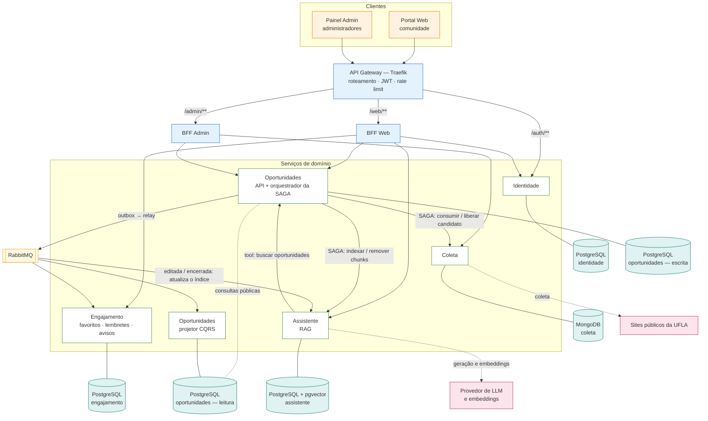

# Arquitetura do ConectaU — visão geral

> **Documento de entrada da arquitetura.** O detalhe de cada item está nos documentos 4.1 a 4.7; este arquivo resume e aponta para eles, sem repetir o conteúdo, para que os documentos não voltem a divergir.
>
> **Status:** arquitetura revisada após a Parte 2 ([o que mudou e por quê](4.1-microsservicos.md#revisão-em-relação-à-parte-2)). Os 5 serviços estão implementados e containerizados desde a Parte 3 ([como subir](../../README.md#-execução-e-infraestrutura)). Na Parte 4, o Assistente passou a gerar respostas com LLM ([RAG e agente](../parte-4/rag-e-agente.md)). Explicação de ponta a ponta: [`SISTEMA.md`](../../SISTEMA.md).

## Em números

| Elemento | Quantidade | Quais |
|---|---|---|
| Serviços de domínio | **5** | Identidade, Coleta, Oportunidades, Engajamento, Assistente |
| Instâncias de banco | **6** | 5 PostgreSQL (um com pgvector) e 1 MongoDB — uma ou mais por serviço, nunca compartilhadas |
| Componentes de borda | 3 | API Gateway (Traefik), BFF Web, BFF Admin |
| Clientes | 2 | Portal Web (comunidade) e Painel Admin |
| Broker de eventos | 1 | RabbitMQ |
| SAGA | 1, orquestrada | Publicação: Oportunidades → Coleta → Assistente |
| CQRS | 1 | Oportunidades: escrita e leitura em instâncias separadas |
| Outbox | 1 fluxo | Eventos de Oportunidades |
| LLM | 1 funcionalidade | Assistente de editais com RAG |

## Diagrama integrado

**Como ler o diagrama:**

- Os clientes só falam com o gateway. O gateway envia login à Identidade e o resto a um dos BFFs.
- Cada serviço tem o próprio banco; nenhuma seta liga um serviço ao banco de outro.
- "Oportunidades — projetor" é um container separado do mesmo serviço: consome eventos e mantém o banco de leitura.
- As chamadas do orquestrador à Coleta e ao Assistente usam rotas `/internal/**`, que o gateway não expõe.

## O fluxo principal, em 6 passos

1. A Coleta encontra um evento numa página da UFLA (ou um admin cadastra um manualmente) e cria um **candidato** `PENDENTE`.
2. Um admin revisa o candidato no Painel Admin e cria a **oportunidade** em `RASCUNHO`.
3. O admin publica, e a **SAGA** roda: a Coleta consome o candidato, o Assistente indexa o texto e Oportunidades marca `PUBLICADA` gravando o evento na **outbox**. Se algo falha, as compensações desfazem os passos anteriores.
4. O relay publica `OportunidadePublicada` no RabbitMQ; o **projetor** atualiza o modelo de leitura (**CQRS**) e o Engajamento atualiza sua cópia.
5. O estudante encontra a oportunidade no Portal Web, salva, cria um lembrete e pergunta ao **Assistente** sobre o edital.
6. Perto do prazo, o Engajamento cria um aviso in-app para o estudante.

## Documentos

| Item | Documento |
|---|---|
| 4.1 — Decomposição em microsserviços | [`4.1-microsservicos.md`](4.1-microsservicos.md) |
| 4.2 — API REST, versionamento e HATEOAS | [`4.2-api-rest.md`](4.2-api-rest.md) · [`openapi.yaml`](openapi.yaml) |
| 4.3 — API Gateway e roteamento | [`4.3-gateway.md`](4.3-gateway.md) |
| 4.4 — Backend for Frontend | [`4.4-bff.md`](4.4-bff.md) |
| 4.5 — Database per service, consistência e outbox | [`4.5-dados-outbox.md`](4.5-dados-outbox.md) |
| 4.6 — SAGA de publicação | [`4.6-saga.md`](4.6-saga.md) |
| 4.7 — CQRS | [`4.7-cqrs.md`](4.7-cqrs.md) |
| Por que um banco e um container por serviço | [`decisoes-isolamento.md`](decisoes-isolamento.md) |
