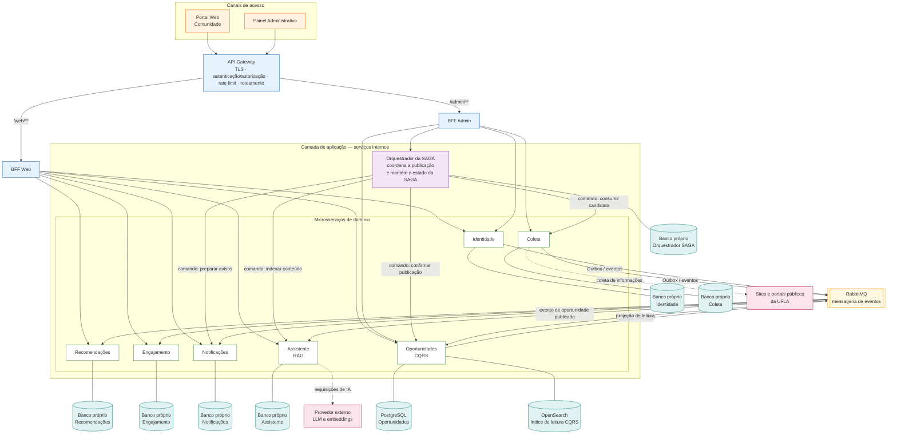

# ConectaU — Arquitetura integrada (proposta revisada)

> Este diagrama consolida em uma única visão os canais de entrada, a camada de borda,
> os serviços de domínio, a coordenação da SAGA, a mensageria e os armazenamentos.
> Ele representa a arquitetura proposta, não uma implementação já executada.

## Como interpretar os fluxos

1. **Acesso externo:** Portal Web e Painel Administrativo entram pelo API Gateway. O Gateway encaminha as rotas aos BFFs correspondentes; os BFFs compõem as chamadas aos serviços internos.
2. **SAGA de publicação:** o pedido administrativo chega pela camada de entrada. O Orquestrador da SAGA coordena os comandos internos para Coleta, Assistente, Notificações e Oportunidades. O serviço Oportunidades continua sendo o proprietário da regra de domínio que efetiva a transição para `PUBLICADA` e registra o evento correspondente em sua Outbox.
3. **Eventos:** serviços publicam eventos por meio do padrão Outbox; o RabbitMQ transporta esses eventos aos consumidores interessados.
4. **Dados:** cada serviço mantém seu armazenamento próprio. O PostgreSQL e o OpenSearch aparecem em Oportunidades por causa do CQRS; o Orquestrador mantém armazenamento separado para o estado e o histórico da SAGA.

## Observações para validação com a documentação detalhada

- Os nomes e tecnologias dos bancos dos demais serviços devem ser conferidos no documento 4.5 antes de congelar o desenho.
- A ligação do RabbitMQ ao Assistente e o fluxo exato de atualização do índice OpenSearch devem ser confirmados com os documentos 4.5, 4.6 e 4.7.
- As setas entre BFFs e serviços representam chamadas internas. O Gateway é a entrada do tráfego externo; não é necessário fazer toda comunicação serviço-a-serviço passar por ele.
- As chamadas do Orquestrador aos participantes da SAGA são internas e não devem ser expostas como rotas públicas do Gateway.
- O diagrama deve ser ajustado após a leitura dos documentos originais, para preservar nomes, eventos, compensações e decisões já aprovadas pelo grupo.
