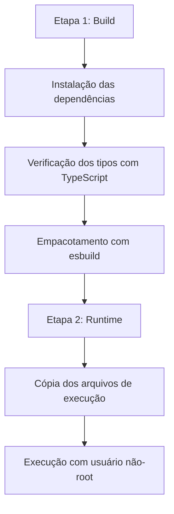
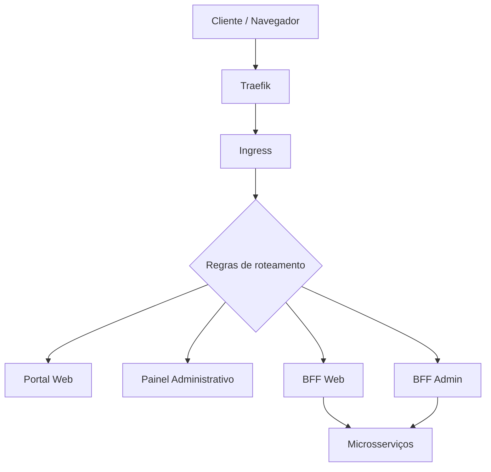

# ConectaU
## Containerização e Orquestração

**Integrantes:** Guilherme, Maria, João e Gustavo

**Disciplina:** Sistemas Distribuídos — UFLA

---

## 1. Sobre o projeto

O ConectaU é um projeto que busca conectar estudantes universitários a oportunidades acadêmicas e profissionais, facilitando o acesso a informações relevantes para sua trajetória.

Nesta etapa, trabalhamos na containerização e na organização da infraestrutura da aplicação, utilizando Docker e Docker Compose. Também desenvolvemos uma implementação complementar com Kubernetes, explorando recursos de implantação, configuração, persistência e escalabilidade.

### Objetivos

- Padronizar o ambiente de execução dos componentes da aplicação.
- Criar imagens personalizadas para os serviços.
- Facilitar a construção e inicialização de toda a infraestrutura.
- Organizar a comunicação entre os containers por meio de redes isoladas.
- Garantir a persistência dos dados utilizando volumes.
- Centralizar o acesso à aplicação por meio de um Gateway.
- Explorar recursos de orquestração e escalabilidade com Kubernetes.

---

## 2. Arquitetura da solução

A infraestrutura foi organizada para executar os componentes do ConectaU em containers independentes, utilizando Docker Compose para gerenciar sua inicialização, configuração e comunicação.

### Visão geral

A aplicação é composta por diferentes camadas:

- **Clientes web:** Portal e Painel Administrativo.
- **BFFs:** BFF Web e BFF Admin, responsáveis por intermediar as requisições dos clientes.
- **Microsserviços:** Coleta, Identidade, Oportunidades, Engajamento e Assistente.
- **Mensageria:** RabbitMQ, utilizado na comunicação assíncrona.
- **Persistência:** bancos de dados separados para os diferentes serviços.
- **Gateway:** Traefik, responsável pelo roteamento das requisições.

### Componentes principais

| Componente | Responsabilidade |
|---|---|
| Portal Web | Interface utilizada pelos estudantes. |
| Painel Admin | Interface administrativa da aplicação. |
| BFF Web | Intermedia as requisições do Portal Web. |
| BFF Admin | Intermedia as requisições do Painel Administrativo. |
| Microsserviços | Implementam as funcionalidades de cada domínio. |
| Bancos de dados | Armazenam os dados de forma separada por serviço. |
| RabbitMQ | Gerencia a comunicação por mensagens. |
| Gateway | Centraliza o acesso e direciona as requisições. |
| Docker Compose | Organiza os containers, redes, variáveis e volumes. |

A infraestrutura também possui uma implementação complementar utilizando Kubernetes, apresentada nas seções seguintes.

---

## 3. Dockerfiles e construção das imagens

Foram criados Dockerfiles específicos para os componentes do ConectaU, permitindo construir imagens personalizadas de acordo com as necessidades de cada serviço.

### 3.1. Imagens dos microsserviços e BFFs

Os cinco microsserviços e os dois BFFs utilizam imagens baseadas no Node.js 22 com Alpine Linux.

Foi adotada a estratégia de **multi-stage build**, separando a etapa de construção da aplicação da etapa de execução.

**Principais configurações:**

| Recurso | Finalidade |
|---|---|
| `FROM node:22-alpine` | Define a imagem base com Node.js 22 e Alpine Linux. |
| `WORKDIR /app` | Define o diretório de trabalho. |
| `npm ci` | Instala as dependências conforme o arquivo de lock. |
| `typecheck` | Realiza a verificação estática dos tipos do TypeScript. |
| `esbuild` | Empacota e transforma o código para execução em Node.js. |
| `USER node` | Executa a aplicação sem utilizar o usuário root. |
| `EXPOSE` | Documenta a porta utilizada pela aplicação no container. |
| `HEALTHCHECK` | Verifica a disponibilidade da aplicação pelo endpoint `/health`. |

### 3.2. Multi-stage build

A estratégia de multi-stage build utiliza duas etapas principais:



Na primeira etapa, são instaladas as dependências e realizadas a verificação dos tipos e a construção do código.

Na segunda etapa, é utilizada uma nova imagem, contendo somente os arquivos necessários para executar a aplicação.

Essa abordagem reduz os componentes presentes na imagem final e evita incluir ferramentas de desenvolvimento que não são necessárias durante a execução.

### 3.3. Imagens dos clientes web

Os clientes Portal Web e Painel Administrativo utilizam a imagem `nginxinc/nginx-unprivileged:1.27-alpine`.

Como são aplicações compostas por arquivos estáticos HTML, CSS e JavaScript, não precisam de uma etapa de compilação.

Os Dockerfiles configuram o Nginx para disponibilizar os arquivos e utilizam verificações de saúde para acompanhar a disponibilidade dos clientes.

### 3.4. Imagens da infraestrutura

Também foram criadas imagens personalizadas para os componentes de infraestrutura:

| Componente | Imagem base | Configuração incorporada |
|---|---|---|
| PostgreSQL | `postgres:17-alpine` | Esquemas SQL de cada serviço. |
| MongoDB | `mongo:8.0` | Script de inicialização do banco de Coleta. |
| RabbitMQ | `rabbitmq:4.1-management-alpine` | Configurações do serviço de mensageria. |
| Gateway | `traefik:v3.7` | Configurações estáticas e dinâmicas de roteamento. |

A imagem do PostgreSQL é reutilizada para criar diferentes instâncias, recebendo o esquema SQL correspondente por meio de argumentos de construção.

Para o serviço Assistente, é utilizada uma imagem baseada no PostgreSQL com pgvector, permitindo trabalhar com recursos de armazenamento vetorial.

### 3.5. Arquivo .dockerignore

O arquivo `.dockerignore` define quais arquivos e diretórios não devem ser enviados ao contexto de construção das imagens.

Entre os itens ignorados estão:

- `node_modules`
- `.git`
- `dist` e `build`
- arquivos de log
- arquivos `.env`

O arquivo `.env.example` é mantido como modelo de configuração, sem expor credenciais reais.

### 3.6. Construção das imagens

As imagens são construídas a partir da raiz do repositório, utilizando os Dockerfiles específicos de cada componente.

Exemplo:

```bash
docker build -f services/identidade/Dockerfile .
```

Para construir e iniciar toda a infraestrutura por meio do Docker Compose:

```bash
docker compose up -d --build
```

O comando `docker images` permite visualizar as imagens construídas e suas respectivas informações.

**Resultado esperado:** imagens personalizadas para os serviços da aplicação e para os componentes de infraestrutura, com configurações específicas para cada um.

---

## 4. Orquestração dos serviços com Docker Compose

O Docker Compose foi utilizado para organizar e executar os componentes do ConectaU por meio de um único arquivo de configuração YAML.

A configuração define os serviços, suas imagens, variáveis de ambiente, dependências, redes e volumes.

### 4.1. Serviços configurados

O ambiente Docker Compose contempla 18 serviços:

| Categoria | Componentes |
|---|---|
| Microsserviços | Coleta, Identidade, Oportunidades, Engajamento e Assistente. |
| BFFs | BFF Web e BFF Admin. |
| Clientes | Portal Web e Painel Administrativo. |
| Bancos de dados | MongoDB e cinco instâncias PostgreSQL. |
| Mensageria | RabbitMQ. |
| Gateway | Traefik. |
| Processamento assíncrono | Projetor de Oportunidades. |

O projetor de Oportunidades utiliza a imagem do serviço de Oportunidades, mas executa um processo separado, responsável pela projeção dos dados.

### 4.2. Redes Docker

Foram definidas redes específicas para organizar a comunicação entre os componentes e restringir o acesso aos recursos.

| Rede | Finalidade |
|---|---|
| `rede-borda` | Comunicação entre Gateway, clientes, BFFs e componentes de entrada. |
| `rede-aplicacao` | Comunicação entre BFFs e microsserviços. |
| `rede-mensageria` | Comunicação entre RabbitMQ e os serviços que utilizam mensagens. |
| `rede-dados-*` | Redes isoladas para comunicação entre cada serviço e seu respectivo banco. |
| `rede-gerencia` | Comunicação destinada ao gerenciamento da infraestrutura de mensageria. |

As redes internas utilizam a configuração `internal: true`, restringindo sua comunicação externa.

Os bancos de dados ficam em redes próprias, evitando que serviços sem necessidade de acesso consigam se comunicar diretamente com eles.

### 4.3. Persistência dos dados

Foram configurados volumes nomeados para preservar os dados dos componentes que necessitam de armazenamento persistente.

A infraestrutura utiliza volumes para:

- MongoDB.
- PostgreSQL de Identidade.
- PostgreSQL de Oportunidades.
- PostgreSQL de leitura de Oportunidades.
- PostgreSQL de Engajamento.
- PostgreSQL do Assistente.
- RabbitMQ.

Dessa forma, os dados são armazenados independentemente do ciclo de vida dos containers, desde que os volumes sejam preservados.

### 4.4. Variáveis de ambiente e credenciais

As configurações dos serviços são disponibilizadas por meio de variáveis de ambiente.

As credenciais e demais informações sensíveis são armazenadas em arquivos locais de configuração, como `.env`, que não são versionados no Git.

O arquivo `.env.example` disponibiliza um modelo com as variáveis necessárias para configurar o ambiente.

Essa separação permite manter as configurações fora do código-fonte e evita a exposição de credenciais reais no repositório.

### 4.5. Inicialização e gerenciamento

O comando abaixo permite construir as imagens e iniciar os serviços em segundo plano:

```bash
docker compose up -d --build
```

Para verificar o estado dos serviços:

```bash
docker compose ps
```

Para consultar os registros de execução:

```bash
docker compose logs
```

Para encerrar os serviços:

```bash
docker compose down
```

O comando `docker compose down` remove os containers e as redes criadas pelo Compose, mas preserva os volumes nomeados, permitindo manter os dados para uma execução posterior.

**Resultado:** os componentes da infraestrutura ficam organizados em uma única configuração, facilitando a inicialização e o gerenciamento do ambiente completo.

---

## 5. Persistência e monitoramento dos serviços

Além de configurar e executar os containers, foram implementados mecanismos para preservar os dados e acompanhar a disponibilidade dos componentes.

### 5.1. Persistência com volumes

Cada banco de dados possui armazenamento próprio, evitando o compartilhamento indevido de dados entre os diferentes serviços.

Os volumes nomeados permitem manter os dados armazenados mesmo quando os containers são removidos e recriados.

No PostgreSQL, por exemplo, o volume é associado ao diretório de armazenamento do banco.

### 5.2. Healthchecks

Foram configurados mecanismos de verificação de saúde nos containers.

| Componente | Verificação | Finalidade |
|---|---|---|
| Microsserviços e BFFs | Requisição HTTP ao endpoint `/health` | Verificar a disponibilidade das aplicações. |
| Clientes web | Requisição HTTP ao endpoint `/health` | Verificar a disponibilidade das interfaces. |
| PostgreSQL | `pg_isready` | Verificar se o banco está aceitando conexões. |
| MongoDB | `mongosh` com operação de ping | Verificar a disponibilidade do banco. |
| RabbitMQ | `rabbitmq-diagnostics -q ping` | Verificar a disponibilidade do serviço de mensageria. |
| Gateway | Verificação de saúde do Traefik | Verificar a disponibilidade do roteador. |

Essas verificações permitem acompanhar a condição dos containers e auxiliar no gerenciamento das dependências entre os serviços.

### 5.3. Dependências entre serviços

O Docker Compose utiliza condições de dependência para controlar a inicialização dos componentes.

Quando necessário, os serviços aguardam que seus bancos de dados ou o RabbitMQ estejam saudáveis antes de iniciar.

Isso ajuda a evitar que uma aplicação tente utilizar uma dependência que ainda não está disponível.

---

## 6. Kubernetes — Implementação complementar

Além da execução com Docker Compose, foi desenvolvida uma implementação complementar utilizando Kubernetes, uma plataforma de orquestração de containers.

O objetivo é explorar recursos de implantação, gerenciamento, configuração, persistência e escalabilidade dos componentes do ConectaU.

### 6.1. Organização dos recursos

Os arquivos de configuração estão organizados no diretório `infrastructure/kubernetes/` e utilizam Kustomize para agrupar os recursos.

| Recurso | Finalidade |
|---|---|
| Namespace | Organiza os recursos do ConectaU em um ambiente chamado `conectau`. |
| ConfigMap | Armazena configurações não sensíveis das aplicações. |
| Secret | Disponibiliza informações sensíveis, como credenciais. |
| Deployment | Gerencia os Pods dos serviços, BFFs e clientes. |
| Service | Disponibiliza um ponto de acesso estável para os Pods. |
| StatefulSet | Gerencia componentes que precisam de identidade e armazenamento persistentes. |
| PersistentVolumeClaim (PVC) | Solicita armazenamento persistente para os componentes. |
| Ingress | Define regras de acesso externo aos serviços. |
| Middleware | Permite aplicar regras adicionais de roteamento e controle de requisições. |

### 6.2. Aplicações e bancos de dados

Foram definidos Deployments e Services para os microsserviços, BFFs e clientes web.

Os bancos de dados e o RabbitMQ utilizam StatefulSets, acompanhados de armazenamento persistente.

Essa organização permite separar os componentes da aplicação e manter os dados associados aos respectivos serviços.

### 6.3. ConfigMaps e Secrets

Os ConfigMaps são utilizados para disponibilizar configurações não sensíveis aos containers.

As informações sensíveis são disponibilizadas por meio de Secrets, gerados a partir do arquivo local `segredos.env`.

O arquivo de configuração de exemplo `segredos.env.example` apresenta as variáveis necessárias para preparar o ambiente.

Os arquivos contendo credenciais reais não são versionados no Git.

### 6.4. Persistência no Kubernetes

Os bancos de dados utilizam armazenamento persistente por meio de PersistentVolumeClaims.

Os StatefulSets permitem associar o armazenamento aos respectivos componentes, possibilitando preservar os dados durante a substituição de Pods.

### 6.5. Implantação da infraestrutura

A organização dos arquivos utiliza Kustomize para aplicar os recursos do ambiente.

O comando abaixo permite aplicar as configurações:

```bash
kubectl apply -k infrastructure/kubernetes/
```

Para acompanhar os Pods:

```bash
kubectl get pods -n conectau
```

Para verificar os Services:

```bash
kubectl get services -n conectau
```

Para consultar os recursos implantados:

```bash
kubectl get all -n conectau
```

A execução depende da preparação do ambiente Kubernetes, das imagens disponíveis no cluster e da configuração local dos Secrets.

---

## 7. Acesso à aplicação com Ingress e Traefik

Para organizar o acesso aos componentes da aplicação no Kubernetes, foi utilizado o Ingress com o Traefik como Ingress Controller.

### 7.1. Ingress

O Ingress define regras de roteamento para direcionar requisições HTTP aos serviços internos do Kubernetes.

No ConectaU, foram configuradas regras para direcionar as requisições de acordo com os caminhos acessados.

Entre os destinos estão:

- Portal Web.
- Painel Administrativo.
- BFF Web.
- BFF Admin.
- Endpoints de autenticação.

### 7.2. Traefik

O Traefik atua como Ingress Controller, interpretando as regras definidas no Ingress e encaminhando as requisições aos serviços correspondentes.

Também foram configurados middlewares para aplicar regras de autenticação, controle de acesso, limitação de requisições e manipulação de caminhos.

O fluxo geral de acesso funciona da seguinte maneira:



A implementação com Kubernetes utiliza as configurações de Gateway e Ingress disponíveis no diretório de infraestrutura.

---

## 8. Escalabilidade no Kubernetes

O Kubernetes permite ajustar a quantidade de réplicas de uma aplicação por meio dos recursos de gerenciamento dos Pods.

A escalabilidade horizontal pode ser demonstrada alterando a quantidade desejada de réplicas de um Deployment.

Por exemplo, para configurar três réplicas do serviço de Identidade:

```bash
kubectl scale deployment identidade --replicas=3 -n conectau
```

Para verificar a quantidade de Pods:

```bash
kubectl get pods -n conectau
```

Em seguida, a aplicação pode ser retornada para uma réplica:

```bash
kubectl scale deployment identidade --replicas=1 -n conectau
```

O Kubernetes ajusta a quantidade de Pods para corresponder ao número de réplicas desejado.

**Resultado esperado:** demonstrar a capacidade de aumentar ou reduzir horizontalmente a quantidade de instâncias de um serviço.

---

## 9. Conclusão

O desenvolvimento desta etapa permitiu aplicar conceitos de containerização e orquestração em uma arquitetura composta por múltiplos serviços.

A implementação possibilitou:

- Construção de imagens Docker personalizadas.
- Utilização de multi-stage build para aplicações Node.js.
- Padronização do ambiente de execução.
- Organização dos serviços por meio de redes isoladas.
- Persistência dos dados utilizando volumes.
- Monitoramento da saúde dos containers.
- Orquestração dos componentes com Docker Compose.
- Gerenciamento complementar com Kubernetes.
- Utilização de ConfigMaps, Secrets, StatefulSets e PersistentVolumeClaims.
- Roteamento de requisições com Ingress e Traefik.
- Exploração da escalabilidade horizontal.

Com isso, o ConectaU passou a contar com uma infraestrutura preparada para executar e gerenciar seus diferentes componentes de maneira organizada e independente.

---

# Demonstração prática

O vídeo demonstrativo apresenta a infraestrutura do ConectaU, incluindo a construção das imagens, a inicialização dos serviços e os recursos de containerização e orquestração implementados.

## Vídeo demonstrativo

[Assistir à demonstração do ConectaU](LINK_DO_VIDEO)