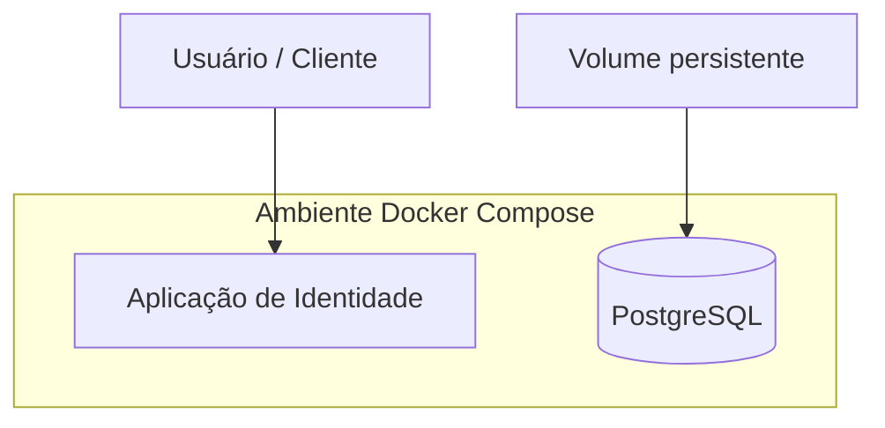
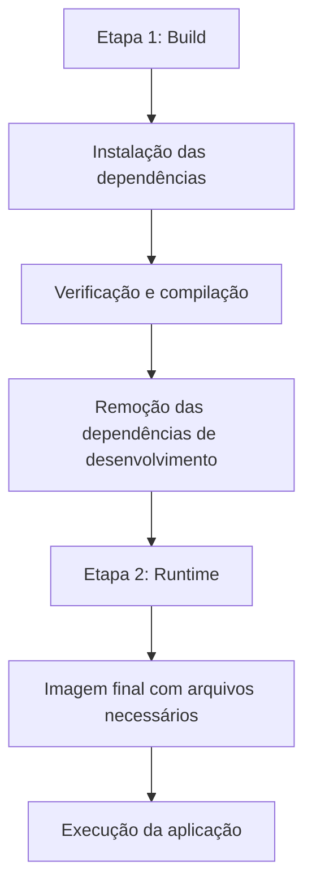
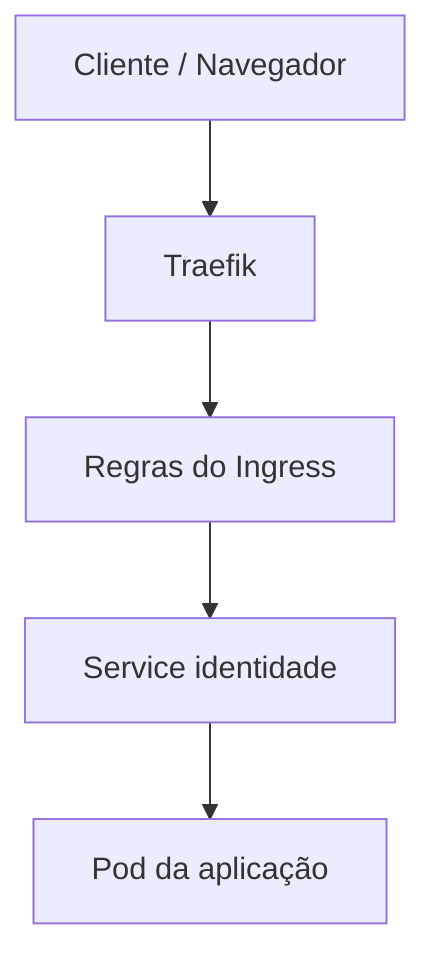

# ConectaU
## Containerização e Orquestração

**Integrantes:** Guilherme, Maria, João e Gustavo

**Disciplina:** Sistemas Distribuídos — UFLA

---

## 1. Sobre o projeto

O ConectaU é um projeto que busca conectar estudantes universitários a oportunidades acadêmicas e profissionais, facilitando o acesso a informações relevantes para sua trajetória.

Nesta etapa do projeto, trabalhamos na containerização e na organização da infraestrutura da aplicação, utilizando Docker e Docker Compose, além de uma implementação complementar com Kubernetes.

### Objetivos

- Padronizar o ambiente de execução da aplicação.
- Facilitar a construção e inicialização dos serviços.
- Organizar a comunicação entre os containers por meio de redes.
- Garantir a persistência dos dados do PostgreSQL.
- Explorar recursos de orquestração e escalabilidade.

---

## 2. Arquitetura da solução

A infraestrutura foi organizada para executar os serviços do ConectaU em containers, utilizando Docker Compose para gerenciar sua inicialização e configuração.

### Visão geral



**Componentes principais:**

| Componente | Responsabilidade |
|---|---|
| Aplicação de Identidade | Disponibiliza os endpoints da API de identidade. |
| PostgreSQL | Serviço de banco de dados utilizado na infraestrutura. |
| Docker | Responsável pela construção e execução dos containers. |
| Docker Compose | Organiza os serviços, redes, variáveis de ambiente e volumes. |

A infraestrutura também possui uma implementação complementar utilizando Kubernetes, apresentada posteriormente.

---

## 3. Dockerfiles e construção das imagens

Para executar os serviços em containers, foram criados Dockerfiles específicos para a aplicação de identidade e para o PostgreSQL.

### 3.1. Imagem da aplicação de identidade

A aplicação utiliza uma imagem baseada no Node.js 22 com Alpine Linux.

**Principais configurações:**

| Recurso | Finalidade |
|---|---|
| `FROM node:22-alpine` | Define a imagem base com Node.js 22 e Alpine Linux. |
| `WORKDIR /app` | Define o diretório de trabalho. |
| `npm ci` | Instala as dependências conforme o arquivo de lock. |
| `typecheck` | Verifica os tipos do TypeScript. |
| `tsc` | Compila o código TypeScript para JavaScript. |
| `npm prune --omit=dev` | Remove as dependências de desenvolvimento. |
| `USER node` | Executa a aplicação sem utilizar o usuário root. |
| `HEALTHCHECK` | Verifica se a aplicação está respondendo pelo endpoint `/health`. |

### 3.2. Multi-stage build

Foi utilizada a estratégia de **multi-stage build**, separando o processo de construção da aplicação de sua execução.



Essa estratégia permite utilizar uma imagem final mais enxuta, sem precisar incluir todas as ferramentas utilizadas durante a compilação.

### 3.3. Imagem do PostgreSQL

Também foi criado um Dockerfile específico para o banco de dados, utilizando a imagem oficial `postgres:17-alpine`.

Foram adicionadas duas configurações:

- **LABEL:** identifica a imagem e fornece informações sobre sua finalidade.
- **HEALTHCHECK:** utiliza o comando `pg_isready` para verificar se o PostgreSQL está aceitando conexões.

### 3.4. Arquivo .dockerignore

O arquivo `.dockerignore` define quais arquivos e diretórios não devem ser enviados ao contexto de construção da imagem.

Entre os itens ignorados estão:

- `node_modules`
- `.git`
- `dist` e `build`
- arquivos de log
- arquivos `.env`

O arquivo `.env.example` é mantido, pois serve como modelo de configuração sem expor credenciais reais.

### 3.5. Construção das imagens

As imagens foram construídas utilizando os seguintes comandos:

```bash
docker build -t conectau-identidade:1.0 .

docker build -t conectau-postgres:latest -f infrastructure/docker/postgres/Dockerfile .
```

O comando `docker images` permite visualizar as imagens construídas e suas respectivas informações.

**Resultado:** foram geradas imagens Docker personalizadas para a aplicação de identidade e para o PostgreSQL.

---

## 4. Orquestração dos serviços com Docker Compose

O Docker Compose foi utilizado para organizar e executar os serviços do ConectaU por meio de um único arquivo de configuração YAML.

Com ele, é possível definir os containers, suas configurações, redes e volumes, facilitando a inicialização e o gerenciamento da infraestrutura.

### 4.1. Serviços configurados

Foram definidos dois serviços principais:

| Serviço | Responsabilidade |
|---|---|
| Identidade | Executa a API de identidade do ConectaU, utilizando a imagem personalizada construída anteriormente. |
| PostgreSQL | Executa o banco de dados utilizando uma imagem personalizada baseada no PostgreSQL 17. |

### 4.2. Redes Docker

Foram criadas duas redes para organizar o acesso entre os serviços:

| Rede | Finalidade |
|---|---|
| `rede-aplicacao` | Rede utilizada pela aplicação de identidade. |
| `rede-dados` | Rede interna compartilhada pela aplicação de identidade e pelo PostgreSQL. |

A rede `rede-dados` foi configurada como interna (`internal: true`), restringindo sua comunicação externa.

A aplicação de identidade participa das duas redes, enquanto o PostgreSQL participa somente da rede de dados.

### 4.3. Persistência dos dados

Foi configurado um volume nomeado chamado `postgres_data`, associado ao diretório de armazenamento do PostgreSQL.

Dessa forma, os dados permanecem armazenados mesmo quando o container é removido e recriado, desde que o volume seja preservado.

### 4.4. Variáveis de ambiente

As configurações do PostgreSQL são definidas por meio de variáveis de ambiente armazenadas em um arquivo `.env`.

Esse arquivo contém informações como:

- Usuário do banco de dados;
- Nome do banco;
- Senha do banco.

O arquivo `.env` não é versionado no Git, evitando a exposição de credenciais. O arquivo `.env.example` disponibiliza um modelo de configuração.

### 4.5. Inicialização da infraestrutura

O comando abaixo permite construir as imagens e iniciar os serviços em segundo plano:

```bash
docker compose up -d --build
```

Para verificar o estado dos serviços:

```bash
docker compose ps
```

Para encerrar os serviços:

```bash
docker compose down
```

O volume nomeado é preservado ao utilizar `docker compose down`, permitindo manter os dados para uma execução posterior.

**Resultado:** os serviços foram organizados em uma única configuração, facilitando sua inicialização, gerenciamento e persistência de dados.

---

## 5. Persistência e monitoramento dos serviços

Além de configurar e executar os containers, foram implementados mecanismos para preservar os dados e verificar a disponibilidade dos serviços.

### 5.1. Persistência com volumes

O PostgreSQL utiliza um volume Docker nomeado chamado `postgres_data`, associado ao diretório `/var/lib/postgresql/data`.

Esse recurso permite manter os dados armazenados independentemente do ciclo de vida do container.

**Teste realizado:**

1. Inicialização dos serviços com Docker Compose.
2. Criação de uma tabela no PostgreSQL.
3. Inserção de um registro de teste.
4. Reinicialização do serviço PostgreSQL.
5. Consulta do registro após a reinicialização.

**Resultado:** os dados permaneceram disponíveis após a reinicialização do container.

### 5.2. Healthchecks

Foram configurados mecanismos de verificação de saúde para os dois serviços.

| Serviço | Verificação | Finalidade |
|---|---|---|
| Identidade | Requisição HTTP ao endpoint `/health` | Verificar se a API está respondendo corretamente. |
| PostgreSQL | Comando `pg_isready` | Verificar se o banco está aceitando conexões. |

Essas verificações permitem identificar quando um container está funcionando ou quando apresenta problemas de disponibilidade.

### 5.3. Testes de funcionamento

Foram utilizados comandos do Docker Compose para acompanhar os serviços:

```bash
docker compose ps
```

Para consultar os registros de execução:

```bash
docker compose logs
```

Também foi realizada uma requisição HTTP ao endpoint de saúde da aplicação:

```bash
curl http://localhost:3101/health
```

**Resultado:** os serviços puderam ser monitorados e a persistência dos dados foi validada por meio de testes práticos.

---

## 6. Kubernetes — Implementação complementar

Além da execução com Docker Compose, foi realizada uma implementação complementar utilizando Kubernetes, uma plataforma de orquestração de containers.

O objetivo foi explorar recursos de gerenciamento, implantação, configuração e escalabilidade da aplicação.

### 6.1. Organização dos recursos

A implementação utiliza os seguintes recursos:

| Recurso | Finalidade |
|---|---|
| Namespace | Organiza os recursos do ConectaU em um ambiente separado chamado `conectau`. |
| ConfigMap | Armazena configurações não sensíveis da aplicação. |
| Secret | Armazena informações sensíveis, como credenciais do banco. |
| Deployment | Gerencia a criação e a quantidade desejada de Pods. |
| Service | Disponibiliza um ponto de acesso estável para os Pods. |
| PVC | Solicita armazenamento persistente para o PostgreSQL. |

### 6.2. Aplicação e banco de dados

Foram criados Deployments separados para a aplicação de identidade e para o PostgreSQL.

A aplicação utiliza as configurações disponibilizadas pelo ConfigMap e pelo Secret.

O PostgreSQL utiliza um PVC para manter os dados armazenados mesmo quando seu Pod é removido e recriado.

### 6.3. Persistência no Kubernetes

Foi realizado um teste prático de persistência:

1. Criação de uma tabela no PostgreSQL.
2. Inserção de um registro de teste.
3. Remoção do Pod do PostgreSQL.
4. Criação automática de um novo Pod pelo Deployment.
5. Consulta do registro após a recriação.

**Resultado:** os dados permaneceram disponíveis após a substituição do Pod, demonstrando a utilização do armazenamento persistente.

---

## 7. Acesso à aplicação com Ingress e Traefik

Para organizar o acesso externo à aplicação no Kubernetes, foi utilizado o Ingress com o Traefik como Ingress Controller.

### 7.1. Ingress

O Ingress define regras de roteamento para direcionar requisições HTTP/HTTPS aos serviços internos do Kubernetes.

No ConectaU, foi configurada uma regra utilizando:

| Configuração | Valor |
|---|---|
| Host | `conectau.local` |
| Caminho | `/` |
| Serviço de destino | `identidade` |
| Porta | `3101` |

### 7.2. Traefik

O Traefik atua como Ingress Controller, interpretando as regras definidas no Ingress e direcionando as requisições ao serviço correspondente.

O fluxo de acesso funciona da seguinte maneira:



Para demonstrar o funcionamento localmente, foi utilizado o encaminhamento de porta (*port-forward*) até o serviço do Traefik.

A requisição foi realizada utilizando o endereço `localhost:8080` e o host `conectau.local`.

---

## 8. Escalabilidade no Kubernetes

Também foi realizado um teste de escalabilidade horizontal da aplicação de identidade.

A quantidade de réplicas foi alterada de uma para três utilizando o comando:

```bash
kubectl scale deployment identidade --replicas=3 -n conectau
```

Após a alteração, foi possível verificar a criação de três Pods em execução.

Em seguida, a aplicação foi retornada para uma réplica:

```bash
kubectl scale deployment identidade --replicas=1 -n conectau
```

**Resultado:** o Kubernetes ajustou automaticamente a quantidade de Pods conforme o número de réplicas desejado, demonstrando o recurso de escalabilidade horizontal.

---

## 9. Conclusão

O desenvolvimento desta etapa permitiu aplicar conceitos de containerização e gerenciamento de serviços distribuídos utilizando Docker e Docker Compose.

A implementação possibilitou:

- Construção de imagens personalizadas para os serviços.
- Padronização do ambiente de execução.
- Organização dos containers por meio de redes.
- Persistência dos dados utilizando volumes.
- Monitoramento da saúde dos serviços.
- Exploração complementar de orquestração e escalabilidade com Kubernetes.

Com isso, o projeto ConectaU passou a contar com uma infraestrutura organizada e preparada para facilitar a execução e o gerenciamento de seus serviços.

---

# Demonstração prática

O vídeo a seguir apresenta a execução da infraestrutura
do ConectaU, incluindo a construção das imagens Docker,
a inicialização dos serviços e os testes realizados.

## Vídeo demonstrativo

[Assistir à demonstração do ConectaU](LINK_DO_VIDEO)