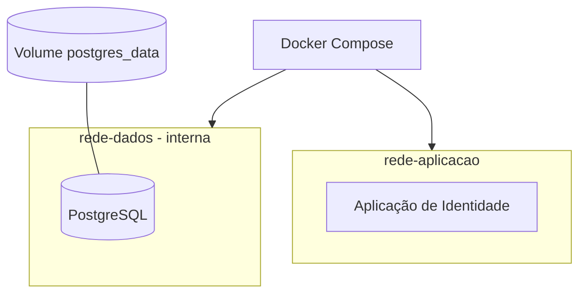
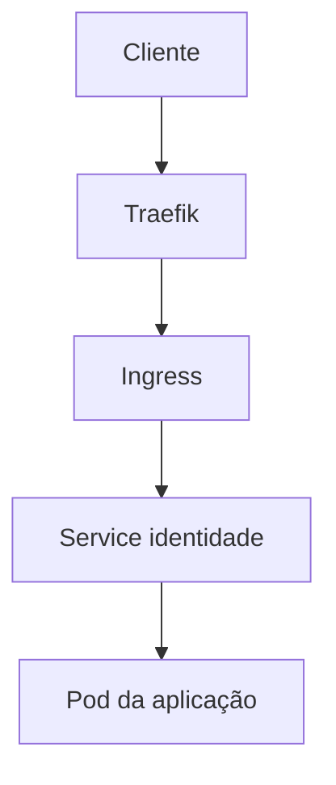

# ConectaU
## Containerização e Orquestração

**Integrantes:** Guilherme, Maria, João e Gustavo

**Disciplina:** Sistemas Distribuídos — UFLA

---

## 1. Introdução e arquitetura

O ConectaU é um projeto que busca conectar estudantes universitários a oportunidades acadêmicas e profissionais.

Nesta etapa, trabalhamos na containerização e organização da infraestrutura da aplicação, utilizando Docker e Docker Compose. Também exploramos Kubernetes como uma implementação complementar.

### Arquitetura da solução

A infraestrutura principal possui dois serviços: a aplicação de identidade e o PostgreSQL.



A aplicação de identidade participa das duas redes, enquanto o PostgreSQL utiliza somente a rede de dados.

**Tecnologias utilizadas:**
- Docker e Docker Compose;
- Node.js 22 e PostgreSQL 17;
- Kubernetes e Traefik, de forma complementar.

## 2. Dockerfiles e construção das imagens

Foram criados dois Dockerfiles personalizados: um para a aplicação de identidade e outro para o PostgreSQL.

### Aplicação de identidade

A imagem da aplicação utiliza Node.js 22 com Alpine Linux.

**Principais decisões técnicas:**

| Recurso | Finalidade |
|---|---|
| Multi-stage build | Separar a compilação da execução da aplicação. |
| `npm ci` | Instalar dependências conforme o lockfile. |
| TypeScript | Verificar os tipos e compilar o código para JavaScript. |
| `npm prune --omit=dev` | Remover dependências de desenvolvimento. |
| `USER node` | Executar a aplicação sem privilégios de root. |
| `HEALTHCHECK` | Verificar a disponibilidade da API pelo endpoint `/health`. |

A utilização de multi-stage build permite gerar uma imagem final contendo apenas os arquivos e dependências necessários para executar a aplicação.

### PostgreSQL

Foi criada uma imagem baseada em `postgres:17-alpine`, com identificação por meio de `LABEL` e verificação de disponibilidade utilizando `pg_isready`.

### Construção das imagens

```bash
docker build -t conectau-identidade:1.0 .

docker build -t conectau-postgres:latest -f infrastructure/docker/postgres/Dockerfile .
```

O arquivo `.dockerignore` também foi utilizado para excluir arquivos desnecessários e evitar o envio de configurações sensíveis ao contexto de construção.

**Responsável pela apresentação:** Guilherme.

## 3. Orquestração com Docker Compose

O Docker Compose foi utilizado para organizar e executar os serviços por meio de um único arquivo de configuração.

### Serviços e configurações

| Serviço | Configuração |
|---|---|
| Identidade | Utiliza a imagem personalizada da aplicação e disponibiliza a porta 3101. |
| PostgreSQL | Utiliza a imagem personalizada do banco de dados. |

### Redes

Foram configuradas duas redes:

- `rede-aplicacao`: utilizada pela aplicação de identidade.
- `rede-dados`: rede interna compartilhada pela aplicação e pelo PostgreSQL.

A separação das redes permite controlar quais serviços participam de cada ambiente de comunicação.

### Variáveis de ambiente e volumes

As credenciais do PostgreSQL são definidas por meio de variáveis armazenadas no arquivo `.env`, que não é versionado no Git.

Também foi criado o volume nomeado `postgres_data`, responsável por preservar os dados do banco de dados.

### Inicialização

```bash
docker compose up -d --build
```

O comando constrói as imagens necessárias e inicia os serviços em segundo plano.

**Responsável pela apresentação:** Maria.

## 4. Persistência e monitoramento

Foram implementados mecanismos para preservar os dados e verificar a disponibilidade dos serviços.

### Healthchecks

| Serviço | Verificação |
|---|---|
| Identidade | Requisição HTTP ao endpoint `/health`. |
| PostgreSQL | Comando `pg_isready`. |

### Teste de persistência

Foi realizado um teste prático com o PostgreSQL:

1. Criação de uma tabela e inserção de um registro.
2. Reinicialização do container.
3. Consulta do registro após a reinicialização.

**Resultado:** os dados permaneceram disponíveis graças ao volume persistente.

**Responsável pela apresentação:** João.

## 5. Kubernetes — Implementação complementar

Além do Docker Compose, foi realizada uma implementação complementar utilizando Kubernetes.

Foram utilizados os seguintes recursos:

| Recurso | Finalidade |
|---|---|
| Namespace | Organizar os recursos do ConectaU. |
| ConfigMap e Secret | Disponibilizar configurações e credenciais. |
| Deployment | Gerenciar a quantidade desejada de Pods. |
| Service | Disponibilizar acesso estável aos Pods. |
| PVC | Solicitar armazenamento persistente para o PostgreSQL. |

Também foi realizado um teste de persistência: após a remoção do Pod do PostgreSQL, um novo Pod foi criado e os dados continuaram disponíveis.

**Responsável pela apresentação:** João.

## 6. Ingress, Traefik e escalabilidade

O Traefik foi utilizado como Ingress Controller, responsável por interpretar as regras de roteamento definidas no Ingress.

### Roteamento

Foi configurada uma regra para direcionar as requisições destinadas a `conectau.local` ao Service da aplicação de identidade, na porta 3101.



O acesso foi testado localmente utilizando o recurso `port-forward`.

### Escalabilidade horizontal

Foi realizado um teste alterando a quantidade de réplicas da aplicação:

- Inicialmente: 1 réplica.
- Durante o teste: 3 réplicas.
- Após o teste: retorno para 1 réplica.

**Resultado:** o Kubernetes ajustou a quantidade de Pods conforme o número de réplicas configurado.

**Responsável pela apresentação:** Gustavo.

## 7. Conclusão

A etapa permitiu aplicar conceitos de containerização, organização de serviços, redes, persistência e monitoramento utilizando Docker e Docker Compose.

Como complemento, a implementação com Kubernetes possibilitou explorar recursos de orquestração, roteamento e escalabilidade.

Com isso, o projeto passou a contar com uma infraestrutura organizada e com mecanismos que facilitam sua execução e gerenciamento.

**Responsável pelo encerramento:** Gustavo.

---

## 8. Demonstração prática

Para complementar a apresentação, será exibido um vídeo demonstrando a construção das imagens, inicialização dos serviços, testes de persistência e recursos complementares implementados.

[Assistir à demonstração do ConectaU](LINK_DO_VIDEO)