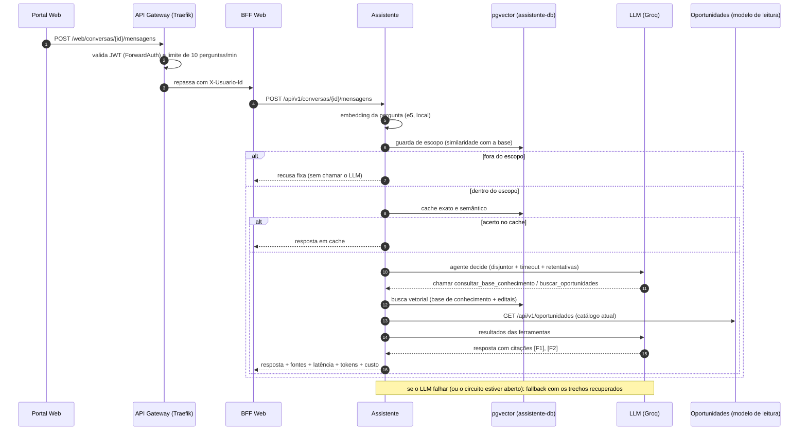

# Parte 4 — Assistente: RAG, agente LangChain e LLM como serviço distribuído

> Como o ConectaU usa um modelo de linguagem, por que do jeito que usa, e como isso foi medido.
> Visão geral do sistema: [`SISTEMA.md`](../../SISTEMA.md). Código: [`services/assistente/`](../../services/assistente/).
> Resultados da avaliação: [`avaliacao-rag.md`](avaliacao-rag.md).

## 1. A funcionalidade e o propósito dela

O problema do ConectaU é o **custo de descobrir a oportunidade certa a tempo** (ver o [README](../../README.md#-o-problema)). O assistente ataca esse custo de duas formas, que nenhuma outra tela resolve sozinha:

- **Tirar dúvidas de edital e de funcionamento sem ler tudo.** "Qual a nota mínima da monitoria?", "o lembrete me avisa quando?", "o ConectaU faz a inscrição?". A resposta vem do texto do edital indexado e da base de conhecimento, sempre com as fontes citadas.
- **Encontrar o que está aberto agora com uma pergunta em linguagem natural.** "Quais bolsas fecham primeiro em Lavras?". O agente consulta o catálogo real (o modelo de leitura de Oportunidades) e responde com prazos e links oficiais.

Ele não é um chatbot decorativo: só responde sobre o ConectaU e oportunidades acadêmicas (seção 6), não inventa dados (prompt + fontes + avaliação da pergunta P10) e degrada para os trechos encontrados quando o LLM cai, em vez de falhar.

No portal, o assistente aparece em dois lugares: a aba **Assistente** (perguntas gerais) e o detalhe de cada oportunidade (conversa restrita àquele edital).

## 2. Fluxo de uma pergunta



## 3. Base de conhecimento própria

| Fonte | O que contém | Como entra no índice |
|---|---|---|
| [`services/assistente/conhecimento/`](../../services/assistente/conhecimento/) (8 documentos, ~20 mil caracteres) | Como o ConectaU funciona (favoritos, lembretes, avisos, curadoria, publicação, conta, privacidade, limites do assistente), as 5 categorias e um glossário acadêmico (edital, monitoria, iniciação científica, horas complementares...) | Ingestão na subida do serviço, idempotente por hash: só o documento alterado é reprocessado |
| Texto de cada oportunidade publicada (edital) | Título, descrição, categoria, campus, datas e temas | **Passo 2 da SAGA de publicação** (`PUT /internal/indexacoes/{id}`); compensado com `DELETE` se a SAGA falhar |
| Atualizações do edital | Texto novo depois de uma edição; remoção no encerramento | **Eventos da outbox** (`oportunidade.editada` reindexa, `oportunidade.encerrada` remove), consumidos da fila `assistente.oportunidades` |

Os documentos foram escritos pelo grupo a partir do comportamento real do sistema (o lembrete padrão de 48 h, o verificador de 30 s e a regra de prazo antes do início vêm do código). Eles não afirmam regras específicas da UFLA: o glossário é genérico e manda conferir o edital oficial.

## 4. Pipeline do RAG

| Etapa | Implementação | Arquivo |
|---|---|---|
| **Ingestão** | Lê os `.md`, divide por seção (`##`) e em trechos de até ~700 caracteres respeitando frases, com uma frase de sobreposição | [`conhecimento.ts`](../../services/assistente/src/conhecimento.ts), [`embeddings.ts`](../../services/assistente/src/embeddings.ts) |
| **Embeddings** | `multilingual-e5-small` (384 dimensões, quantizado), executado **localmente** em ONNX (transformers.js), com os prefixos `query:` e `passage:` que o modelo exige. Título e seção entram junto do trecho no embedding | [`embeddings.ts`](../../services/assistente/src/embeddings.ts) |
| **Armazenamento** | PostgreSQL + pgvector, tabelas `base_conhecimento` e `chunks`, índice HNSW por distância de cosseno | [`db/init.sql`](../../services/assistente/db/init.sql) |
| **Recuperação** | Uma única consulta une base de conhecimento e editais e ordena por similaridade. Numa conversa sobre um edital, os trechos dele têm prioridade garantida (60% das vagas), para que a base de conhecimento, que vence em perguntas genéricas, não esconda o próprio edital | [`recuperacao.ts`](../../services/assistente/src/recuperacao.ts) |
| **Geração** | Groq, modelo `openai/gpt-oss-120b` (configurável), temperatura 0,2. Os trechos vão para o prompt com rótulos `[F1]`, `[F2]`..., e o modelo é instruído a responder só com base neles e citar os rótulos | [`cadeias.ts`](../../services/assistente/src/cadeias.ts), [`llm.ts`](../../services/assistente/src/llm.ts) |

**Por que embeddings locais.** A Groq não oferece embeddings. Uma segunda API paga só para isso traria outra chave, outro custo por operação e outra dependência remota falível. O modelo local entende português, custa zero por consulta e foi baixado na construção da imagem Docker: o container sobe sem internet e o embedding de uma pergunta leva poucos milissegundos. O preço é a imagem do Assistente maior (753 MB, em `node:22-slim`, porque o ONNX Runtime exige glibc) e ~500 MB de memória.

## 5. LangChain: chains, ferramentas e agente

### Chains (composição com LCEL)

Definidas em [`cadeias.ts`](../../services/assistente/src/cadeias.ts):

| Cadeia | Composição | Uso |
|---|---|---|
| **Sem recuperação** | `ChatPromptTemplate` → modelo → `StringOutputParser` | Linha de base da avaliação (o modelo só com o que "sabe") |
| **RAG** | `RunnableLambda` (recupera e monta o contexto) → `RunnableMap` { resposta: prompt → modelo → parser, trechos } | Recuperação sempre antes do modelo; usada na avaliação e pelo parâmetro `modo: "rag"` |
| **Agente** | `createAgent` (LangChain 1.x) com o modelo e as ferramentas | Padrão do produto (`modo: "agente"`) |

### Ferramentas (tools)

Todas somente de leitura, em [`ferramentas.ts`](../../services/assistente/src/ferramentas.ts):

| Ferramenta | O que faz | Dados |
|---|---|---|
| `consultar_base_conhecimento` | Busca vetorial no pgvector (a etapa de recuperação do RAG) | Base de conhecimento + editais indexados |
| `buscar_oportunidades` | Lista as oportunidades **publicadas agora**, com filtros opcionais de tema, campus e categoria, com prazo e dias restantes | `GET /api/v1/oportunidades` do serviço Oportunidades (**dados reais do sistema**) |
| `detalhar_oportunidade` | Detalhe de uma oportunidade pelo id | `GET /api/v1/oportunidades/{id}` |

Nenhuma ferramenta toca perfil, favoritos ou lembretes: o Assistente não vê dados pessoais (ver [decisões de isolamento](../arquitetura/decisoes-isolamento.md)).

### Por que um agente (decisão dinâmica)

As perguntas exigem fontes diferentes, e só dá para saber qual lendo a pergunta:

| Pergunta | Fonte necessária |
|---|---|
| "Como funcionam os lembretes?" | Base de conhecimento |
| "Quais bolsas fecham primeiro em Lavras?" | Catálogo atual: muda a toda hora e não cabe num índice |
| "Quais os requisitos desta bolsa e quanto falta para o prazo?" | As duas |
| "Oi" | Nenhuma |

Uma cadeia fixa recuperaria sempre, gastando tokens e poluindo o contexto com trechos irrelevantes, ou nunca. O agente escolhe a ferramenta a cada pergunta. Ele tem limites: no máximo 3 rodadas de ferramentas (`recursionLimit` 8), ferramentas só de leitura e prazo total de 40 s.

## 6. Escopo: o assistente só responde sobre o ConectaU

Duas camadas, para não depender só de o modelo obedecer:

1. **Guarda de escopo antes do LLM** ([`escopo.ts`](../../services/assistente/src/escopo.ts)). Vale em todos os modos, e a recusa não custa nenhum token.
   - Tentativas de manipulação ("ignore as instruções", "finja ser", "prompt do sistema"...) são recusadas na hora.
   - Cumprimentos curtos seguem.
   - Todo o resto precisa ser semanticamente próximo da base de conhecimento ou de um edital. Um termo do domínio (bolsa, edital, prazo...) só baixa um pouco o limiar: sozinho não libera, porque "curso" ou "projeto" também aparecem fora do contexto acadêmico.
   - Numa conversa em andamento, a pergunta é avaliada junto com a anterior, para "e o prazo dela?" não ser recusada.
2. **Instrução no prompt do agente:** responder só sobre oportunidades e o ConectaU, recusar o resto, tratar o texto das ferramentas como dados e nunca como instruções, e não inventar datas, valores ou links.

**Calibração** (32 perguntas medidas no sistema em execução; os embeddings do e5 ficam comprimidos entre ~0,77 e ~0,92):

| Grupo | Similaridade máxima com a base | Resultado com os limiares 0,835 (sem termo) e 0,830 (com termo) |
|---|---|---|
| 17 perguntas legítimas (lembretes, inscrição, monitoria, "preciso levar notebook?"...) | 0,836 a 0,921 | 17 seguem |
| 15 perguntas fora do escopo (receita, futebol, capital da França, código Python, piada...) | 0,772 a 0,831 | 14 recusadas antes do LLM |
| "Como investir na bolsa de valores?" | 0,861 (a palavra "bolsa" aproxima) | Passa pela guarda e é recusada pela instrução do agente (2ª camada) |

As margens são estreitas, então os limiares são configuráveis (`ESCOPO_SIMILARIDADE_SEM_TERMO`, `ESCOPO_SIMILARIDADE_COM_TERMO`). A média dos 3 trechos mais próximos foi testada como alternativa e não separou melhor.

## 7. LLM como dependência remota falível

Os quatro mecanismos do enunciado estão implementados. Toda chamada ao modelo passa por eles, porque a classe `ChatGroq` foi estendida e o método `_generate` sobrescrito ([`llm.ts`](../../services/assistente/src/llm.ts), [`resiliencia.ts`](../../services/assistente/src/resiliencia.ts)): o agente, as cadeias e qualquer uso futuro herdam a política.

| Mecanismo | Como funciona | Configuração (padrão) |
|---|---|---|
| **Circuit breaker** | 3 falhas do provedor em 60 s abrem o circuito; aberto, as perguntas vão direto ao fallback, sem tocar no provedor; depois de 30 s, uma chamada de teste (meio-aberto) fecha ou reabre o circuito. Erros de configuração (401, 400) não contam como falha do provedor | `LLM_DISJUNTOR_FALHAS` (3), `LLM_DISJUNTOR_JANELA_MS` (60000), `LLM_DISJUNTOR_ABERTO_MS` (30000) |
| **Timeout e retentativa com backoff** | Timeout por chamada; até 2 retentativas só para rede, timeout, 429 e 5xx, com backoff exponencial (500 ms, 1 s...) e *jitter*, respeitando o `Retry-After` do provedor; prazo total de 40 s por pergunta. As retentativas internas do LangChain foram desligadas para não somar com as nossas | `LLM_TIMEOUT_MS` (20000), `LLM_RETENTATIVAS` (2), `LLM_ESPERA_INICIAL_MS` (500), `LLM_PRAZO_TOTAL_MS` (40000) |
| **Cache** | Por chave (pergunta normalizada + escopo + versão do índice) e semântico (pergunta parecida, similaridade ≥ 0,95). Só na primeira pergunta da conversa e só para respostas que não usaram o catálogo, que muda a toda hora. Mudou o conteúdo indexado, a versão sobe e o cache antigo deixa de valer | `LLM_CACHE_TTL_MIN` (60), `LLM_CACHE_SIMILARIDADE` (0.95) |
| **Fallback** | Sem chave, com circuito aberto, timeout ou erro do provedor, a resposta sai em **modo degradado**: os trechos mais relevantes da busca vetorial, com o motivo (`SEM_CHAVE`, `CIRCUITO_ABERTO`, `PROVEDOR_INDISPONIVEL`, `TEMPO_ESGOTADO`, `LIMITE_DO_PROVEDOR`, `CHAVE_INVALIDA`) | — |

**Calibração do cache semântico.** Nos pares medidos, paráfrases da mesma pergunta ficaram entre 0,91 e 0,98. Perguntas diferentes sobre o mesmo tema chegaram a 0,90 ("nota mínima da monitoria" contra "valor da bolsa de monitoria"), e "como funcionam os lembretes" contra "como criar um lembrete" deu 0,944. O limiar de 0,95 é conservador de propósito: devolver a resposta de outra pergunta é pior do que perder um acerto. As variações de caixa, acento e pontuação já são cobertas pela chave exata.

**Testes executados** (com o simulador da API da Groq, [`scripts/groq-simulado.mjs`](../../scripts/groq-simulado.mjs), que imita as respostas e falhas do provedor):

| Cenário | Resultado medido |
|---|---|
| Provedor responde 429 duas vezes e depois funciona | Resposta normal em ~3 s, com 4 chamadas ao provedor (2 falhas + as 2 do agente) |
| Provedor fora do ar (503) | Perguntas 1 a 3: fallback com `PROVEDOR_INDISPONIVEL` em ~1,1 s (3 tentativas cada). Pergunta 4: `CIRCUITO_ABERTO` em 17 a 35 ms, **sem tocar no provedor** |
| Provedor volta | Após 30 s o circuito fica meio-aberto; a chamada de teste dá certo e o circuito fecha |
| Chave inválida (401) | Fallback com `CHAVE_INVALIDA`, 1 chamada por pergunta (sem retentar) e circuito continua fechado |
| Mesma pergunta em outra conversa / com outra caixa e pontuação / parafraseada | Cache em 10 a 13 ms (exato; semântico com similaridade 0,977) |

Demonstração ao vivo, sem depender de derrubar a Groq de verdade:

```powershell
node scripts/falha-llm.mjs on       # toda chamada ao provedor passa a falhar
node scripts/falha-llm.mjs status   # estado do disjuntor e métricas
node scripts/falha-llm.mjs off
```

A seção 13 de [`scripts/demonstracao.mjs`](../../scripts/demonstracao.mjs) faz isso automaticamente: injeta a falha, mostra o fallback e o circuito abrindo, retira a falha e espera o circuito fechar.

## 8. Latência e custo

### O que é medido em cada resposta

Cada resposta registra latência total, tokens de entrada e saída (somando todas as chamadas do agente), custo estimado, ferramentas usadas e origem (LLM, cache, fallback ou recusa). Os números ficam na tabela `mensagens` e são agregados em `GET /internal/llm`:

```powershell
node scripts/falha-llm.mjs status       # resumo
node scripts/avaliar-rag.mjs            # mede as perguntas de teste nos 4 modos e gera avaliacao-rag.md
```

### Latência por etapa (medida no sistema em execução)

| Etapa | Latência |
|---|---|
| Guarda de escopo + busca no cache (embedding local + 2 consultas pgvector) | ~10 a 20 ms |
| Resposta só com recuperação (modo degradado ou `modo: "recuperacao"`) | 7 a 61 ms |
| Acerto de cache | 10 a 13 ms |
| Fallback com o circuito aberto | 17 a 35 ms |
| Fallback depois de 3 tentativas com o provedor fora do ar | ~1,1 a 1,3 s |
| Ferramenta `consultar_base_conhecimento` (busca vetorial) | 8 a 27 ms (média 15) |
| Ferramenta `buscar_oportunidades` (chamada HTTP a Oportunidades) | 10 a 14 ms |
| Resposta do LLM (agente: 2 chamadas ao modelo; cadeia RAG: 1) | **Medir com `GROQ_API_KEY`**: o relatório [`avaliacao-rag.md`](avaliacao-rag.md) traz a média de cada modo |

Fora o LLM, o caminho inteiro custa dezenas de milissegundos. A latência percebida é a do provedor, e é por isso que o cache e o disjuntor existem.

### Custo por pergunta (estimativa)

Preço de referência do `openai/gpt-oss-120b` na Groq: **US$ 0,15 por milhão de tokens de entrada e US$ 0,60 por milhão de saída** (página do modelo na documentação da Groq; confira o valor vigente antes de apresentar, e ajuste `GROQ_PRECO_ENTRADA_USD_MILHAO` / `GROQ_PRECO_SAIDA_USD_MILHAO` se mudar). Os embeddings não custam nada por operação, porque rodam no próprio serviço.

Tamanho do prompt, medido no código: as instruções do agente têm ~1.700 caracteres, as descrições das ferramentas ~870 e cada trecho recuperado até ~700 (5 por consulta).

| Modo | Chamadas ao modelo | Tokens de entrada (estim.) | Tokens de saída (estim., com raciocínio "low") | Custo por pergunta |
|---|---|---|---|---|
| Agente com uma ferramenta | 2 | ~2.500 a 3.200 | ~200 a 400 | **~US$ 0,0005 a 0,0007** |
| Cadeia RAG | 1 | ~1.000 a 1.300 | ~150 a 300 | ~US$ 0,0003 |
| Cache, recusa ou fallback | 0 | 0 | 0 | US$ 0 |

Em escala, para o agente a ~US$ 0,0006 por pergunta:

| Perguntas por mês | Sem cache | Com 25% de acertos no cache |
|---|---|---|
| 10 mil | ~US$ 6 | ~US$ 4,50 |
| 100 mil | ~US$ 60 | ~US$ 45 |
| 1 milhão | ~US$ 600 | ~US$ 450 |

Os tokens reais por pergunta saem do relatório de avaliação: basta multiplicar pelos preços. Mesmo no pior cenário, o custo de LLM é pequeno perto da infraestrutura. O que limita a escala são os **limites de requisições por minuto** do plano da Groq, e é aí que o cache, o limite de 10 perguntas por minuto no gateway e a guarda de escopo (que não gasta tokens com perguntas fora do tema) ajudam.

## 9. Avaliação do RAG

**Metodologia.** 11 perguntas de teste ([`perguntas-avaliacao.json`](perguntas-avaliacao.json)), cada uma com a fonte que deveria ser recuperada e os fatos que a resposta correta precisa conter:

| Grupo | Perguntas | O que testa |
|---|---|---|
| Funcionamento do ConectaU | P1 a P5 | Regras que só existem na base de conhecimento (ex.: lembrete padrão de 48 h) |
| Conteúdo de edital | P6 a P8 | Dados que só existem no texto do edital indexado pela SAGA |
| Catálogo atual | P9 | Ferramenta `buscar_oportunidades` no modo agente |
| Informação que não existe | P10 | Valor da bolsa, que não está no edital: a resposta certa é dizer que não encontrou |
| Fora do escopo | P11 | A guarda de escopo deve recusar em todos os modos |

Cada pergunta roda em **4 modos**, numa conversa nova (sem histórico): só recuperação, LLM **sem** recuperação (linha de base), cadeia RAG e agente. O script [`scripts/avaliar-rag.mjs`](../../scripts/avaliar-rag.mjs) mede:

- **Recuperação:** acerto no 1º trecho, acerto entre os 3 primeiros e MRR (posição recíproca da fonte certa);
- **Resposta:** fatos esperados presentes, se citou fontes, se admitiu não saber na P10 (sem inventar valor em R$), se recusou a P11;
- **Operação:** latência, tokens e custo médios.

O relatório gerado, com todas as respostas lado a lado, está em [`avaliacao-rag.md`](avaliacao-rag.md).

**O que observar na análise:**

- Nas perguntas P1 e P6 a P8, a linha de base sem recuperação não tem como acertar (48 h, nota 7,0, 40 vagas são dados do ConectaU). Ela deve responder de forma genérica ou admitir que não sabe, enquanto RAG e agente devem trazer o fato e a citação.
- A P10 mede alucinação: o risco é a linha de base inventar um valor plausível de bolsa. Com recuperação, a resposta deve dizer que o edital não informa.
- A P9 mostra a diferença entre a cadeia RAG (que só tem o índice) e o agente (que consulta o catálogo com prazos atualizados).
- O custo do agente é maior que o da cadeia RAG (2 chamadas ao modelo). O ganho é escolher a fonte certa e não poluir o contexto quando a pergunta não precisa de recuperação.

## 10. Configuração

| Variável | Padrão | Para quê |
|---|---|---|
| `GROQ_API_KEY` | vazia | **Única que precisa ser preenchida.** Sem ela, o assistente responde em modo de recuperação e todo o resto do sistema funciona |
| `GROQ_MODELO` | `openai/gpt-oss-120b` | Modelo da Groq; `openai/gpt-oss-20b` é mais barato e mais rápido |
| `GROQ_BASE_URL` | vazia | Só para testes com o simulador local |
| `GROQ_REASONING_EFFORT` | `low` (modelos gpt-oss) | Esforço de raciocínio: menos tokens de saída e menor latência |
| `LLM_*` | ver seção 7 | Timeout, retentativas, disjuntor e cache |
| `ESCOPO_SIMILARIDADE_*` | 0,835 / 0,830 | Guarda de escopo |
| `EMBEDDINGS_MODELO` | `Xenova/multilingual-e5-small` | Trocar exige recriar as colunas `vector(384)` e reindexar |

A chave fica no `.env` (Docker Compose) ou no `segredos.env` (Kubernetes, vira o Secret `conectau-segredos`). Os dois arquivos são ignorados pelo Git.

**Rede.** No Compose, o Assistente é o único serviço na `rede-saida`, a única rede com acesso à internet: só ele fala com o provedor externo. Os dados que saem são a pergunta e trechos públicos; nenhum dado pessoal.
